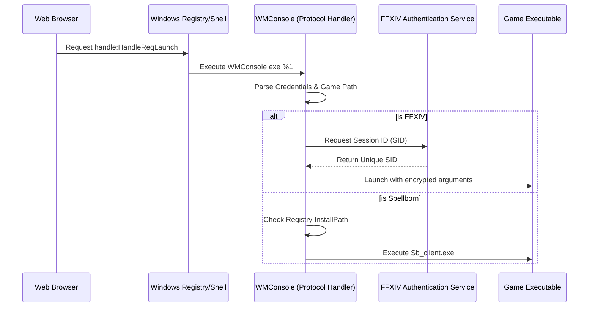
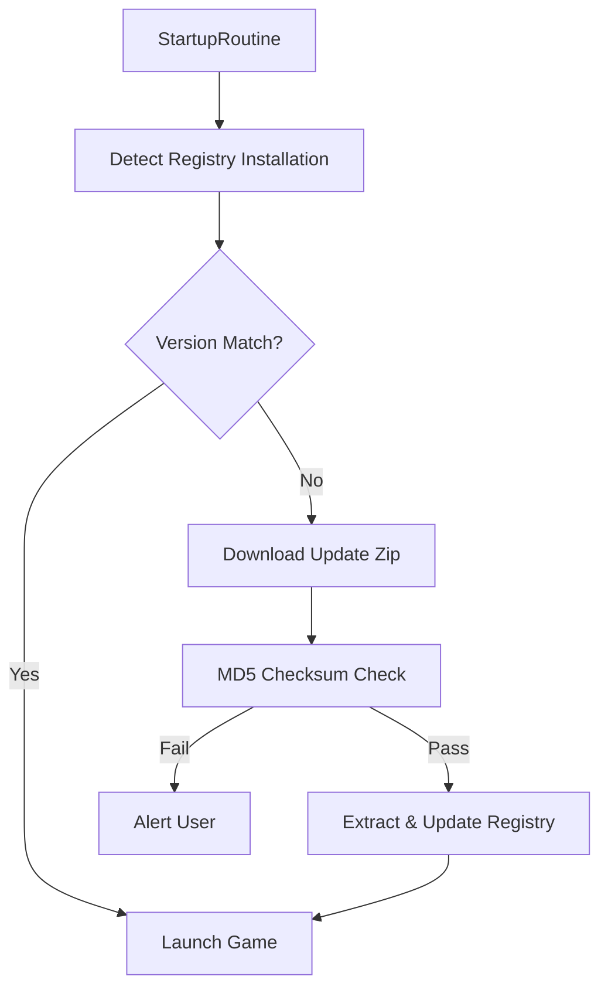

Relevant source files

The following files were used as context for generating this wiki page:

- [handlerlaunch/Program.cs](handlerlaunch/Program.cs)
- [handlerlaunch/SupportObjects.cs](handlerlaunch/SupportObjects.cs)
- [CoreLibLaunchSupport/Class1.cs](CoreLibLaunchSupport/Class1.cs)
- [LibDalamud/Dalamud/DalamudLauncher.cs](LibDalamud/Dalamud/DalamudLauncher.cs)
- [LibDalamud/Dalamud/DalamudUpdater.cs](LibDalamud/Dalamud/DalamudUpdater.cs)
- [SpinningWheelLib/Window1.xaml.cs](SpinningWheelLib/Window1.xaml.cs)
- [LaunchApp/wwwroot/index.html](LaunchApp/wwwroot/index.html)

# WebLaunch Overview

WebLaunch is a multi-game launcher system that enables users to start game clients via specialized web-to-desktop custom protocol handlers. The system integrates a Blazor WebAssembly frontend with a C# backend to manage game updates, authentication, and secure process injection.

The project primarily supports *Final Fantasy XIV* (FFXIV) and *The Chronicles of Spellborn*. It provides a robust framework for handling game-specific requirements like the Dalamud plugin system for FFXIV and registry-based installation tracking for Spellborn. 

Sources: [handlerlaunch/Program.cs:400-474](handlerlaunch/Program.cs#L400-L474), [handlerlaunch/SupportObjects.cs:115-180](handlerlaunch/SupportObjects.cs#L115-L180)

## System Architecture

WebLaunch uses a decoupled architecture consisting of a web frontend, a protocol handler execution engine, and specialized library modules for game logic and UI.

### Core Components

| Component | Responsibility |
| :--- | :--- |
| **LaunchApp** | A Blazor WebAssembly frontend that provides the user interface for initiating game launches. |
| **WMConsole/handlerlaunch** | The main desktop entry point that handles the `HandleWebRequest` custom protocol. |
| **CoreLibLaunchSupport** | Manages native process launching, ACL fixes, and FFXIV-specific authentication. |
| **LibDalamud** | Handles the lifecycle of the Dalamud plugin framework, including updates and injection. |
| **SpinningWheelLib** | Provides WPF-based progress windows and message boxes for desktop user feedback. |

Sources: [LaunchApp/wwwroot/index.html:1-40](LaunchApp/wwwroot/index.html#L1-L40), [handlerlaunch/Program.cs:40-60](handlerlaunch/Program.cs#L40-L60), [CoreLibLaunchSupport/Class1.cs:20-60](CoreLibLaunchSupport/Class1.cs#L20-L60), [LibDalamud/Dalamud/DalamudLauncher.cs:15-30](LibDalamud/Dalamud/DalamudLauncher.cs#L15-L30)

### Launch Request Flow

The following diagram illustrates the sequence of operations when a user initiates a launch from the web interface:

Sources: [handlerlaunch/Program.cs:175-185](handlerlaunch/Program.cs#L175-L185), [handlerlaunch/SupportObjects.cs:405-550](handlerlaunch/SupportObjects.cs#L405-L550), [CoreLibLaunchSupport/Class1.cs:725-780](CoreLibLaunchSupport/Class1.cs#L725-L780)

## Protocol Handling and Execution

The system registers a custom URL protocol named `HandleWebRequest` in the Windows Registry to bridge web interactions with local execution.

### Registry Registration
The `RegisterProtocolHandler` function creates the necessary registry keys under `Software\Classes\HandleWebRequest`. It sets the "URL Protocol" string and defines the shell command to point to `WMConsole.exe`.
Sources: [handlerlaunch/Program.cs:173-189](handlerlaunch/Program.cs#L173-L189)

### Argument Parsing
The application parses incoming URI arguments to extract game-specific parameters. It uses the `TextFollowing` helper to isolate keys such as `login=`, `pass=`, `hash=`, and `gamepath=`. 
Sources: [handlerlaunch/Program.cs:73-83](handlerlaunch/Program.cs#L73-L83), [handlerlaunch/SupportObjects.cs:415-460](handlerlaunch/SupportObjects.cs#L415-L460)

## Final Fantasy XIV Integration

The FFXIV module handles complex authentication and integrates the Dalamud plugin framework.

### Authentication Logic
The `FfxivAuthenticationService` performs a multi-step login:
1. Fetches a `_STORED_` token from the Square Enix login page.
2. Posts credentials (username, password, OTP) to the SID endpoint.
3. Validates the subscription and acquires a unique session identifier.
Sources: [CoreLibLaunchSupport/Class1.cs:675-760](CoreLibLaunchSupport/Class1.cs#L675-L760)

### Process Injection and Security
WebLaunch uses a `NativeProcessLauncher` to start the game process in a suspended state. This allows the system to:
- Apply Access Control List (ACL) fixes to the process handle.
- Configure DPI awareness settings (`HighDPIAware` or `DPIUnaware`).
- Disable `SeDebugPrivilege` for security.
- Inject Dalamud hooks before resuming the primary thread.
Sources: [CoreLibLaunchSupport/Class1.cs:195-260](CoreLibLaunchSupport/Class1.cs#L195-L260), [CoreLibLaunchSupport/Class1.cs:330-360](CoreLibLaunchSupport/Class1.cs#L330-L360)

## Chronicles of Spellborn Support

The Spellborn supporter manages game updates and local file integrity via MD5 checksums.

### Update Mechanism
The system fetches an `updates.json` file from a remote server to compare the `installedVersion` in the registry against the `latest.json`.
1. **Detection**: Checks the registry key `Software\The Chronicles of Spellborn\installPath`.
2. **Download**: Uses `WebClient` to download zip patches if versions mismatch.
3. **Verification**: Validates the MD5 hash of downloaded files before extraction.
4. **Extraction**: Overwrites existing files using `Ionic.Zip`.

Sources: [handlerlaunch/SupportObjects.cs:45-80](handlerlaunch/SupportObjects.cs#L45-L80), [handlerlaunch/SupportObjects.cs:200-280](handlerlaunch/SupportObjects.cs#L200-L280)

## User Interface and Feedback

WebLaunch utilizes a WPF library (`SpinningWheelLib`) to display progress during long-running tasks like updates or authentication.

### Progress and Message Windows
The `Window1` class provides two modes:
- **Progress Mode**: Shows a circular indeterminate loader or a percentage-based progress bar for downloads.
- **MessageBox Mode**: Displays custom labels, list items (e.g., launch steps), and action buttons (OK/Cancel).

The system redirects standard console output to these WPF windows using a `ConsoleOutputRedirector`, ensuring that background logs are visible to the user in the desktop UI.
Sources: [SpinningWheelLib/Window1.xaml.cs:90-150](SpinningWheelLib/Window1.xaml.cs#L90-L150), [handlerlaunch/Program.cs:17-45](handlerlaunch/Program.cs#L17-L45)

### Desktop Notifications
WebLaunch employs `Microsoft.Toolkit.Uwp.Notifications` to send Windows Toast notifications for lifecycle events such as "Application Started" or "FFXIV Launch".
Sources: [handlerlaunch/Program.cs:265-274](handlerlaunch/Program.cs#L265-L274)

## Summary

WebLaunch provides a specialized bridge between web-based game management and local execution. By centralizing authentication, update logic, and process security into a protocol handler, it simplifies the launch experience for complex legacy and modern MMORPGs while maintaining granular control over the client environment.
