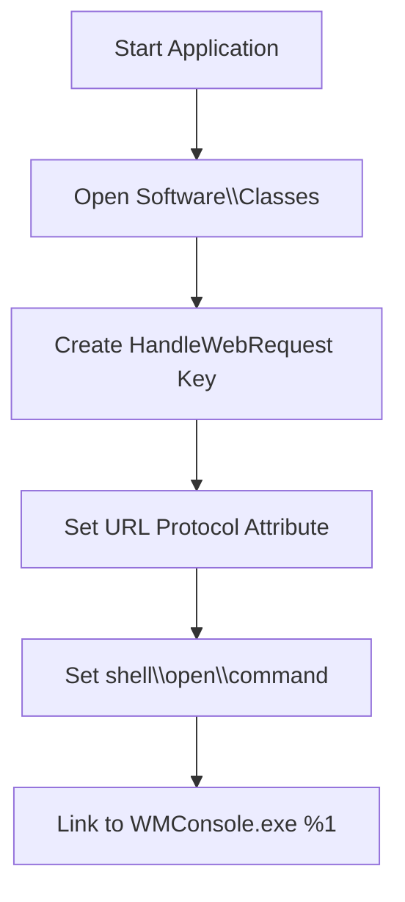
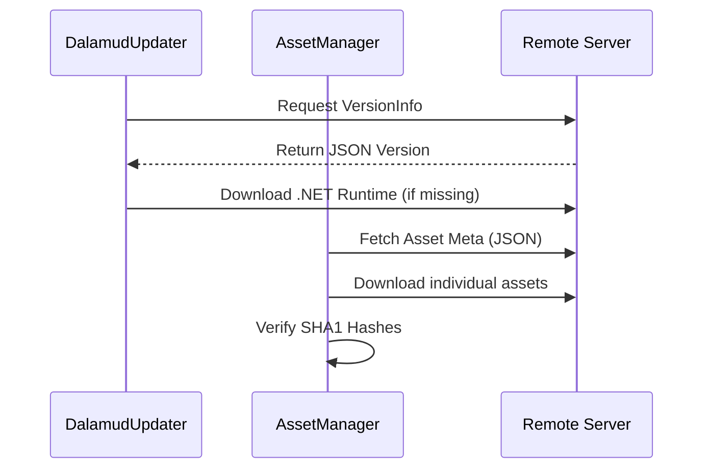

Relevant source files

The following files were used as context for generating this wiki page:

- [handlerlaunch/Program.cs](handlerlaunch/Program.cs)
- [handlerlaunch/SupportObjects.cs](handlerlaunch/SupportObjects.cs)
- [LibDalamud/Dalamud/DalamudUpdater.cs](LibDalamud/Dalamud/DalamudUpdater.cs)
- [LibDalamud/Dalamud/AssetManager.cs](LibDalamud/Dalamud/AssetManager.cs)
- [El'GarnanPluginSystem/CoreFunctions.cs](El%27GarnanPluginSystem/CoreFunctions.cs)
- [CoreLibLaunchSupport/Class1.cs](CoreLibLaunchSupport/Class1.cs)

# Setup and Installation

WebLaunch automates the deployment and configuration of game environments and supporting tools. The system handles file distribution, registry modification, protocol registration, and component updates to ensure a consistent execution environment.

## Protocol Handler Registration

The system registers a custom URI scheme to allow game launches directly from web browsers. It creates registry entries under `Software\Classes\HandleWebRequest` and associates the `HandleReqLaunch` protocol with the local application executable.

Sources: [handlerlaunch/Program.cs:178-197](handlerlaunch/Program.cs#L178-L197)

## Installation and File Deployment

The application identifies a target installation directory and copies necessary binaries and libraries. It uses a default path at `D:\HandleGame\` or derives a path based on the current executable location.

### Component Deployment
The following table lists core components deployed during the setup process:

| File Name | Purpose |
| :--- | :--- |
| `WMConsole.exe` | Main entry point and protocol handler target. |
| `CoreLibLaunchSupport.dll` | Provides native process launching and ACL fixes. |
| `LibDalamud.dll` | Manages third-party game integration and updates. |
| `DotNetZip.dll` | Handles extraction of game assets and updates. |
| `Elgar'nan.dll` | Core plugin system loader. |

Sources: [handlerlaunch/Program.cs:98-176](handlerlaunch/Program.cs#L98-L176)

### Registry Configuration
The `registryManipulation` class manages game-specific settings in the Windows Registry under `Software\The Chronicles of Spellborn`.

*  **detectInstallation:** Checks if `installPath` exists.
*  **updateKeyValue:** Updates versions or paths.
*  **createkeys:** Initializes the installation path if missing.

Sources: [handlerlaunch/SupportObjects.cs:81-164](handlerlaunch/SupportObjects.cs#L81-L164)

## Dependency Management and Updates

WebLaunch maintains system integrity through automated updates for the application, game assets, and the Dalamud component.

### Asset and Runtime Deployment
The `DalamudUpdater` and `AssetManager` ensure that the required .NET runtimes and game assets are present before execution.

Sources: [LibDalamud/Dalamud/DalamudUpdater.cs:122-170](LibDalamud/Dalamud/DalamudUpdater.cs#L122-L170), [LibDalamud/Dalamud/AssetManager.cs:40-95](LibDalamud/Dalamud/AssetManager.cs#L40-L95)

### Automated Game Patching
The `SpellbornSupporter` performs a startup routine that verifies the installation directory and fetches `updates.json` to synchronize the local version with the server.

1.  **Check Version:** Compares `installedVersion` in registry with `latest.json`.
2.  **Download:** Fetches zip files if a mismatch occurs.
3.  **Extract:** Overwrites existing files using `Ionic.Zip`.
4.  **Verify:** Validates downloads via MD5 checksums.

Sources: [handlerlaunch/SupportObjects.cs:222-264](handlerlaunch/SupportObjects.cs#L222-L264), [handlerlaunch/SupportObjects.cs:290-305](handlerlaunch/SupportObjects.cs#L290-L305)

## Plugin System Initialization

The `CoreFunctions` class initializes the `Plugins` directory and loads game-specific logic modules. If enabled, it sets up a `FileSystemWatcher` to support hot-reloading of plugin DLLs during runtime.

1.  **Directory Creation:** Ensures the `Plugins` folder exists in the installation path.
2.  **Validation:** Checks plugin dependencies and minimum version requirements.
3.  **Initialization:** Calls `InitializeAsync` on each discovered `IGamePlugin`.

Sources: [El'GarnanPluginSystem/CoreFunctions.cs:82-114](El'GarnanPluginSystem/CoreFunctions.cs#L82-L114), [El'GarnanPluginSystem/CoreFunctions.cs:157-190](El'GarnanPluginSystem/CoreFunctions.cs#L157-L190)

## Conclusion
Setup and installation involve registering protocol handlers for web integration, deploying a comprehensive set of library dependencies, and establishing a self-updating mechanism for game assets and runtimes. These systems work together to provide a seamless transition from a web-based interface to a fully configured local game environment.
