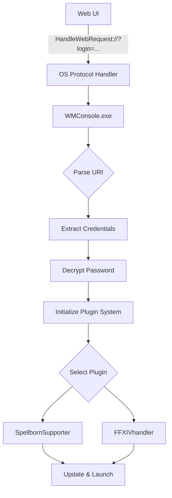
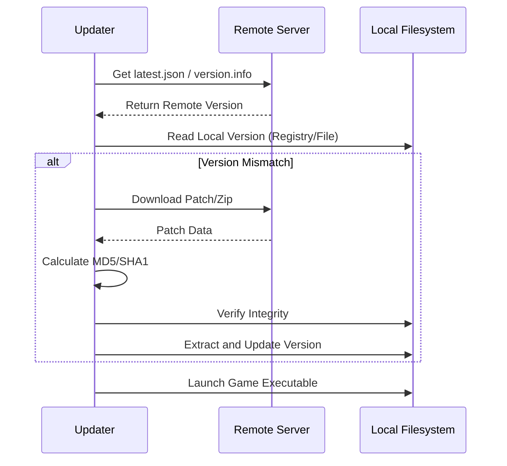

Relevant source files

The following files were used as context for generating this wiki page:

- [handlerlaunch/Program.cs](handlerlaunch/Program.cs)
- [handlerlaunch/SupportObjects.cs](handlerlaunch/SupportObjects.cs)
- [SpinningWheelLib/Window1.xaml.cs](SpinningWheelLib/Window1.xaml.cs)
- [LibDalamud/Dalamud/DalamudUpdater.cs](LibDalamud/Dalamud/DalamudUpdater.cs)
- [LibDalamud/Dalamud/AssetManager.cs](LibDalamud/Dalamud/AssetManager.cs)
- [CoreLibLaunchSupport/Troubleshootthing.cs](CoreLibLaunchSupport/Troubleshootthing.cs)
- [LaunchApp/wwwroot/index.html](LaunchApp/wwwroot/index.html)

# Architecture Overview

WebLaunch is a multi-layered application system that enables game launching and updating via web-based triggers. It consists of a Blazor WebAssembly frontend, a local protocol handler (WMConsole), and specialized libraries for game-specific logic, asset management, and UI feedback.

The system uses a custom URL protocol (`HandleWebRequest`) to bridge the gap between a web browser and the local operating system, allowing users to trigger complex game launch and update sequences from a web interface. Sources: [handlerlaunch/Program.cs:220-238](handlerlaunch/Program.cs#L220-L238), [LaunchApp/wwwroot/index.html](LaunchApp/wwwroot/index.html)

## System Components

The architecture is divided into three main functional areas: Frontend, Launch Support, and Game-Specific Modules.

### Core Component Descriptions

| Component | Description | Primary Files |
| :--- | :--- | :--- |
| **LaunchApp** | A Blazor WebAssembly frontend that provides the user interface for game selection and launch triggering. | `LaunchApp/wwwroot/index.html` |
| **WMConsole (Program.cs)** | The entry point for the local protocol handler. It processes URI arguments, manages plugin initialization, and coordinates UI windows. | `handlerlaunch/Program.cs` |
| **SpellbornSupporter** | Manages the lifecycle of The Chronicles of Spellborn, including registry management, version checking, and MD5-verified updates. | `handlerlaunch/SupportObjects.cs` |
| **DalamudUpdater** | Handles the update logic for Dalamud components, including integrity checks, runtime downloads, and asset synchronization. | `LibDalamud/Dalamud/DalamudUpdater.cs` |
| **SpinningWheelLib** | A WPF library providing progress windows and message boxes for visual feedback during long-running launch operations. | `SpinningWheelLib/Window1.xaml.cs` |

Sources: [handlerlaunch/Program.cs](handlerlaunch/Program.cs), [handlerlaunch/SupportObjects.cs:121-130](handlerlaunch/SupportObjects.cs#L121-L130), [LibDalamud/Dalamud/DalamudUpdater.cs:17-40](LibDalamud/Dalamud/DalamudUpdater.cs#L17-L40), [SpinningWheelLib/Window1.xaml.cs:97-120](SpinningWheelLib/Window1.xaml.cs#L97-L120)

## Launch Sequence and Data Flow

When a user initiates a launch from the web frontend, the browser invokes the registered `HandleWebRequest` protocol. The operating system passes the encoded URI to `WMConsole.exe`.

### Protocol Handling and Plugin Execution

1.  **URI Parsing**: `Program.Main` receives the URI and extracts query parameters like `login`, `pass`, `hash`, and `gamepath`. Sources: [handlerlaunch/Program.cs:336-340](handlerlaunch/Program.cs#L336-L340), [handlerlaunch/Program.cs:461-507](handlerlaunch/Program.cs#L461-L507)
2.  **Decryption**: Encrypted passwords are decrypted using XOR logic and a provided 16-character hash. Sources: [handlerlaunch/Program.cs:511-544](handlerlaunch/Program.cs#L511-L544)
3.  **Plugin Invocation**: The `CoreFunctions` plugin system loads the appropriate module (e.g., `ffxiv-launcher` or `spellborn-launcher`) to handle game-specific execution requirements. Sources: [handlerlaunch/Program.cs:240-251](handlerlaunch/Program.cs#L240-L251), [handlerlaunch/Program.cs:348-360](handlerlaunch/Program.cs#L348-L360)

The diagram shows the flow from a web request to the execution of game-specific plugins. Sources: [handlerlaunch/Program.cs:336-400](handlerlaunch/Program.cs#L336-L400), [handlerlaunch/SupportObjects.cs:480-500](handlerlaunch/SupportObjects.cs#L480-L500)

## Update and Integrity Systems

WebLaunch includes robust update mechanisms to ensure local game files match remote versions.

### Spellborn Update Logic
The `SpellbornSupporter` performs version checks by comparing local registry values with a remote `latest.json` file. If a mismatch is detected, it downloads zip patches, verifies them via MD5 checksums, and extracts them to the installation directory. Sources: [handlerlaunch/SupportObjects.cs:40-100](handlerlaunch/SupportObjects.cs#L40-L100), [handlerlaunch/SupportObjects.cs:222-250](handlerlaunch/SupportObjects.cs#L222-L250)

### Dalamud Asset Management
The `AssetManager` and `DalamudUpdater` handle complex dependencies for Dalamud-based games. This includes:
*  **Asset Refreshing**: Checks `asset.ver` and downloads SHA1-verified assets from a remote store. Sources: [LibDalamud/Dalamud/AssetManager.cs:134-165](LibDalamud/Dalamud/AssetManager.cs#L134-L165)
*  **Integrity Verification**: Compares local file hashes against a remote `hashes.json` to ensure binary consistency. Sources: [LibDalamud/Dalamud/DalamudUpdater.cs:189-220](LibDalamud/Dalamud/DalamudUpdater.cs#L189-L220)

This sequence illustrates the verification and update process used before launching a game. Sources: [handlerlaunch/SupportObjects.cs:252-300](handlerlaunch/SupportObjects.cs#L252-L300), [LibDalamud/Dalamud/DalamudUpdater.cs:100-150](LibDalamud/Dalamud/DalamudUpdater.cs#L100-L150)

## Visual Feedback and Troubleshooting

To improve user experience during asynchronous operations, the system employs a dedicated UI library and troubleshooting logging.

### Progress and Message Windows
The `Window1` class in `SpinningWheelLib` creates a non-blocking WPF window. It supports:
*  **Console Redirection**: Redirects standard output to a RichTextBox for real-time logging. Sources: [SpinningWheelLib/Window1.xaml.cs:51-70](SpinningWheelLib/Window1.xaml.cs#L51-L70)
*  **Progress Tracking**: Uses a `DispatcherTimer` and `Stopwatch` to animate progress bars based on estimated duration. Sources: [SpinningWheelLib/Window1.xaml.cs:150-165](SpinningWheelLib/Window1.xaml.cs#L150-L165)
*  **Automatic Closing**: Polls for the presence of the game process (e.g., `ffxiv_dx11`) and closes the window once the game has successfully launched. Sources: [handlerlaunch/Program.cs:282-305](handlerlaunch/Program.cs#L282-L305)

### Troubleshooting Payloads
The `Troubleshooting` class generates Base64-encoded JSON payloads containing system state information, including game versions, platform details, and BCK file matches. Sources: [CoreLibLaunchSupport/Troubleshootthing.cs:141-180](CoreLibLaunchSupport/Troubleshootthing.cs#L141-L180)

## Summary
The WebLaunch architecture provides a secure and automated path from web selection to game execution. By separating concern into a protocol handler, a plugin system, and specialized updater libraries, it maintains high integrity for game files while providing a seamless user experience through redirected console output and automated progress tracking.
