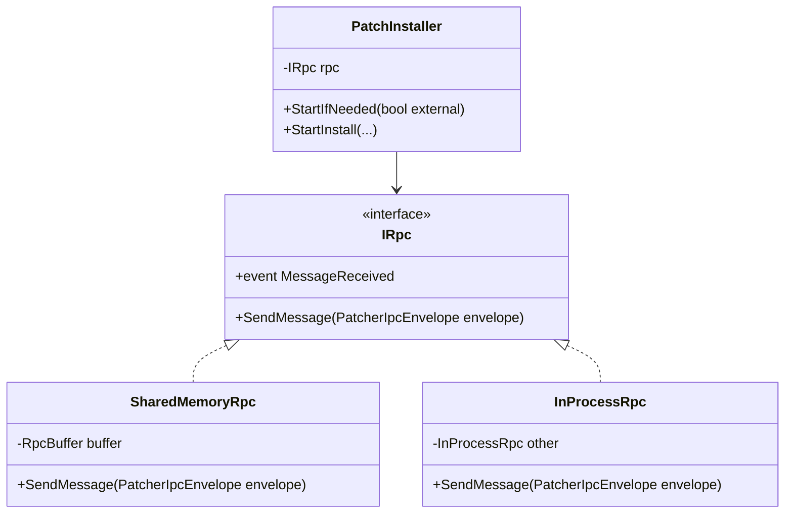
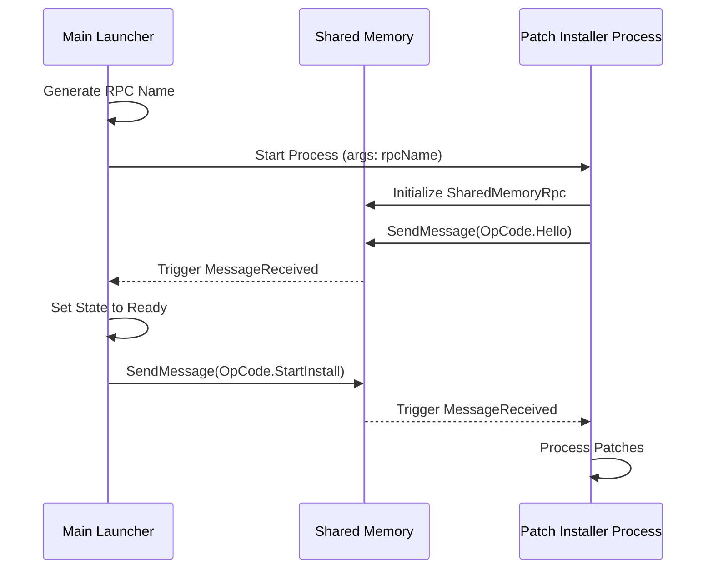

Relevant source files

The following files were used as context for generating this wiki page:

- [LibDalamud/Patching/Rpc/IRpc.cs](LibDalamud/Patching/Rpc/IRpc.cs)
- [LibDalamud/Patching/Rpc/Implementations/InProcessRpc.cs](LibDalamud/Patching/Rpc/Implementations/InProcessRpc.cs)
- [LibDalamud/Patching/Rpc/Implementations/SharedMemoryRpc.cs](LibDalamud/Patching/Rpc/Implementations/SharedMemoryRpc.cs)
- [LibDalamud/Patching/IndexedZiPatch/IndexedZiPatchIndexRemoteInstaller.cs](LibDalamud/Patching/IndexedZiPatch/IndexedZiPatchIndexRemoteInstaller.cs)
- [LibDalamud/Game/Patch/PatchInstaller.cs](LibDalamud/Game/Patch/PatchInstaller.cs)
- [LibDalamud/Patching/RemotePatchInstaller.cs](LibDalamud/Patching/RemotePatchInstaller.cs)
- [LibDalamud/Patching/Rpc/PatcherIpcStartInstall.cs](LibDalamud/Patching/Rpc/PatcherIpcStartInstall.cs)

# IPC and RPC Mechanisms

The IPC (Inter-Process Communication) and RPC (Remote Procedure Call) mechanisms in WebLaunch provide a structured way for different application components to communicate across process boundaries. These systems primarily support patch installation, game management, and background worker coordination.

This architecture enables the main launcher to offload resource-intensive or privileged tasks—such as file patching—to separate worker processes while maintaining real-time progress tracking and control.

## System Architecture

The project implements a multi-layered communication stack. At the base is the `IRpc` interface, which abstracts the transport layer. Implementations include `SharedMemoryRpc` for cross-process communication and `InProcessRpc` for local testing or single-process execution.

### Communication Layers

*  **Transport Layer:** Handles raw data transmission using shared memory buffers or direct object references.
*  **Protocol Layer:** Defines the `PatcherIpcEnvelope` and `PatcherIpcOpCode` to categorize messages.
*  **Service Layer:** High-level handlers like `PatchInstaller` and `IndexedZiPatchIndexRemoteInstaller` that execute specific business logic based on RPC calls.

Sources: [LibDalamud/Patching/Rpc/IRpc.cs](LibDalamud/Patching/Rpc/IRpc.cs), [LibDalamud/Game/Patch/PatchInstaller.cs:51-86](LibDalamud/Game/Patch/PatchInstaller.cs#L51-L86)

### RPC Implementation Overview

The following diagram shows the relationship between the RPC interfaces and their concrete implementations.

Sources: [LibDalamud/Patching/Rpc/IRpc.cs](LibDalamud/Patching/Rpc/IRpc.cs), [LibDalamud/Patching/Rpc/Implementations/InProcessRpc.cs](LibDalamud/Patching/Rpc/Implementations/InProcessRpc.cs), [LibDalamud/Patching/Rpc/Implementations/SharedMemoryRpc.cs](LibDalamud/Patching/Rpc/Implementations/SharedMemoryRpc.cs), [LibDalamud/Game/Patch/PatchInstaller.cs](LibDalamud/Game/Patch/PatchInstaller.cs)

## Patching RPC Workflow

The patching system utilizes RPC to manage the lifecycle of a game update. The `PatchInstaller` class starts a separate `XIVLauncher.PatchInstaller.exe` process and establishes a connection using a unique RPC channel name.

### Connection Sequence

1.  The `PatchInstaller` generates a unique GUID-based channel name.
2.  It launches the external patcher process, passing the channel name as a command-line argument.
3.  The external process connects to the shared memory buffer and sends a `Hello` opcode.
4.  The main process receives `Hello` and transitions its state to `Ready`.

Sources: [LibDalamud/Game/Patch/PatchInstaller.cs:51-78](LibDalamud/Game/Patch/PatchInstaller.cs#L51-L78), [LibDalamud/Patching/RemotePatchInstaller.cs:25-39](LibDalamud/Patching/RemotePatchInstaller.cs#L25-L39)

Sources: [LibDalamud/Game/Patch/PatchInstaller.cs:51-125](LibDalamud/Game/Patch/PatchInstaller.cs#L51-L125), [LibDalamud/Patching/RemotePatchInstaller.cs:25-50](LibDalamud/Patching/RemotePatchInstaller.cs#L25-L50)

## Indexed ZiPatch Remote Installer

For complex patching operations involving indexed files, the `IndexedZiPatchIndexRemoteInstaller` uses a specialized `RpcBuffer` from the `SharedMemory` library. This allows for synchronous-like `Task` calls across processes.

### Worker Opcodes and Results

The system uses specific opcodes to instruct the worker process.

| Opcode | Description |
| :--- | :--- |
| `Construct` | Initializes a new patcher instance with a provided index. |
| `VerifyFiles` | Triggers a file integrity check in the worker process. |
| `Install` | Executes the actual patching/installation task. |
| `CancelTask` | Aborts a currently running task using a Token ID. |
| `DisposeAndExit` | Cleans up the worker and terminates the process. |

Sources: [LibDalamud/Patching/IndexedZiPatch/IndexedZiPatchIndexRemoteInstaller.cs:411-435](LibDalamud/Patching/IndexedZiPatch/IndexedZiPatchIndexRemoteInstaller.cs#L411-L435)

### Data Serialization

The `WorkerSubprocessBody` inner class listens for requests on the `RpcBuffer`. It uses a `BinaryReader` to deserialize incoming byte arrays into command opcodes and parameters. Once the task is complete, it writes a `WorkerResultCode` back to the buffer.

Sources: [LibDalamud/Patching/IndexedZiPatch/IndexedZiPatchIndexRemoteInstaller.cs:228-360](LibDalamud/Patching/IndexedZiPatch/IndexedZiPatchIndexRemoteInstaller.cs#L228-L360)

## RPC Data Structures

### PatcherIpcEnvelope
This is the primary container for all RPC messages.

*  **OpCode**: A `PatcherIpcOpCode` enum determining the purpose of the message.
*  **Data**: An object containing the payload (e.g., `PatcherIpcStartInstall` or `DirectoryInfo`).

Sources: [LibDalamud/Game/Patch/PatchInstaller.cs:88-105](LibDalamud/Game/Patch/PatchInstaller.cs#L88-L105)

### PatcherIpcStartInstall
Contains the necessary context to begin a patching operation.

| Field | Type | Description |
| :--- | :--- | :--- |
| `PatchFile` | `FileInfo` | The local patch file to be applied. |
| `Repo` | `Repository` | The game repository (Boot, Ffxiv, etc.) being patched. |
| `VersionId` | `string` | The version string to be written to the .ver file. |
| `GameDirectory` | `DirectoryInfo` | The path to the game installation. |
| `KeepPatch` | `bool` | Whether to delete the patch file after successful installation. |

Sources: [LibDalamud/Patching/Rpc/PatcherIpcStartInstall.cs:8-14](LibDalamud/Patching/Rpc/PatcherIpcStartInstall.cs#L8-L14)

## Summary

The RPC and IPC mechanisms in WebLaunch allow the software to maintain a responsive UI while performing heavy disk operations in a separate process. By abstracting the transport layer through `IRpc`, the system supports both modular testing and secure, high-performance cross-process communication via shared memory. This structure ensures that patch installation is isolated, verifiable, and manageable through a standardized protocol of opcodes and envelopes.
