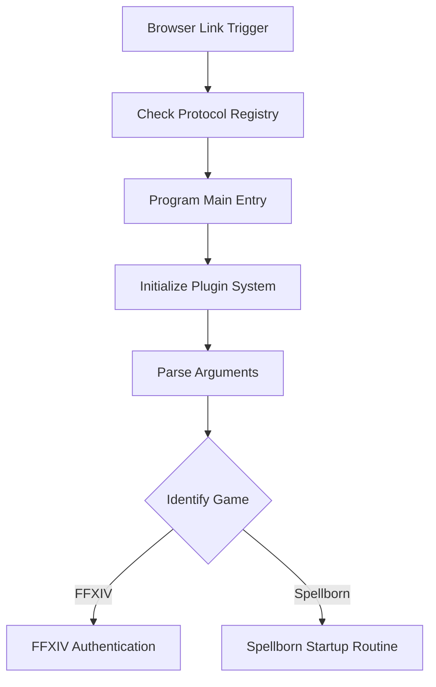
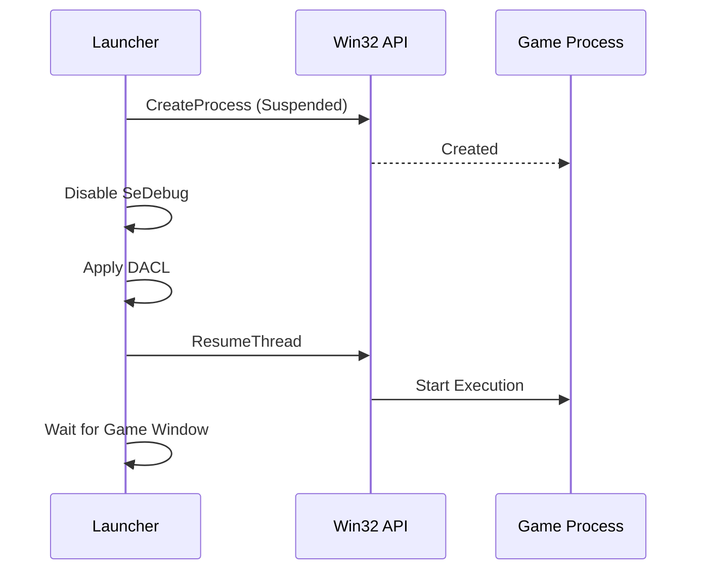

Relevant source files

The following files were used as context for generating this wiki page:

- [LibDalamud/Game/Launcher.cs](LibDalamud/Game/Launcher.cs)
- [LibDalamud/Game/IntegrityCheck.cs](LibDalamud/Game/IntegrityCheck.cs)
- [handlerlaunch/SupportObjects.cs](handlerlaunch/SupportObjects.cs)
- [handlerlaunch/Program.cs](handlerlaunch/Program.cs)
- [LibDalamud/Dalamud/DalamudLauncher.cs](LibDalamud/Dalamud/DalamudLauncher.cs)
- [CoreLibLaunchSupport/Class1.cs](CoreLibLaunchSupport/Class1.cs)

# Game Launcher Core

Game Launcher Core provides the foundational logic for authenticating users, verifying game file integrity, and managing the secure execution of game clients. The system supports multiple game targets, primarily focusing on Final Fantasy XIV (FFXIV) and The Chronicles of Spellborn, while facilitating plugin injection through the Dalamud framework.

Sources: [handlerlaunch/Program.cs](handlerlaunch/Program.cs), [LibDalamud/Game/Launcher.cs](LibDalamud/Game/Launcher.cs), [handlerlaunch/SupportObjects.cs](handlerlaunch/SupportObjects.cs)

## System Entry and Protocol Handling

The application initializes by registering a custom URL protocol handler named `HandleWebRequest`. This allows the launcher to be triggered via web browser links using the `HandleReqLaunch` scheme.

Sources: [handlerlaunch/Program.cs:175-195](handlerlaunch/Program.cs#L175-L195)

### Startup Flow
1. The `Main` method hides the console window and initializes the plugin system.
2. It copies necessary dependencies to the installation directory.
3. The system parses command-line arguments to determine the target game (FFXIV or Spellborn) and extraction of credentials.

Sources: [handlerlaunch/Program.cs:255-320](handlerlaunch/Program.cs#L255-L320)

The diagram shows the transition from a web-triggered event to game-specific initialization paths.

## Authentication and Session Management

### FFXIV Authentication
The `FfxivAuthenticationService` manages the multi-step OAuth login process for FFXIV. It retrieves a stored token from the login page, requests a session ID (SID) using credentials, and acquires a unique patch identifier from the server.

Sources: [CoreLibLaunchSupport/Class1.cs:640-750](CoreLibLaunchSupport/Class1.cs#L640-L750)

| Parameter | Type | Description |
| :--- | :--- | :--- |
| `Username` | string | The user's Square Enix ID. |
| `Password` | string | Decrypted user password. |
| `Otp` | string | One-time password (optional). |
| `IsSteam` | bool | Indicates if the account is a Steam service account. |

Sources: [CoreLibLaunchSupport/Class1.cs:638](CoreLibLaunchSupport/Class1.cs#L638)

### Password Decryption
Password security involves a XOR-based decryption method. The launcher receives an encrypted Base64 string and a hash. It uses the first 16 characters of the hash as a key to decrypt the bytes.

Sources: [handlerlaunch/SupportObjects.cs:517-540](handlerlaunch/SupportObjects.cs#L517-L540), [handlerlaunch/Program.cs:461-490](handlerlaunch/Program.cs#L461-L490)

## Game Execution and Process Management

The `NativeProcessLauncher` handles the creation of game processes using Win32 API calls. It creates processes in a suspended state (`CREATE_SUSPENDED`) to allow for environment configuration and security adjustments before execution begins.

Sources: [CoreLibLaunchSupport/Class1.cs:141-310](CoreLibLaunchSupport/Class1.cs#L141-L310)

### Launch Configuration
- **DPI Awareness**: The system sets the `__COMPAT_LAYER` environment variable to either `HighDPIAware` or `DPIUnaware` based on configuration.
- **Security**: It disables `SeDebugPrivilege` for the launched process and applies specific Discretionary Access Control Lists (DACL).
- **Steam Integration**: If `IsSteam` is true, the environment variable `IS_FFXIV_LAUNCH_FROM_STEAM` is set to "1".

Sources: [CoreLibLaunchSupport/Class1.cs:338-347](CoreLibLaunchSupport/Class1.cs#L338-L347), [CoreLibLaunchSupport/Class1.cs:426-455](CoreLibLaunchSupport/Class1.cs#L426-L455), [LibDalamud/Game/Launcher.cs:185-195](LibDalamud/Game/Launcher.cs#L185-L195)

The sequence diagram illustrates the secure process creation lifecycle implemented in the `NativeProcessLauncher`.

## Integrity Verification

The `IntegrityCheck` module ensures game files match remote references. It calculates SHA1 hashes for local files and compares them against a JSON manifest fetched from a remote base URL.

Sources: [LibDalamud/Game/IntegrityCheck.cs:15-60](LibDalamud/Game/IntegrityCheck.cs#L15-L60)

### Comparison Logic
- **Remote Fetch**: Downloads the manifest based on the game version string.
- **Local Scan**: Recursively scans the game directory, specifically looking for `.index` and `.index2` files if requested.
- **Reporting**: Generates a report listing missing or mismatched file hashes.

Sources: [LibDalamud/Game/IntegrityCheck.cs:35-58](LibDalamud/Game/IntegrityCheck.cs#L35-L58), [LibDalamud/Game/IntegrityCheck.cs:80-120](LibDalamud/Game/IntegrityCheck.cs#L80-L120)

## Spellborn Support Routine

The `SpellbornSupporter` class manages the lifecycle for "The Chronicles of Spellborn". It includes automated update checking, file extraction, and registry-based installation detection.

Sources: [handlerlaunch/SupportObjects.cs:146-215](handlerlaunch/SupportObjects.cs#L146-L215)

### Update Handler
The system fetches `updates.json` to check for applicable patches. If the `installedVersion` in the registry does not match the `latest.json` version, the launcher performs a download and extraction using `Ionic.Zip`.

Sources: [handlerlaunch/SupportObjects.cs:40-65](handlerlaunch/SupportObjects.cs#L40-L65), [handlerlaunch/SupportObjects.cs:250-285](handlerlaunch/SupportObjects.cs#L250-L285)

## Plugin Support (Dalamud)

The `DalamudLauncher` class facilitates the injection of the Dalamud framework into the FFXIV process. It supports multiple loading methods:
- **DllInject**: Standard DLL injection.
- **EntryPoint**: Rewriting the Original Entry Point (OEP).
- **ACLonly**: Fixes without injection.

Sources: [LibDalamud/Dalamud/DalamudLauncher.cs:20-30](LibDalamud/Dalamud/DalamudLauncher.cs#L20-L30), [LibDalamud/Dalamud/DalamudLauncher.cs:115-135](LibDalamud/Dalamud/DalamudLauncher.cs#L115-L135)

The launcher holds the game start until the `DalamudUpdater` confirms the runtime and assets are up to date and consistent with the game version.

Sources: [LibDalamud/Dalamud/DalamudLauncher.cs:55-80](LibDalamud/Dalamud/DalamudLauncher.cs#L55-L80)

## Summary

The Game Launcher Core integrates protocol handling, complex OAuth authentication, secure native process management, and file integrity validation. By utilizing a plugin-based architecture and Win32 API abstractions, it provides a robust environment for launching legacy and modern game clients while maintaining security and version consistency.
