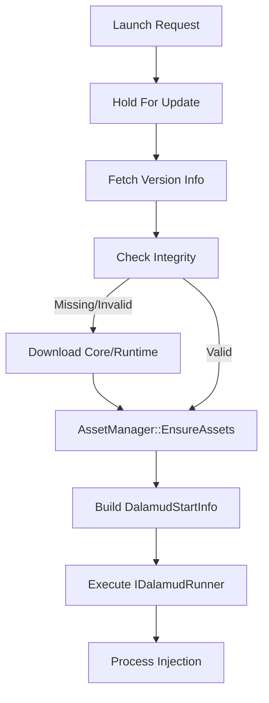

<details>
<summary>Relevant source files</summary>

The following files were used as context for generating this wiki page:

- [LibDalamud/Dalamud/DalamudLauncher.cs](LibDalamud/Dalamud/DalamudLauncher.cs)
- [LibDalamud/Dalamud/DalamudUpdater.cs](LibDalamud/Dalamud/DalamudUpdater.cs)
- [LibDalamud/Dalamud/AssetManager.cs](LibDalamud/Dalamud/AssetManager.cs)
- [LibDalamud/Dalamud/DalamudSettings.cs](LibDalamud/Dalamud/DalamudSettings.cs)
- [LibDalamud/Dalamud/DalamudStartInfo.cs](LibDalamud/Dalamud/DalamudStartInfo.cs)
- [CoreLibLaunchSupport/Class1.cs](CoreLibLaunchSupport/Class1.cs)
</details>

# Dalamud Integration

Dalamud Integration provides the core infrastructure for updating, configuring, and injecting the Dalamud plugin framework into the game process. This system ensures that all required assets and runtimes are present and valid before the game starts.

The integration coordinates between the launcher and the game's execution environment to manage version compatibility and environment variables. It handles the retrieval of remote version metadata, asset integrity verification, and the final process injection via various load methods.
Sources: [LibDalamud/Dalamud/DalamudLauncher.cs](LibDalamud/Dalamud/DalamudLauncher.cs), [LibDalamud/Dalamud/DalamudUpdater.cs](LibDalamud/Dalamud/DalamudUpdater.cs)

## Architecture and Components

The integration consists of several specialized components that handle specific parts of the lifecycle.

### DalamudLauncher
`DalamudLauncher` acts as the primary orchestrator. It manages the waiting state for updates and initiates the game process with correct injection parameters. It populates `DalamudStartInfo` with configuration paths, asset directories, and troubleshooting data.
Sources: [LibDalamud/Dalamud/DalamudLauncher.cs:72-105](LibDalamud/Dalamud/DalamudLauncher.cs#L72-L105), [LibDalamud/Dalamud/DalamudStartInfo.cs](LibDalamud/Dalamud/DalamudStartInfo.cs)

### DalamudUpdater
`DalamudUpdater` manages the local installation of Dalamud. It performs several critical actions:
*  Fetches version metadata from remote endpoints.
*  Downloads the Dalamud core files and .NET runtimes.
*  Verifies file integrity using MD5 hashes.
*  Manages "staging" and "release" rollout buckets.
Sources: [LibDalamud/Dalamud/DalamudUpdater.cs:100-112](LibDalamud/Dalamud/DalamudUpdater.cs#L100-L112), [LibDalamud/Dalamud/DalamudUpdater.cs:228-262](LibDalamud/Dalamud/DalamudUpdater.cs#L228-L262)

### AssetManager
`AssetManager` ensures all required external assets are downloaded and up to date. It compares local versions against remote metadata and performs SHA1 hash checks on individual asset files.
Sources: [LibDalamud/Dalamud/AssetManager.cs:46-95](LibDalamud/Dalamud/AssetManager.cs#L46-L95)

## Launch and Injection Flow

The system uses a specific sequence to ensure the game environment is ready for Dalamud.



The diagram shows the sequence from initial request to the final injection of Dalamud into the game process.
Sources: [LibDalamud/Dalamud/DalamudLauncher.cs:48-69](LibDalamud/Dalamud/DalamudLauncher.cs#L48-L69), [LibDalamud/Dalamud/DalamudUpdater.cs:126-218](LibDalamud/Dalamud/DalamudUpdater.cs#L126-L218)

### Injection Methods
The integration supports multiple ways to load Dalamud into the target process, defined by the `DalamudLoadMethod` enumeration.

| Method | Description |
| :--- | :--- |
| `EntryPoint` | OEP (Original Entry Point) rewrite for early loading. |
| `DllInject` | Standard DLL injection into the running process. |
| `ACLonly` | ACL-only fix without active framework injection. |

Sources: [LibDalamud/Dalamud/DalamudLauncher.cs:108-120](LibDalamud/Dalamud/DalamudLauncher.cs#L108-L120), [LibDalamud/Dalamud/DalamudLoadMethod.cs](LibDalamud/Dalamud/DalamudLoadMethod.cs)

## Data Structures and Configuration

### DalamudStartInfo
The system passes critical runtime data to the injector through the `DalamudStartInfo` class.

| Field | Description |
| :--- | :--- |
| `WorkingDirectory` | The directory where the injector operates. |
| `ConfigurationPath` | Path to the `dalamudConfig.json` file. |
| `AssetDirectory` | Path to the versioned asset folder. |
| `DelayInitializeMs` | Configurable delay before initialization starts. |
| `GameVersion` | The detected version of the FFXIV client. |

Sources: [LibDalamud/Dalamud/DalamudStartInfo.cs](LibDalamud/Dalamud/DalamudStartInfo.cs), [LibDalamud/Dalamud/DalamudLauncher.cs:81-93](LibDalamud/Dalamud/DalamudLauncher.cs#L81-L93)

### Integrity Verification
The system validates the local installation by comparing files against a `hashes.json` manifest.

```csharp
// Verification logic in DalamudUpdater.cs
public static bool IsIntegrity(DirectoryInfo addonPath)
{
    var hashesPath = Path.Combine(addonPath.FullName, "hashes.json");
    if (!File.Exists(hashesPath)) return false;

    return CheckIntegrity(addonPath, File.ReadAllText(hashesPath));
}
```

Sources: [LibDalamud/Dalamud/DalamudUpdater.cs:228-251](LibDalamud/Dalamud/DalamudUpdater.cs#L228-L251)

## Version Management and Updates

The update process targets specific "tracks" (e.g., release, canary, control). `DalamudUpdater` determines the track based on settings and randomized rollout buckets.

### Update Logic
1.  **Metadata Retrieval**: The updater queries `REMOTE_BASE` with the rollout bucket and beta key.
2.  **Runtime Check**: It checks if the required .NET Runtime version is installed locally.
3.  **Core Download**: If version mismatch or integrity failure occurs, it downloads the Dalamud ZIP from the remote `DownloadUrl`.
4.  **Asset Refresh**: `AssetManager` checks `asset.ver` and downloads missing files to a versioned subdirectory.
Sources: [LibDalamud/Dalamud/DalamudUpdater.cs:126-170](LibDalamud/Dalamud/DalamudUpdater.cs#L126-L170), [LibDalamud/Dalamud/AssetManager.cs:115-135](LibDalamud/Dalamud/AssetManager.cs#L115-L135)

## Conclusion
The Dalamud Integration system ensures a stable and verified environment for game plugins. By centralizing update logic, integrity checks, and injection orchestration, the system maintains compatibility between the launcher, the plugin framework, and the evolving game client.
Sources: [LibDalamud/Dalamud/DalamudLauncher.cs](LibDalamud/Dalamud/DalamudLauncher.cs), [LibDalamud/Dalamud/DalamudUpdater.cs](LibDalamud/Dalamud/DalamudUpdater.cs)
