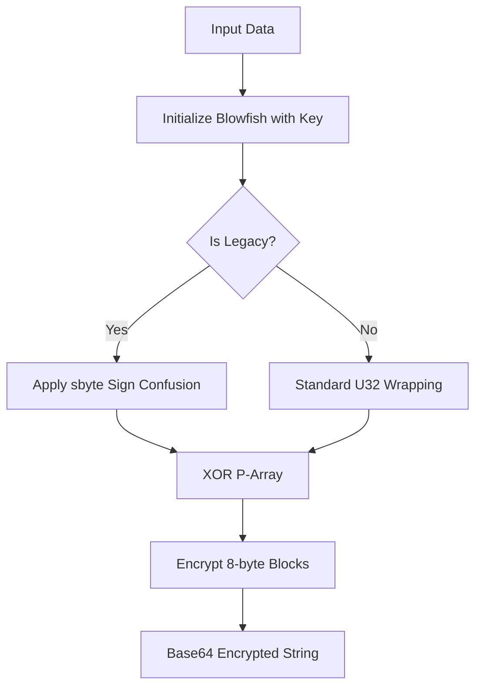
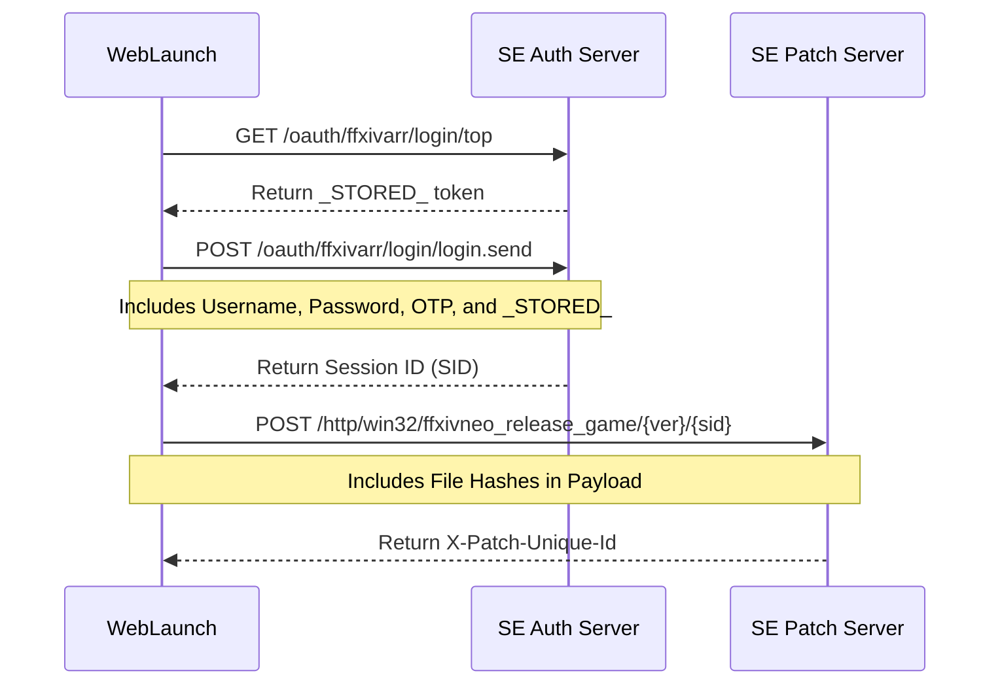

Relevant source files

The following files were used as context for generating this wiki page:

- [LibDalamud/Encryption/BlockCipher/Blowfish.cs](LibDalamud/Encryption/BlockCipher/Blowfish.cs)
- [LibDalamud/Encryption/LegacyBlowfish.cs](LibDalamud/Encryption/LegacyBlowfish.cs)
- [LibDalamud/Encryption/BlockCipher/BlowfishState.cs](LibDalamud/Encryption/BlockCipher/BlowfishState.cs)
- [LibDalamud/Encryption/ArgumentBuilder.cs](LibDalamud/Encryption/ArgumentBuilder.cs)
- [CoreLibLaunchSupport/Class1.cs](CoreLibLaunchSupport/Class1.cs)
- [LibDalamud/Game/Launcher.cs](LibDalamud/Game/Launcher.cs)

# Encryption and Authentication

Encryption and Authentication modules manage secure communication between the launcher and game services. The system implements block ciphers for local data protection and coordinates with external OAuth providers to acquire valid session identifiers for game execution.

The core implementation relies on the Blowfish algorithm, featuring a specialized "Legacy" variant to maintain compatibility with specific Square Enix implementations. These tools ensure that sensitive launch arguments and session tokens remain protected during the authentication handshake.

## Blowfish Block Cipher

The project implements the Blowfish encryption algorithm to secure data blocks. The system includes a standard `Blowfish` class for general use and a `LegacyBlowfish` class specifically designed for compatibility with Square Enix's modified implementation.

### Implementation Details
The `Blowfish` class utilizes an internal `BlowfishState` struct to manage P-arrays and S-boxes. It supports key lengths between 32 and 448 bits. The algorithm processes data in 8-byte blocks, handling endianness conversions during encryption and decryption.

Sources: `[LibDalamud/Encryption/BlockCipher/Blowfish.cs:12-25](LibDalamud/Encryption/BlockCipher/Blowfish.cs#L12-L25)`, `[LibDalamud/Encryption/BlockCipher/BlowfishState.cs:113-125](LibDalamud/Encryption/BlockCipher/BlowfishState.cs#L113-L125)`

### Legacy Blowfish (SE Variant)
The `LegacyBlowfish` implementation addresses a specific bug in the Square Enix version of the algorithm. It forces sign confusion by using signed numbers (`sbyte`) when wrapping bytes into 32-bit integers for key initialization.

Sources: `[LibDalamud/Encryption/LegacyBlowfish.cs:175-188](LibDalamud/Encryption/LegacyBlowfish.cs#L175-L188)`

*The diagram shows the encryption flow, highlighting the specific sign confusion step required for legacy compatibility.*

## Argument Encryption

The `ArgumentBuilder` class constructs and encrypts the command-line arguments required to launch the game client. It secures these arguments using the legacy Blowfish variant.

### Encrypted Argument Structure
Encrypted arguments are wrapped in a specific string format: `//**sqex{version}{ciphertext}{checksum}**//`. The version is currently hardcoded to `3`.

Sources: `[LibDalamud/Encryption/ArgumentBuilder.cs:13-18](LibDalamud/Encryption/ArgumentBuilder.cs#L13-L18)`, `[LibDalamud/Encryption/ArgumentBuilder.cs:83-95](LibDalamud/Encryption/ArgumentBuilder.cs#L83-L95)`

### Key Derivation
The encryption key derives from the system tick count. The builder retrieves `Environment.TickCount`, masks it, and converts the resulting 32-bit integer into a hexadecimal string to serve as the Blowfish key.

| Component | Logic | Source |
| :--- | :--- | :--- |
| **Key Version** | Hardcoded to `3` | `[ArgumentBuilder.cs:13](ArgumentBuilder.cs#L13)` |
| **Raw Tick** | `Environment.TickCount` (uint) | `[ArgumentBuilder.cs:101](ArgumentBuilder.cs#L101)` |
| **Masked Key** | `ticks & 0xFFFF_0000u` | `[ArgumentBuilder.cs:115](ArgumentBuilder.cs#L115)` |
| **Checksum** | Derived from `(key & 0x000F_0000) >> 16` | `[ArgumentBuilder.cs:21-35](ArgumentBuilder.cs#L21-L35)` |

## Authentication Flow

Authentication involves acquiring a Session ID (SID) and a unique patch identifier from Square Enix servers.

### FFXIV Authentication Service
The `FfxivAuthenticationService` coordinates several HTTP requests to acquire a valid game session:
1. **Fetch Stored Value**: Retrieves a hidden token (`_STORED_`) from the login top page.
2. **Request Session ID**: Submits credentials and the stored token to the login endpoint.
3. **Request Unique Identifier**: Uses the local game version, the acquired SID, and a hash payload of boot executables to get the final `X-Patch-Unique-Id`.

Sources: `[CoreLibLaunchSupport/Class1.cs:646-735](CoreLibLaunchSupport/Class1.cs#L646-L735)`

*The authentication sequence follows the official Square Enix handshake protocol to validate the client version and user subscription.*

### Hash Verification
To prevent tampering, the launcher generates SHA1 hashes of critical boot files. This hash payload is sent to the patch server during session registration.
* Files hashed include: `ffxivboot64.exe`, `ffxivlauncher64.exe`, and `ffxivupdater64.exe`.

Sources: `[CoreLibLaunchSupport/Class1.cs:608-641](CoreLibLaunchSupport/Class1.cs#L608-L641)`, `[LibDalamud/Game/Launcher.cs:72-80](LibDalamud/Game/Launcher.cs#L72-L80)`

## Security Components Summary

| Class | Responsibility | File Path |
| :--- | :--- | :--- |
| `Blowfish` | Standard block cipher encryption/decryption. | `[Blowfish.cs](Blowfish.cs)` |
| `LegacyBlowfish` | Specialized encryption for SE argument compatibility. | `[LegacyBlowfish.cs](LegacyBlowfish.cs)` |
| `ArgumentBuilder` | Formats and encrypts game launch parameters. | `[ArgumentBuilder.cs](ArgumentBuilder.cs)` |
| `FfxivAuthenticationService` | Manages the OAuth and SID acquisition lifecycle. | `[CoreLibLaunchSupport/Class1.cs](CoreLibLaunchSupport/Class1.cs)` |
| `FfxivHashBuilder` | Generates file integrity hashes for server validation. | `[CoreLibLaunchSupport/Class1.cs](CoreLibLaunchSupport/Class1.cs)` |

## Summary
The encryption and authentication system ensures that only authorized users with intact game files can launch the client. By utilizing a combination of legacy Blowfish encryption for argument passing and a multi-stage OAuth handshake for session management, the launcher maintains compatibility with official game servers while securing user credentials and session data.
