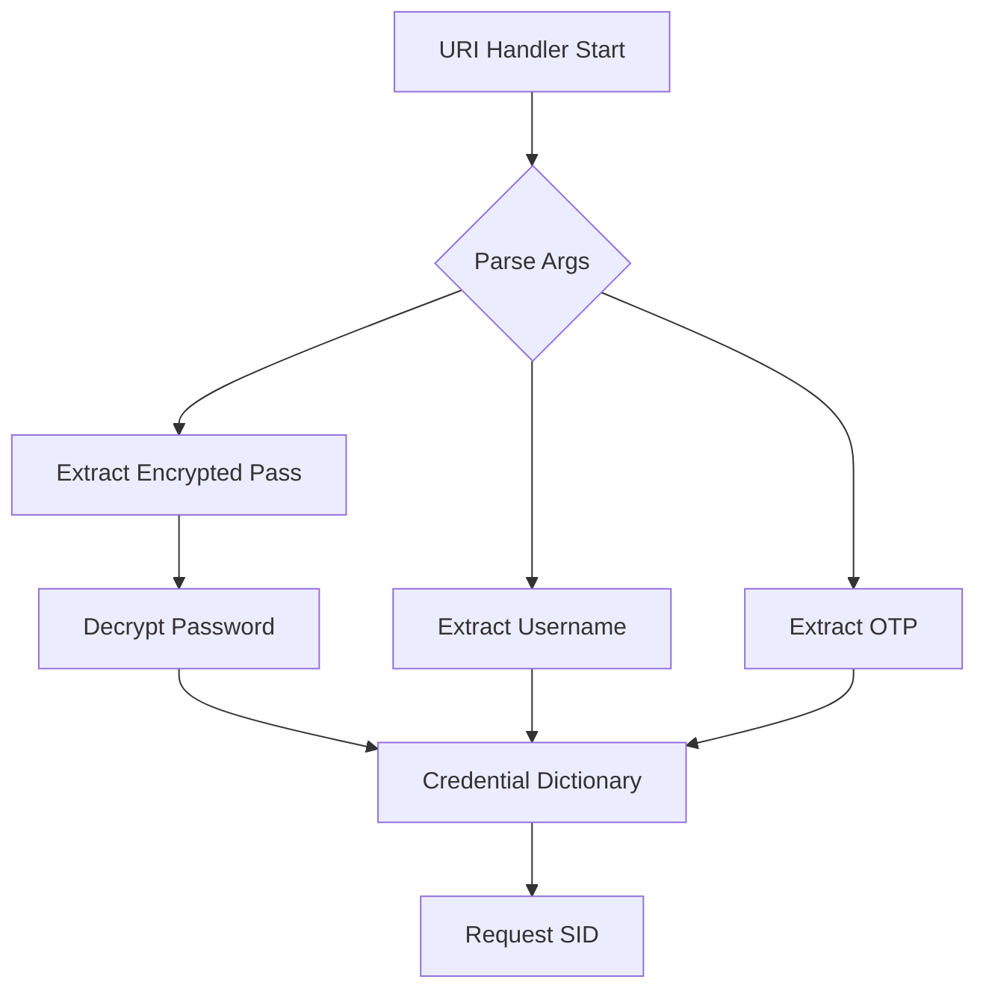
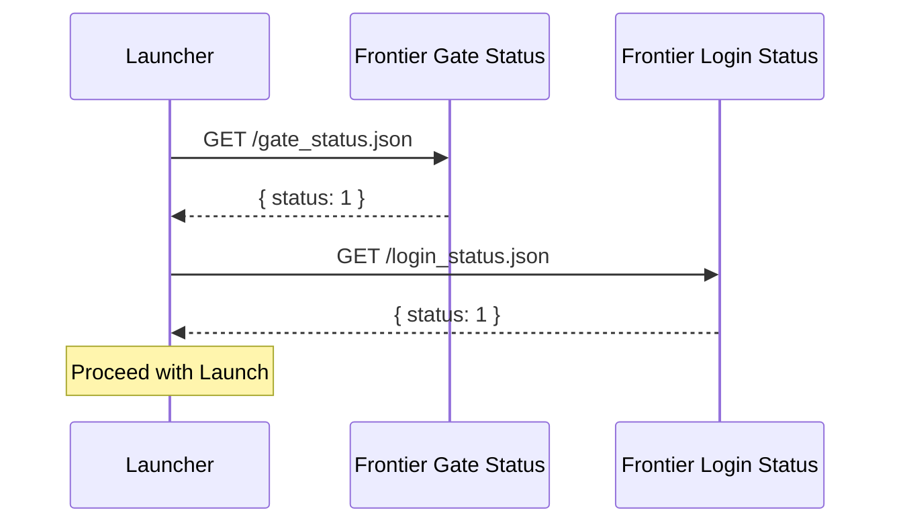

<details>
<summary>Relevant source files</summary>

The following files were used as context for generating this wiki page:

- [handlerlaunch/SupportObjects.cs](handlerlaunch/SupportObjects.cs)
- [handlerlaunch/Program.cs](handlerlaunch/Program.cs)
- [LibLaunchSupport/Class1.cs](LibLaunchSupport/Class1.cs)
- [CoreLibLaunchSupport/Class1.cs](CoreLibLaunchSupport/Class1.cs)
- [LibDalamud/Game/Launcher.cs](LibDalamud/Game/Launcher.cs)
- [LibDalamud/Util/PlatformHelpers.cs](LibDalamud/Util/PlatformHelpers.cs)
</details>

# OTP and Local HTTP Server

WebLaunch manages One-Time Passwords (OTP) and local network communication to authenticate users and launch Final Fantasy XIV (FFXIV) or Chronicles of Spellborn. The system captures credentials, including encrypted passwords and OTPs, through custom URI protocol handlers and processes them using local network logic to obtain valid session identifiers.

This module ensures that the local environment can securely communicate with Square Enix authentication servers while maintaining compatibility with platforms like Steam.

## Authentication and OTP Handling

The authentication system processes user credentials to obtain a Session ID (SID) or a Unique ID. The `networklogic` class orchestrates these requests by communicating with Square Enix's OAuth and patch servers.

### Credential Extraction
When the application starts via a URI like `HandleWebRequest://`, the `Program` class parses the arguments to extract the username, encrypted password, and OTP. The system decrypts the password using a XOR-based method with a provided hash.



Sources: [handlerlaunch/Program.cs:461-512](handlerlaunch/Program.cs#L461-L512), [handlerlaunch/SupportObjects.cs:410-475](handlerlaunch/SupportObjects.cs#L410-L475)

### Authentication Flow
The system performs a multi-step authentication process:
1.  **Stored Token Fetching:** The client requests a `_STORED_` value from the login page.
2.  **SID Request:** The client sends the username, password, and OTP to the `login.send` endpoint to receive a session ID.
3.  **Unique ID Acquisition:** The client sends the SID along with hardware-specific hashes to the patch server to receive the final `X-Patch-Unique-Id`.

Sources: [LibLaunchSupport/Class1.cs:640-708](LibLaunchSupport/Class1.cs#L640-L708), [CoreLibLaunchSupport/Class1.cs:720-768](CoreLibLaunchSupport/Class1.cs#L720-L768)

## Local Network Logic

The local network logic handles environment-specific requirements such as SSL validation, User-Agent generation, and port management.

### User-Agent and Computer Identification
The application generates a unique `UserAgent` string based on the machine's hardware profile. This prevents identification issues during the login process. The `MakeComputerId` function creates a SHA1 hash of the `MachineName`, `UserName`, `OSVersion`, and `ProcessorCount`.

| Component | Logic | Source |
| :--- | :--- | :--- |
| **User-Agent Template** | `SQEXAuthor/2.0.0(Windows 6.2; ja-jp; {0})` | [LibLaunchSupport/Class1.cs:608](LibLaunchSupport/Class1.cs#L608) |
| **Computer ID Hash** | SHA1(Environment Info) | [LibLaunchSupport/Class1.cs:780-798](LibLaunchSupport/Class1.cs#L780-L798) |
| **SSL Trust** | Overrides `ServerCertificateValidationCallback` to true | [LibLaunchSupport/Class1.cs:769-777](LibLaunchSupport/Class1.cs#L769-L777) |

### Service Status Monitoring
The `WorldStatusService` monitors the availability of the game's gate and login servers by querying local-friendly JSON endpoints.



Sources: [CoreLibLaunchSupport/Class1.cs:771-807](CoreLibLaunchSupport/Class1.cs#L771-L807), [LibLaunchSupport/Class1.cs:753-767](LibLaunchSupport/Class1.cs#L753-L767)

## Local HTTP Communication and Ports

The application utilizes local networking utilities to ensure services are available and not blocked by local firewall or port conflicts.

### Available Port Discovery
The `PlatformHelpers` class provides a utility to find an available TCP port on the local loopback address. It creates a socket, binds it to port 0, and retrieves the assigned port number.

```csharp
public static int GetAvailablePort()
{
    using var socket = new Socket(AddressFamily.InterNetwork, SocketType.Stream, ProtocolType.Tcp);
    socket.Bind(new IPEndPoint(IPAddress.Loopback, port: 0));
    return ((IPEndPoint)socket.LocalEndPoint).Port;
}
```

Sources: [LibDalamud/Util/PlatformHelpers.cs:75-81](LibDalamud/Util/PlatformHelpers.cs#L75-L81)

### Local Download Management
The system supports local downloads via the `AriaManager`, which interfaces with a local `aria2` instance via JSON-RPC, typically hosted at `http://localhost:6800/jsonrpc`. This is primarily used for patch acquisition and asset management.
Sources: [LibDalamud/Game/Patch/Acquisition/Aria/AriaManager.cs:22-28](LibDalamud/Game/Patch/Acquisition/Aria/AriaManager.cs#L22-L28)

## Summary

The OTP and Local HTTP Server components coordinate the secure transmission of user credentials to Square Enix servers while managing local environment states. By decrypting credentials locally and performing a sequence of OAuth requests, the system transitions from a web-based launch request to a fully authenticated game process. It monitors world status and manages local ports to ensure a stable connection during the launch sequence.
