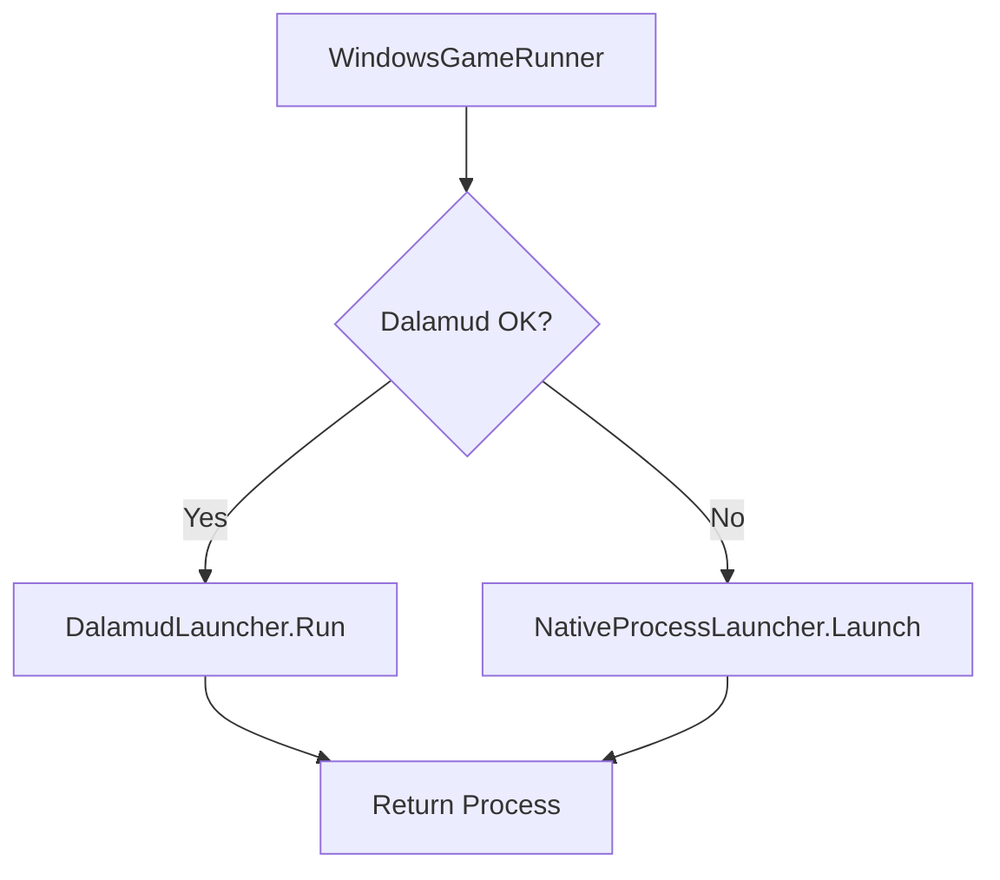
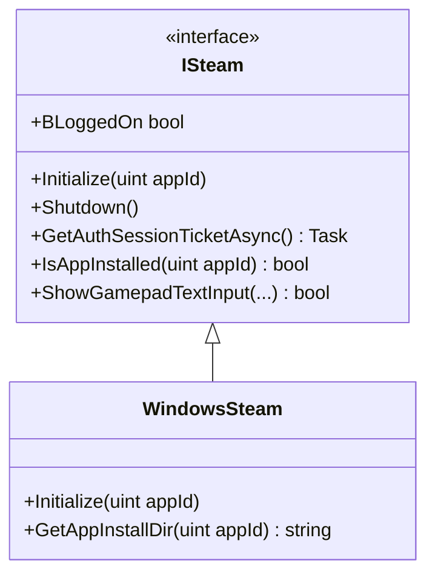
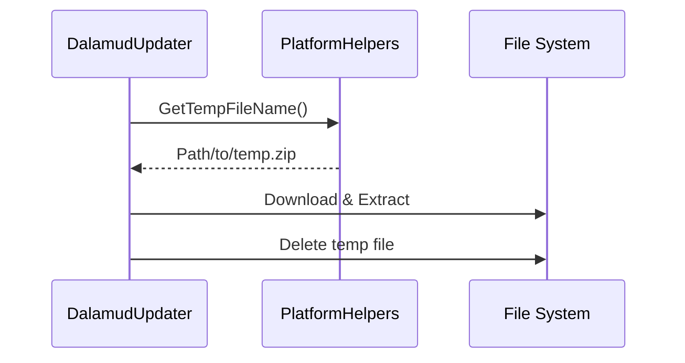

Relevant source files

The following files were used as context for generating this wiki page:

- [LibDalamud/PlatformAbstractions/IGameRunner.cs](LibDalamud/PlatformAbstractions/IGameRunner.cs)
- [LibDalamud/PlatformAbstractions/ISteam.cs](LibDalamud/PlatformAbstractions/ISteam.cs)
- [CoreLibLaunchSupport/Class1.cs](CoreLibLaunchSupport/Class1.cs)
- [LibDalamud/Dalamud/windalamud.cs](LibDalamud/Dalamud/windalamud.cs)
- [LibDalamud/Util/PlatformHelpers.cs](LibDalamud/Util/PlatformHelpers.cs)
- [LibDalamud/Dalamud/DalamudUpdater.cs](LibDalamud/Dalamud/DalamudUpdater.cs)

# Platform Abstractions

Platform Abstractions provide a decoupled interface for interacting with operating system features and third-party services. This system allows the launcher to execute game processes, manage Steam integration, and handle platform-specific utilities across different environments like Windows, Linux (via Wine), and macOS.

The abstractions hide complex P/Invoke calls and native API logic behind clean C# interfaces. This architecture ensures that core logic remains independent of the underlying host platform implementation.

Sources: [CoreLibLaunchSupport/Class1.cs](CoreLibLaunchSupport/Class1.cs), [LibDalamud/Util/PlatformHelpers.cs:11-30](LibDalamud/Util/PlatformHelpers.cs#L11-L30)

## Game Execution Abstractions

The `IGameRunner` interface defines the contract for starting game processes. It standardizes how the launcher passes working directories, arguments, and environment variables to the game executable.

### Windows Implementation
The `WindowsGameRunner` implements this interface using a `NativeProcessLauncher`. If the `dalamudOk` flag is set, it executes the game via the `DalamudLauncher`; otherwise, it performs a standard native launch.

The diagram shows the decision logic for choosing the execution path based on the state of the Dalamud hook system.

Sources: [CoreLibLaunchSupport/Class1.cs:64-67](CoreLibLaunchSupport/Class1.cs#L64-L67), [CoreLibLaunchSupport/Class1.cs:517-548](CoreLibLaunchSupport/Class1.cs#L517-L548)

### Native Process Launching
The `NativeProcessLauncher` handles low-level Windows API interactions. It manages process security descriptors, thread resumption, and DPI awareness settings.

| Feature | Action |
| :--- | :--- |
| **Security** | Applies Access Control Lists (ACLs) to game processes. |
| **DPI Awareness** | Configures `__COMPAT_LAYER` environment variables. |
| **Integrity** | Disables `SeDebugPrivilege` for the child process. |
| **Synchronization** | Waits for the game window to become visible before returning. |

Sources: [CoreLibLaunchSupport/Class1.cs:114-360](CoreLibLaunchSupport/Class1.cs#L114-L360)

## Steam Integration

The `ISteam` interface abstracts features provided by the Steamworks API. It allows the launcher to verify installations, retrieve authentication tickets, and handle gamepad input overlays.

The class diagram represents the relationship between the Steam abstraction and its Windows implementation.

### Key Capabilities
- **Authentication**: Fetches session tickets for game login validation.
- **Overlay Management**: Opens web pages within the Steam game overlay.
- **Environment Setup**: On Unix platforms, it uses `setenv` to manually set the `SteamAppId` because standard environment variables may not persist correctly.

Sources: [LibDalamud/PlatformAbstractions/ISteam.cs](LibDalamud/PlatformAbstractions/ISteam.cs), [LibDalamud/Dalamud/windalamud.cs:645-717](LibDalamud/Dalamud/windalamud.cs#L645-L717)

## Platform Helpers and Utilities

The `PlatformHelpers` class provides static methods for common OS tasks that vary between platforms.

### Platform Detection
The system identifies the current environment using `RuntimeInformation` and `OSVersion`. It categorizes the host into three primary types:
- `Win32`
- `Win32OnLinux` (Detection for Wine/Proton)
- `Mac`

Sources: [LibDalamud/Util/PlatformHelpers.cs:11-30](LibDalamud/Util/PlatformHelpers.cs#L11-L30)

### Utility Functions
- **Elevated Access**: `IsElevated()` checks for Administrator rights on Windows or Root (UID 0) on Unix.
- **Disk Space**: `GetDiskFreeSpace()` uses `kernel32.dll` on Windows to bypass `DriveInfo` bugs in Wine, while using standard `DriveInfo` on other platforms.
- **Process Management**: The `WindowsRestartManager` uses `rstrtmgr.dll` to identify and shut down processes that are locking game files during updates.

Sources: [LibDalamud/Util/PlatformHelpers.cs:57-145](LibDalamud/Util/PlatformHelpers.cs#L57-L145), [LibDalamud/Dalamud/windalamud.cs:382-550](LibDalamud/Dalamud/windalamud.cs#L382-L550)

## Update and Integrity Abstractions

The `DalamudUpdater` coordinates the lifecycle of game hooks and runtimes. It uses the platform's temporary directory for downloads and `System.IO.Compression` for extraction.

The sequence shows how the updater utilizes platform utilities to manage transient download data safely.

Sources: [LibDalamud/Dalamud/DalamudUpdater.cs:134-180](LibDalamud/Dalamud/DalamudUpdater.cs#L134-L180), [LibDalamud/Util/PlatformHelpers.cs:36-40](LibDalamud/Util/PlatformHelpers.cs#L36-L40)

## Summary

Platform Abstractions decouple the WebLaunch core from the complexities of native APIs. By centralizing logic for process execution, Steamworks integration, and filesystem management, the system provides a stable foundation for cross-platform expansion and robust error handling. This architecture ensures that Windows-specific fixes (like the Wine disk space workaround) do not pollute the primary application logic.
