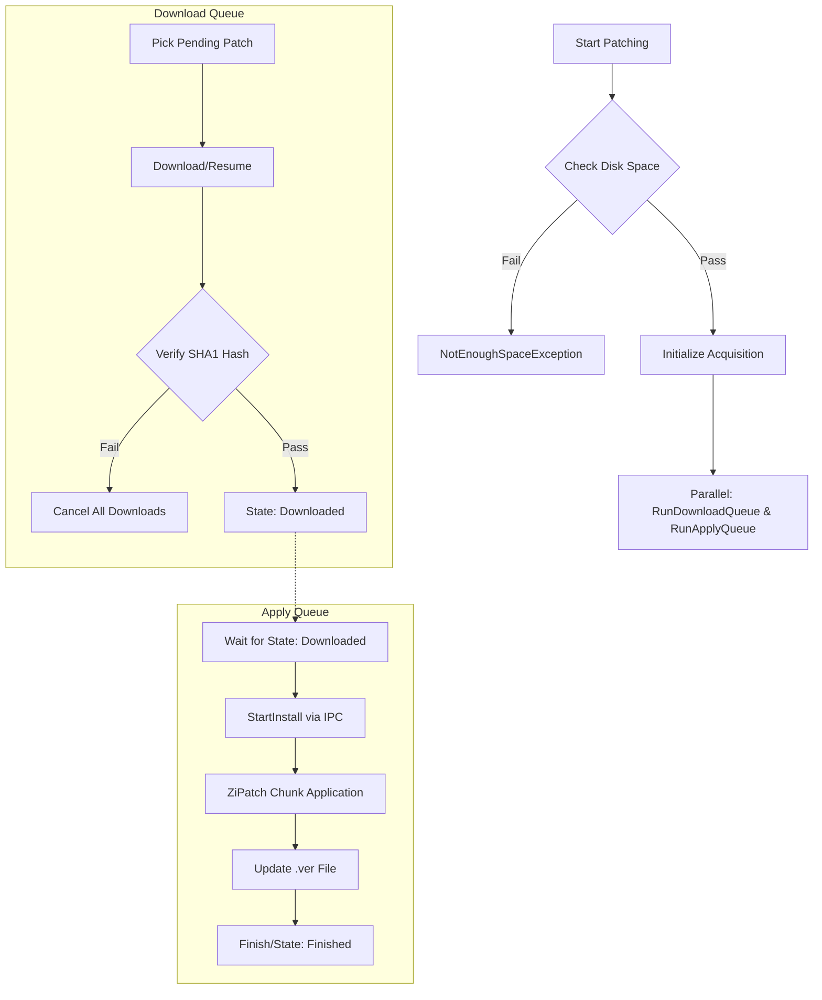
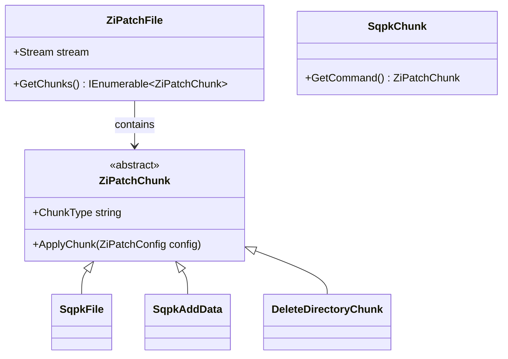

Relevant source files

The following files were used as context for generating this wiki page:

- [LibDalamud/Game/Patch/PatchManager.cs](LibDalamud/Game/Patch/PatchManager.cs)
- [LibDalamud/Game/Patch/PatchInstaller.cs](LibDalamud/Game/Patch/PatchInstaller.cs)
- [LibDalamud/Game/Patch/PatchVerifier.cs](LibDalamud/Game/Patch/PatchVerifier.cs)
- [LibDalamud/Patching/IndexedZiPatch/IndexedZiPatchInstaller.cs](LibDalamud/Patching/IndexedZiPatch/IndexedZiPatchInstaller.cs)
- [LibDalamud/Patching/IndexedZiPatch/IndexedZiPatchIndexRemoteInstaller.cs](LibDalamud/Patching/IndexedZiPatch/IndexedZiPatchIndexRemoteInstaller.cs)
- [LibDalamud/Patching/RemotePatchInstaller.cs](LibDalamud/Patching/RemotePatchInstaller.cs)
- [LibDalamud/Patching/ZiPatch/ZiPatchFile.cs](LibDalamud/Patching/ZiPatch/ZiPatchFile.cs)
- [LibDalamud/Game/Launcher.cs](LibDalamud/Game/Launcher.cs)

# Patching Engine Overview

The Patching Engine manages the acquisition, verification, and installation of game updates. It handles complex patching operations through a multi-stage process involving download queue management, file integrity verification using SHA1 hashes, and the application of ZiPatch chunks to game files. The engine supports both local and remote installation modes, often utilizing a separate elevated process for administrative file operations.

Sources: [LibDalamud/Game/Patch/PatchManager.cs:40-80](LibDalamud/Game/Patch/PatchManager.cs#L40-L80), [LibDalamud/Game/Patch/PatchInstaller.cs:15-35](LibDalamud/Game/Patch/PatchInstaller.cs#L15-L35)

## Core Architecture

The engine uses a decoupled architecture to separate download logic from installation logic. `PatchManager` coordinates the overall flow, managing concurrent downloads and sequential installations. It interacts with `PatchInstaller`, which can operate in an "external" mode by spawning `XIVLauncher.PatchInstaller.exe` with administrative privileges to perform the actual file writes.

### Primary Components

| Component | Responsibility |
| :--- | :--- |
| **PatchManager** | Orchestrates download and installation queues; manages disk space checks. |
| **PatchInstaller** | Handles IPC communication with the elevated installation process. |
| **PatchVerifier** | Downloads metadata and performs repair operations for broken game files. |
| **IndexedZiPatchInstaller** | Processes indexed patch files and performs low-level data reconstruction. |
| **RemotePatchInstaller** | Executes the actual ZiPatch chunk application logic in the target process. |

Sources: [LibDalamud/Game/Patch/PatchManager.cs:45-65](LibDalamud/Game/Patch/PatchManager.cs#L45-L65), [LibDalamud/Game/Patch/PatchVerifier.cs:25-50](LibDalamud/Game/Patch/PatchVerifier.cs#L25-L50), [LibDalamud/Patching/RemotePatchInstaller.cs:15-30](LibDalamud/Patching/RemotePatchInstaller.cs#L15-L30)

### Patching Lifecycle

The following diagram illustrates the lifecycle of a patch from initialization to completion.

Sources: [LibDalamud/Game/Patch/PatchManager.cs:107-160](LibDalamud/Game/Patch/PatchManager.cs#L107-L160), [LibDalamud/Game/Patch/PatchManager.cs:283-324](LibDalamud/Game/Patch/PatchManager.cs#L283-L324)

## Data Verification and Integrity

Integrity is maintained through multi-layered checks. Before installation, `PatchManager` verifies the SHA1 hash of the downloaded `.patch` file against the expected hashes provided in the `PatchListEntry`. During repair operations, `PatchVerifier` uses `IndexedZiPatchIndex` files to verify individual segments of the game files.

### Verification Logic
*  **Hash Checking:** Validates downloads by reading file blocks defined by `HashBlockSize` and comparing the SHA1 result against the `Hashes` array.
*  **Metadata Comparison:** `PatchVerifier` fetches `latest.json` and `.patch.index` files from a remote repository to identify missing or corrupt blocks in existing game installations.
*  **Version Files:** The engine manages `.ver` and `.bck` (backup) files to track the current version of various game repositories (Boot, Ffxiv, Ex1-Ex4).

Sources: [LibDalamud/Game/Patch/PatchManager.cs:326-368](LibDalamud/Game/Patch/PatchManager.cs#L326-L368), [LibDalamud/Game/Patch/PatchVerifier.cs:343-380](LibDalamud/Game/Patch/PatchVerifier.cs#L343-L380), [LibDalamud/Patching/RemotePatchInstaller.cs:141-164](LibDalamud/Patching/RemotePatchInstaller.cs#L141-L164)

## ZiPatch System

The `ZiPatch` system implements the low-level patching protocol. It processes patches as a series of "chunks" that define operations like adding files, deleting directories, or expanding existing data.

### Chunk Operations
*  **SqpkFile:** Adds or deletes files within the Sqpack structures.
*  **SqpkAddData / SqpkDeleteData:** Modifies specific blocks within existing files.
*  **SqpkHeader:** Updates file headers, such as version info.

Sources: [LibDalamud/Patching/ZiPatch/ZiPatchFile.cs:11-45](LibDalamud/Patching/ZiPatch/ZiPatchFile.cs#L11-L45), [LibDalamud/Patching/ZiPatch/Chunk/ZiPatchChunk.cs:11-50](LibDalamud/Patching/ZiPatch/Chunk/ZiPatchChunk.cs#L11-L50)

## Process Communication (IPC)

Because game directory modifications often require administrative rights, the engine utilizes a Remote Procedure Call (RPC) mechanism to communicate between the main launcher and the `XIVLauncher.PatchInstaller.exe`.

*  **SharedMemoryRpc:** Uses shared memory for high-performance communication between the main app and the elevated worker.
*  **Opcodes:** The engine uses specific opcodes like `StartInstall`, `InstallOk`, `InstallFailed`, and `Bye` to synchronize states.
*  **RemotePatchInstaller:** A class in the worker process that listens for these messages and executes the `InstallPatch` method.

Sources: [LibDalamud/Game/Patch/PatchInstaller.cs:40-70](LibDalamud/Game/Patch/PatchInstaller.cs#L40-L70), [LibDalamud/Patching/RemotePatchInstaller.cs:15-60](LibDalamud/Patching/RemotePatchInstaller.cs#L15-L60), [LibDalamud/Patching/IndexedZiPatch/IndexedZiPatchIndexRemoteInstaller.cs:20-80](LibDalamud/Patching/IndexedZiPatch/IndexedZiPatchIndexRemoteInstaller.cs#L20-L80)

## Repair and Recovery

The `PatchVerifier` provides a recovery mechanism for corrupted installations. It performs a "Repair and Repair" flow:
1.  Downloads version metadata (`latest.json`) from the repository.
2.  Downloads `.patch.index` files for each game repository.
3.  Compares local files against the index.
4.  Identifies missing or corrupt parts and queues only those specific segments for download from the patch servers.
5.  Moves unnecessary or unknown files to a `repair_recycler` directory.

Sources: [LibDalamud/Game/Patch/PatchVerifier.cs:215-280](LibDalamud/Game/Patch/PatchVerifier.cs#L215-L280), [LibDalamud/Game/Patch/PatchVerifier.cs:165-200](LibDalamud/Game/Patch/PatchVerifier.cs#L165-L200)
