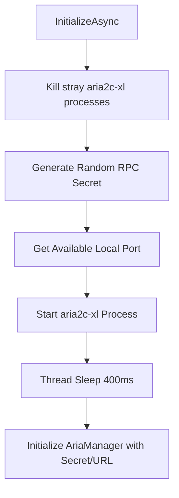
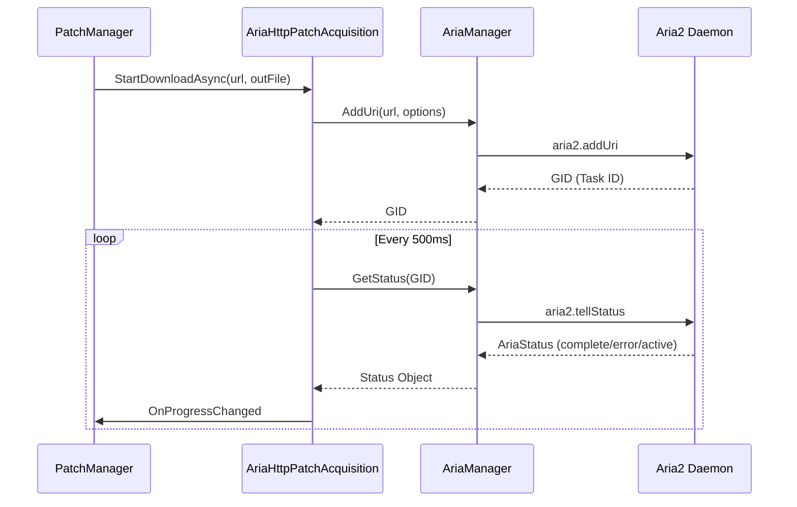

Relevant source files

The following files were used as context for generating this wiki page:

- [LibDalamud/Game/Patch/Acquisition/Aria/AriaManager.cs](LibDalamud/Game/Patch/Acquisition/Aria/AriaManager.cs)
- [LibDalamud/Game/Patch/Acquisition/Aria/AriaHttpPatchAcquisition.cs](LibDalamud/Game/Patch/Acquisition/Aria/AriaHttpPatchAcquisition.cs)
- [LibDalamud/Game/Patch/Acquisition/Aria/Attributes/AriaStatus.cs](LibDalamud/Game/Patch/Acquisition/Aria/Attributes/AriaStatus.cs)
- [LibDalamud/Game/Patch/PatchManager.cs](LibDalamud/Game/Patch/PatchManager.cs)
- [LibDalamud/Game/Patch/Acquisition/Aria/Attributes/AriaFile.cs](LibDalamud/Game/Patch/Acquisition/Aria/Attributes/AriaFile.cs)

# Aria Download Manager

The Aria Download Manager integrates the `aria2c` utility to handle high-speed patch downloads within the library. It wraps a local `aria2c-xl.exe` process and communicates via JSON-RPC to manage download tasks, providing status updates and lifecycle management for game assets.

Sources: [LibDalamud/Game/Patch/Acquisition/Aria/AriaHttpPatchAcquisition.cs:17-57](LibDalamud/Game/Patch/Acquisition/Aria/AriaHttpPatchAcquisition.cs#L17-L57), [LibDalamud/Game/Patch/Acquisition/Aria/AriaManager.cs:15-25](LibDalamud/Game/Patch/Acquisition/Aria/AriaManager.cs#L15-L25)

## Architecture and Process Lifecycle

The system operates by spawning a child process for the Aria2 executable and establishing a secure RPC connection. The `AriaHttpPatchAcquisition` class manages the initialization and shutdown of this process.

### Process Initialization
When `InitializeAsync` is called, the manager kills any existing `aria2c-xl` processes to prevent conflicts. It generates a random secret for RPC authentication and selects an available port. The process starts with specific flags to enable RPC, set log levels, and configure connection limits.

Sources: [LibDalamud/Game/Patch/Acquisition/Aria/AriaHttpPatchAcquisition.cs:22-68](LibDalamud/Game/Patch/Acquisition/Aria/AriaHttpPatchAcquisition.cs#L22-L68)

### Lifecycle Management
The manager ensures the Aria2 process remains active during downloads and terminates it upon completion.

| Action | Description | File Reference |
| :--- | :--- | :--- |
| **Initialize** | Sets up environment, kills strays, and starts the executable. | `AriaHttpPatchAcquisition.cs:22` |
| **Shutdown** | Sends RPC shutdown command and kills process if it hangs. | `AriaHttpPatchAcquisition.cs:72` |
| **AddUri** | Queues a new URL for download with custom HTTP headers. | `AriaManager.cs:40` |
| **GetStatus** | Polls the current state of a specific download GID. | `AriaManager.cs:85` |

## JSON-RPC Interface

The `AriaManager` class provides a typed wrapper for the Aria2 JSON-RPC API. It automatically prepends the authentication token to every request.

### RPC Methods Summary
*  **aria2.addUri**: Adds a new download. Supports URIs, user agents, and referrers.
*  **aria2.tellStatus**: Returns a `AriaStatus` object containing `downloadSpeed`, `completedLength`, and current `status`.
*  **aria2.pauseAll / unpauseAll**: Controls global task execution.
*  **aria2.shutdown**: Terminates the Aria2 daemon.

Sources: [LibDalamud/Game/Patch/Acquisition/Aria/AriaManager.cs:33-160](LibDalamud/Game/Patch/Acquisition/Aria/AriaManager.cs#L33-L160)

### Download Task Monitoring
The acquisition service runs a background task to monitor download progress after submitting a URI.

Sources: [LibDalamud/Game/Patch/Acquisition/Aria/AriaHttpPatchAcquisition.cs:98-155](LibDalamud/Game/Patch/Acquisition/Aria/AriaHttpPatchAcquisition.cs#L98-L155)

## Data Models

The system uses several attribute classes to deserialize JSON responses from the Aria2 RPC server.

### AriaStatus Model
This model represents the state of a specific task.
*  **Status**: Indicates if the task is `active`, `complete`, `removed`, or `error`.
*  **DownloadSpeed**: Current speed in bytes per second.
*  **CompletedLength**: Total bytes downloaded so far.
*  **Files**: A list of `AriaFile` objects associated with the task.

Sources: [LibDalamud/Game/Patch/Acquisition/Aria/Attributes/AriaStatus.cs:12-46](LibDalamud/Game/Patch/Acquisition/Aria/Attributes/AriaStatus.cs#L12-L46)

### AriaFile Model
Details specific files within a download task.
*  **Path**: Local destination path.
*  **Length**: Total expected file size.
*  **CompletedLength**: Bytes currently written to disk.

Sources: [LibDalamud/Game/Patch/Acquisition/Aria/Attributes/AriaFile.cs:12-32](LibDalamud/Game/Patch/Acquisition/Aria/Attributes/AriaFile.cs#L12-L32)

## Integration with Patching

`PatchManager` utilizes `AriaHttpPatchAcquisition` as one of its primary acquisition methods. It calculates a speed limit per download slot by dividing the global speed limit by the maximum number of concurrent downloads (defaulted to 4).

### Acquisition Configuration
When using Aria, the system sets the following default options for every task:
*  `max-connection-per-server`: 8
*  `max-tries`: 100
*  `auto-file-renaming`: false
*  `allow-overwrite`: true

Sources: [LibDalamud/Game/Patch/Acquisition/Aria/AriaHttpPatchAcquisition.cs:103-112](LibDalamud/Game/Patch/Acquisition/Aria/AriaHttpPatchAcquisition.cs#L103-L112), [LibDalamud/Game/Patch/PatchManager.cs:134-140](LibDalamud/Game/Patch/PatchManager.cs#L134-L140)

### Failure Handling
If the Aria2 process fails to start or an RPC call returns an error status, the acquisition service triggers an `AcquisitionResult.Error`, which informs the `PatchManager` to halt the update process or fallback to other methods.

Sources: [LibDalamud/Game/Patch/Acquisition/Aria/AriaHttpPatchAcquisition.cs:115-120](LibDalamud/Game/Patch/Acquisition/Aria/AriaHttpPatchAcquisition.cs#L115-L120), [LibDalamud/Game/Patch/PatchManager.cs:195-200](LibDalamud/Game/Patch/PatchManager.cs#L195-L200)
