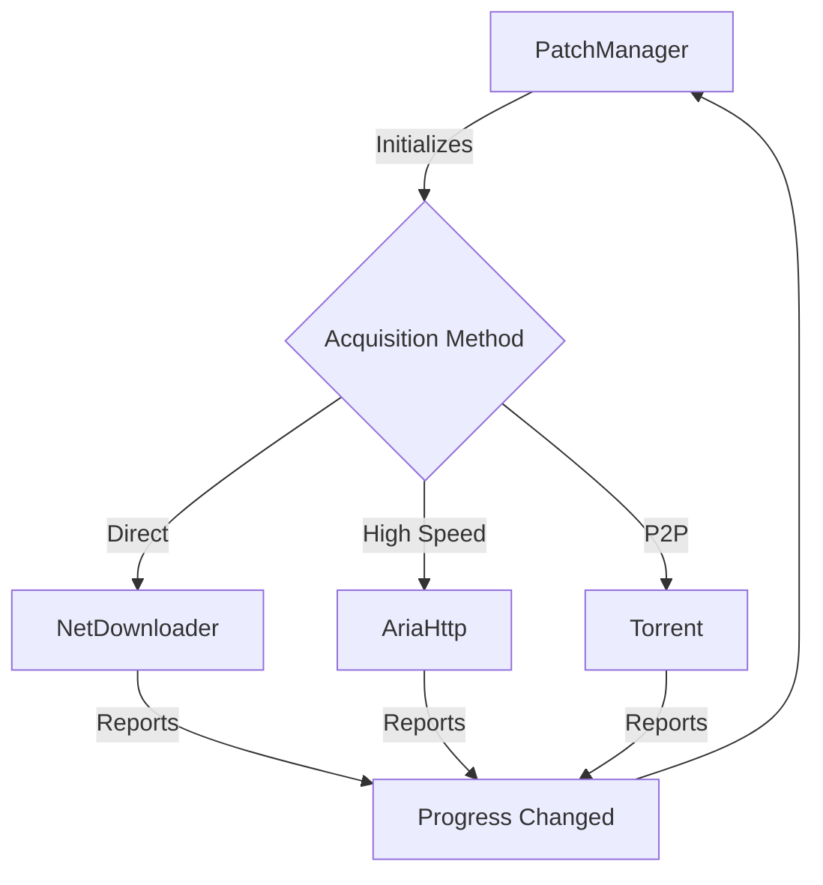
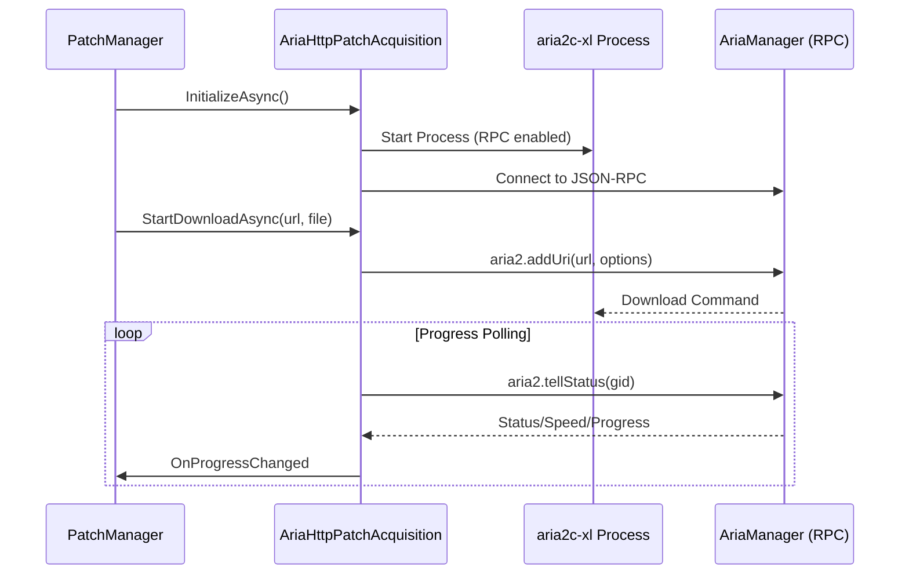
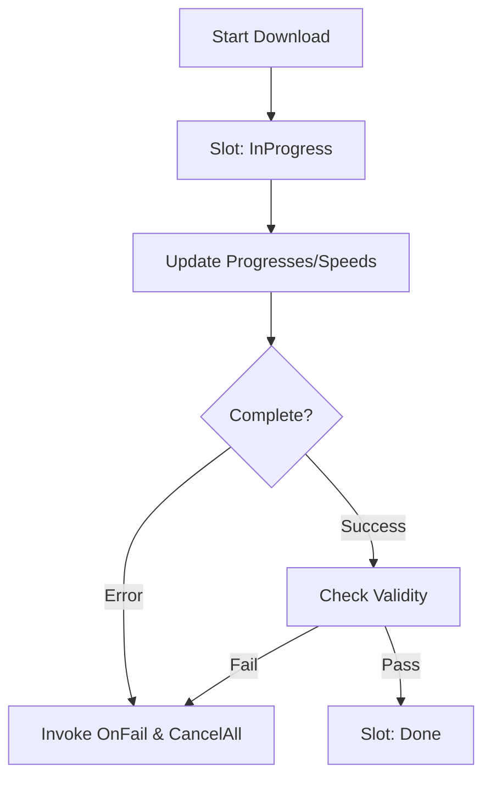

Relevant source files

The following files were used as context for generating this wiki page:

- [LibDalamud/Game/Patch/Acquisition/TorrentPatchAcquisition.cs](LibDalamud/Game/Patch/Acquisition/TorrentPatchAcquisition.cs)
- [LibDalamud/Game/Patch/Acquisition/NetDownloaderPatchAcquisition.cs](LibDalamud/Game/Patch/Acquisition/NetDownloaderPatchAcquisition.cs)
- [LibDalamud/Game/Patch/PatchManager.cs](LibDalamud/Game/Patch/PatchManager.cs)
- [LibDalamud/Game/Patch/Acquisition/Aria/AriaHttpPatchAcquisition.cs](LibDalamud/Game/Patch/Acquisition/Aria/AriaHttpPatchAcquisition.cs)
- [LibDalamud/Game/Patch/Acquisition/Aria/AriaManager.cs](LibDalamud/Game/Patch/Acquisition/Aria/AriaManager.cs)

# Torrent and Direct Downloader Implementations

The acquisition system manages the retrieval of game patches using various protocols including BitTorrent, direct HTTP downloads via the `Downloader` library, and high-speed multi-connection downloads using `aria2`. This system ensures reliable patch delivery by providing fallback mechanisms between different acquisition methods based on availability and performance.

## Patch Acquisition Architecture

The `PatchManager` coordinates the download and installation of patches. It maintains a queue of `PatchDownload` objects and assigns them to available download slots. Each slot utilizes a specific implementation of the `PatchAcquisition` base class.

The diagram shows how `PatchManager` delegates download tasks to specific acquisition implementations which report progress back to the manager.
Sources: [LibDalamud/Game/Patch/PatchManager.cs:75-102](LibDalamud/Game/Patch/PatchManager.cs#L75-L102), [LibDalamud/Game/Patch/PatchManager.cs:175-200](LibDalamud/Game/Patch/PatchManager.cs#L175-L200)

### Acquisition Methods and Fallbacks
The system supports several acquisition strategies defined by the `AcquisitionMethod` enum. These strategies often include fallback logic to ensure downloads continue if a preferred method (like Torrent) is unavailable for a specific patch.

| Method | Primary Protocol | Fallback Protocol |
| :--- | :--- | :--- |
| `NetDownloader` | HTTP (Direct) | None |
| `MonoTorrentNetFallback` | BitTorrent | NetDownloader |
| `MonoTorrentAriaFallback` | BitTorrent | Aria2 |
| `Aria` | HTTP (Multi-connection) | None |

Sources: [LibDalamud/Game/Patch/PatchManager.cs:141-164](LibDalamud/Game/Patch/PatchManager.cs#L141-L164), [LibDalamud/Game/Patch/PatchManager.cs:208-238](LibDalamud/Game/Patch/PatchManager.cs#L208-L238)

## Implementation Details

### BitTorrent Acquisition (`TorrentPatchAcquisition`)
This implementation uses the `MonoTorrent` library. It attempts to locate a `.torrent` file for a given patch on a remote GitHub-hosted repository.

*  **Initialization**: Sets up a `ClientEngine` and configures the maximum download speed globally.
*  **Applicability**: Checks if a torrent metadata file exists at `http://goaaats.github.io/patchtorrent/[path].torrent`.
*  **Process**: Loads the torrent bytes into a `TorrentManager` and starts the DHT announcement to find peers.

Sources: [LibDalamud/Game/Patch/Acquisition/TorrentPatchAcquisition.cs:18-35](LibDalamud/Game/Patch/Acquisition/TorrentPatchAcquisition.cs#L18-L35), [LibDalamud/Game/Patch/Acquisition/TorrentPatchAcquisition.cs:48-58](LibDalamud/Game/Patch/Acquisition/TorrentPatchAcquisition.cs#L48-L58)

### Aria2 Acquisition (`AriaHttpPatchAcquisition`)
This implementation utilizes an external `aria2c-xl` process to handle high-performance downloads.

The sequence shows the interaction between the acquisition class and the external aria2 process via JSON-RPC.
Sources: [LibDalamud/Game/Patch/Acquisition/Aria/AriaHttpPatchAcquisition.cs:24-74](LibDalamud/Game/Patch/Acquisition/Aria/AriaHttpPatchAcquisition.cs#L24-L74), [LibDalamud/Game/Patch/Acquisition/Aria/AriaHttpPatchAcquisition.cs:100-118](LibDalamud/Game/Patch/Acquisition/Aria/AriaHttpPatchAcquisition.cs#L100-L118)

### Direct HTTP Acquisition (`NetDownloaderPatchAcquisition`)
Uses the `Downloader` library for standard HTTP retrieval. It is configured to use parallel downloads with 8 chunks by default.

*  **Configuration**: Sets `BufferBlockSize` to 8000 bytes and enables `ParallelDownload`.
*  **Temp Storage**: Uses a specific `temp` sub-directory within the patch store for partial downloads.

Sources: [LibDalamud/Game/Patch/Acquisition/NetDownloaderPatchAcquisition.cs:15-32](LibDalamud/Game/Patch/Acquisition/NetDownloaderPatchAcquisition.cs#L15-L32), [LibDalamud/Game/Patch/Acquisition/NetDownloaderPatchAcquisition.cs:41-45](LibDalamud/Game/Patch/Acquisition/NetDownloaderPatchAcquisition.cs#L41-L45)

## Progress and Error Handling

The `PatchManager` monitors active downloads through slots. If a download fails or encounters a hash check error, the manager cancels all other active downloads in the queue to prevent further bandwidth waste.

Sources: [LibDalamud/Game/Patch/PatchManager.cs:235-260](LibDalamud/Game/Patch/PatchManager.cs#L235-L260), [LibDalamud/Game/Patch/PatchManager.cs:266-285](LibDalamud/Game/Patch/PatchManager.cs#L266-L285)

### Validation and Integrity
After a download completes, the system performs a SHA1 hash check on the resulting file. The patch is divided into blocks based on `HashBlockSize`, and each block's hash is compared against the `PatchListEntry` metadata.

Sources: [LibDalamud/Game/Patch/PatchManager.cs:365-410](LibDalamud/Game/Patch/PatchManager.cs#L365-L410)

## Conclusion
The Torrent and Direct Downloader implementations provide a robust multi-layered approach to patch acquisition. By leveraging P2P (BitTorrent), high-performance RPC-based tools (Aria2), and standard HTTP fallbacks, the system ensures that game updates can be retrieved efficiently regardless of network conditions or server availability.
