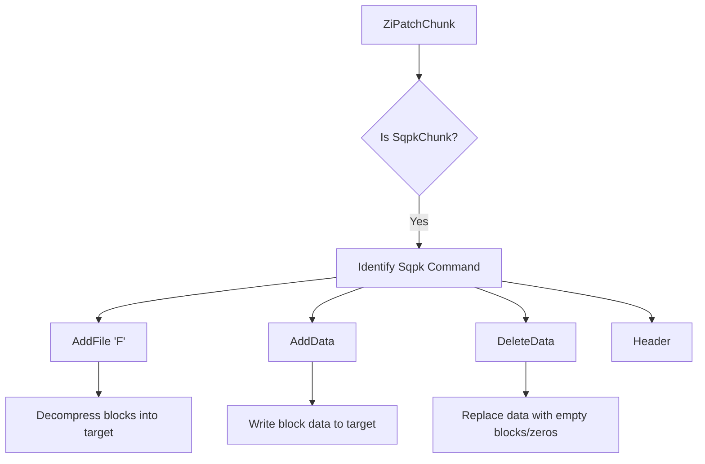
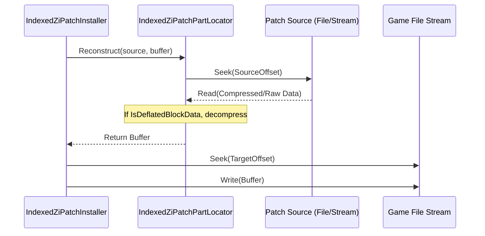

Relevant source files

The following files were used as context for generating this wiki page:

- [LibDalamud/Patching/ZiPatch/ZiPatchFile.cs](LibDalamud/Patching/ZiPatch/ZiPatchFile.cs)
- [LibDalamud/Patching/ZiPatch/Chunk/SqpkCommand/SqpkFile.cs](LibDalamud/Patching/ZiPatch/Chunk/SqpkCommand/SqpkFile.cs)
- [LibDalamud/Patching/IndexedZiPatch/IndexedZiPatchIndex.cs](LibDalamud/Patching/IndexedZiPatch/IndexedZiPatchIndex.cs)
- [LibDalamud/Patching/IndexedZiPatch/IndexedZiPatchInstaller.cs](LibDalamud/Patching/IndexedZiPatch/IndexedZiPatchInstaller.cs)
- [LibDalamud/Patching/IndexedZiPatch/IndexedZiPatchOperations.cs](LibDalamud/Patching/IndexedZiPatch/IndexedZiPatchOperations.cs)
- [LibDalamud/Patching/IndexedZiPatch/IndexedZiPatchPartLocator.cs](LibDalamud/Patching/IndexedZiPatch/IndexedZiPatchPartLocator.cs)
- [LibDalamud/Patching/ZiPatch/Chunk/ZiPatchChunk.cs](LibDalamud/Patching/ZiPatch/Chunk/ZiPatchChunk.cs)
- [LibDalamud/Patching/ZiPatch/Chunk/FileHeaderChunk.cs](LibDalamud/Patching/ZiPatch/Chunk/FileHeaderChunk.cs)

# ZiPatch and Sqpk Operations

ZiPatch and Sqpk operations manage the application and verification of game updates. The system processes patch files containing various data chunks, including specialized Sqpack (Sqpk) commands. These operations ensure game files match expected versions by applying differential updates, adding new files, or deleting obsolete data. The core implementation relies on the `IndexedZiPatch` module to create indices for patch files, which allows for efficient verification and repair of the game installation from local or remote sources.

Sources: [LibDalamud/Patching/IndexedZiPatch/IndexedZiPatchOperations.cs](LibDalamud/Patching/IndexedZiPatch/IndexedZiPatchOperations.cs), [LibDalamud/Patching/ZiPatch/ZiPatchFile.cs](LibDalamud/Patching/ZiPatch/ZiPatchFile.cs)

## ZiPatch File Structure and Chunks

A `ZiPatchFile` starts with a specific magic identifier (`0x50495A91`, `0x48435441`, `0x0A1A0A0D`) and consists of a series of chunks. Each chunk contains a size header, a type identifier, the data payload, and a CRC32 checksum.

Sources: [LibDalamud/Patching/ZiPatch/ZiPatchFile.cs:12-32](LibDalamud/Patching/ZiPatch/ZiPatchFile.cs#L12-L32), [LibDalamud/Patching/ZiPatch/Chunk/ZiPatchChunk.cs:52-85](LibDalamud/Patching/ZiPatch/Chunk/ZiPatchChunk.cs#L52-L85)

### Core Chunk Types

The system recognizes several chunk types through a factory pattern in `ZiPatchChunk`.

| Chunk Type | Description |
| :--- | :--- |
| **FHDR** | File Header: Contains version, patch type, and command counts. |
| **APLO** | Apply Option: Configures patch application settings. |
| **ADIR** | Add Directory: Creates new directories in the game path. |
| **DDIR** | Delete Directory: Removes existing directories. |
| **SQPK** | Sqpack Command: Specialized commands for game data files. |
| **EOF** | End of File: Signals the termination of the patch stream. |

Sources: [LibDalamud/Patching/ZiPatch/Chunk/ZiPatchChunk.cs:28-37](LibDalamud/Patching/ZiPatch/Chunk/ZiPatchChunk.cs#L28-L37), [LibDalamud/Patching/ZiPatch/Chunk/FileHeaderChunk.cs:7-38](LibDalamud/Patching/ZiPatch/Chunk/FileHeaderChunk.cs#L7-L38)

### Sqpk (Sqpack) Commands

Sqpk commands handle the modification of `.dat` and `.index` files within the Sqpack filesystem.

The diagram shows the branching logic when the system encounters a Sqpack command within a patch file.

Sources: [LibDalamud/Patching/IndexedZiPatch/IndexedZiPatchIndex.cs:113-228](LibDalamud/Patching/IndexedZiPatch/IndexedZiPatchIndex.cs#L113-L228), [LibDalamud/Patching/ZiPatch/Chunk/SqpkCommand/SqpkFile.cs:14-30](LibDalamud/Patching/ZiPatch/Chunk/SqpkCommand/SqpkFile.cs#L14-L30)

## Indexed ZiPatch Architecture

The `IndexedZiPatchIndex` class provides a map of how various patch files reconstruct specific target game files. This indexing avoids the need to read entire patch files linearly during verification.

### Index Components
*  **Source Files:** A list of patch file names used as data providers.
*  **Target Files:** A collection of `IndexedZiPatchTargetFile` objects representing game files (e.g., `ffxivgame.ver`, `sqpack/ex1/ex1.dat0`).
*  **Part Locators:** `IndexedZiPatchPartLocator` structures that define exactly where a segment of a target file comes from (Source Index, Source Offset, or specialized states like all-zeros).

Sources: [LibDalamud/Patching/IndexedZiPatch/IndexedZiPatchIndex.cs:17-45](LibDalamud/Patching/IndexedZiPatch/IndexedZiPatchIndex.cs#L17-L45), [LibDalamud/Patching/IndexedZiPatch/IndexedZiPatchPartLocator.cs:13-35](LibDalamud/Patching/IndexedZiPatch/IndexedZiPatchPartLocator.cs#L13-L35)

### Data Flow for Reconstructing Files

This diagram illustrates the process of reading data from a patch source, potentially decompressing it, and writing it to the correct offset in the game file.

Sources: [LibDalamud/Patching/IndexedZiPatch/IndexedZiPatchPartLocator.cs:238-251](LibDalamud/Patching/IndexedZiPatch/IndexedZiPatchPartLocator.cs#L238-L251), [LibDalamud/Patching/IndexedZiPatch/IndexedZiPatchInstaller.cs:342-353](LibDalamud/Patching/IndexedZiPatch/IndexedZiPatchInstaller.cs#L342-L353)

## Verification and Repair Operations

The `IndexedZiPatchOperations` class provides high-level static methods to verify game integrity and perform repairs.

### Verification Logic
Verification uses the `IndexedZiPatchInstaller` to check each part of every file defined in the index.
1.  The system opens game files in read-only mode.
2.  It iterates through `IndexedZiPatchPartLocator` entries.
3.  If the locator has a valid CRC32, the system calculates the checksum of the existing game data.
4.  If the checksum fails or data is missing, the part is marked for repair.

Sources: [LibDalamud/Patching/IndexedZiPatch/IndexedZiPatchOperations.cs:64-106](LibDalamud/Patching/IndexedZiPatch/IndexedZiPatchOperations.cs#L64-L106), [LibDalamud/Patching/IndexedZiPatch/IndexedZiPatchPartLocator.cs:144-184](LibDalamud/Patching/IndexedZiPatch/IndexedZiPatchPartLocator.cs#L144-L184)

### Repair and Installation
Repairs can occur from local files or remote URIs.
*  **HTTP Installation:** The `HttpInstallTaskConfig` uses HTTP range requests to download only the specific missing byte ranges from remote patch files.
*  **Stream Installation:** The `StreamInstallTaskConfig` reads from provided local streams.
*  **Non-Patch Data:** Parts marked as `SOURCE_INDEX_ZEROS` or `SOURCE_INDEX_EMPTY_BLOCK` are reconstructed locally without downloading data.

Sources: [LibDalamud/Patching/IndexedZiPatch/IndexedZiPatchInstaller.cs:407-450](LibDalamud/Patching/IndexedZiPatch/IndexedZiPatchInstaller.cs#L407-L450), [LibDalamud/Patching/IndexedZiPatch/IndexedZiPatchInstaller.cs:513-547](LibDalamud/Patching/IndexedZiPatch/IndexedZiPatchInstaller.cs#L513-L547)

## Data Structures and Enums

### IndexedZiPatchPartLocator Source Indices
Special constant values represent data states that do not require an actual patch file source.

| Constant Name | Value | Description |
| :--- | :--- | :--- |
| `SOURCE_INDEX_ZEROS` | 255 | The segment should be filled with zeros. |
| `SOURCE_INDEX_EMPTY_BLOCK` | 254 | The segment represents an empty Sqpack block. |
| `SOURCE_INDEX_UNAVAILABLE` | 253 | The data is currently not available. |

Sources: [LibDalamud/Patching/IndexedZiPatch/IndexedZiPatchPartLocator.cs:15-18](LibDalamud/Patching/IndexedZiPatch/IndexedZiPatchPartLocator.cs#L15-L18)

### Verification Results
The `VerifyDataResult` enum defines the status of a specific file segment after an integrity check.

| Result | Description |
| :--- | :--- |
| `Pass` | Data matches the expected CRC32 or format. |
| `FailUnverifiable` | Part cannot be verified (e.g., source data missing from index). |
| `FailNotEnoughData` | The file ended prematurely compared to the expected size. |
| `FailBadData` | The data exists but the CRC32 check failed. |

Sources: [LibDalamud/Patching/IndexedZiPatch/IndexedZiPatchPartLocator.cs:115-121](LibDalamud/Patching/IndexedZiPatch/IndexedZiPatchPartLocator.cs#L115-L121)

## Remote vs Local Installation
The project provides two implementations for executing the installation logic:
1.  **IndexedZiPatchIndexLocalInstaller:** Executes the patching process directly within the current process.
2.  **IndexedZiPatchIndexRemoteInstaller:** Launches a separate worker process (potentially with elevated "runas" privileges) and communicates via an `RpcBuffer`. This is typically used when the game directory requires administrator permissions for writing.

Sources: [LibDalamud/Patching/IndexedZiPatch/IndexedZiPatchIndexLocalInstaller.cs:16-30](LibDalamud/Patching/IndexedZiPatch/IndexedZiPatchIndexLocalInstaller.cs#L16-L30), [LibDalamud/Patching/IndexedZiPatch/IndexedZiPatchIndexRemoteInstaller.cs:25-45](LibDalamud/Patching/IndexedZiPatch/IndexedZiPatchIndexRemoteInstaller.cs#L25-L45)

## Summary
ZiPatch and Sqpk operations form the backbone of the project's update and maintenance system. By utilizing an indexed approach to patch files, the system can perform granular verification and targeted repairs. This design minimizes bandwidth usage through HTTP range requests and ensures file integrity via CRC32 validation across both local and remote installation modes.
