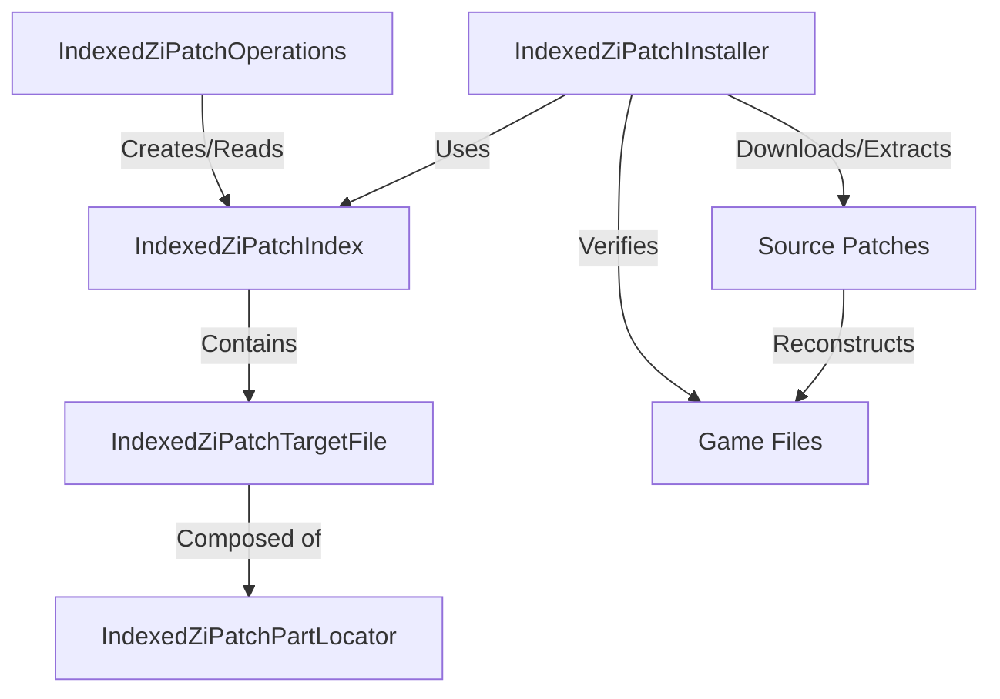
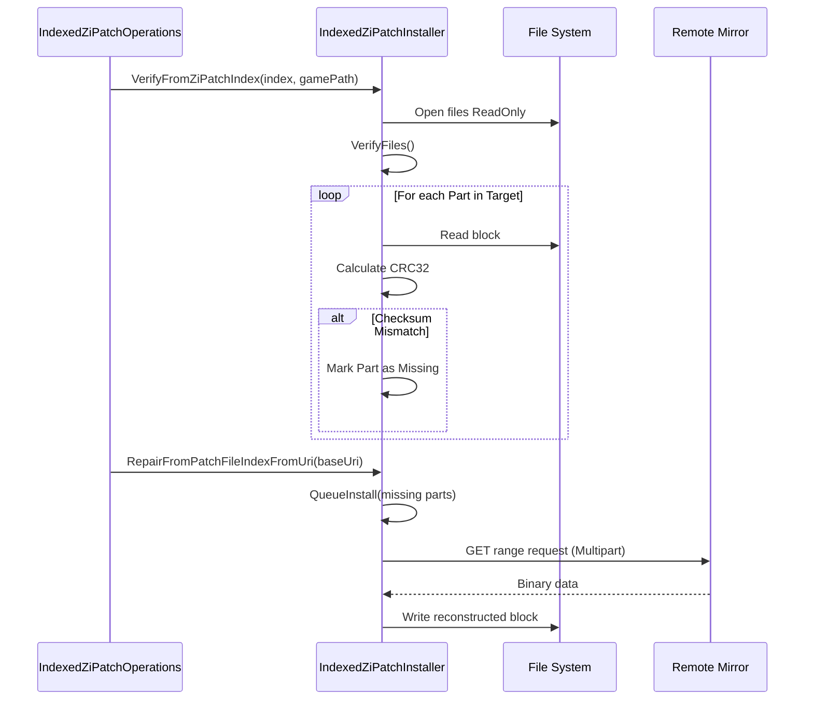

<details>
<summary>Relevant source files</summary>

The following files were used as context for generating this wiki page:

- [LibDalamud/Patching/IndexedZiPatch/IndexedZiPatchInstaller.cs](LibDalamud/Patching/IndexedZiPatch/IndexedZiPatchInstaller.cs)
- [LibDalamud/Patching/IndexedZiPatch/IndexedZiPatchIndex.cs](LibDalamud/Patching/IndexedZiPatch/IndexedZiPatchIndex.cs)
- [LibDalamud/Patching/IndexedZiPatch/IndexedZiPatchOperations.cs](LibDalamud/Patching/IndexedZiPatch/IndexedZiPatchOperations.cs)
- [LibDalamud/Patching/IndexedZiPatch/IndexedZiPatchPartLocator.cs](LibDalamud/Patching/IndexedZiPatch/IndexedZiPatchPartLocator.cs)
- [LibDalamud/Patching/IndexedZiPatch/IndexedZiPatchTargetFile.cs](LibDalamud/Patching/IndexedZiPatch/IndexedZiPatchTargetFile.cs)
- [LibDalamud/Patching/IndexedZiPatch/IIndexedZiPatchIndexInstaller.cs](LibDalamud/Patching/IndexedZiPatch/IIndexedZiPatchIndexInstaller.cs)
- [LibDalamud/Patching/IndexedZiPatch/IndexedZiPatchIndexRemoteInstaller.cs](LibDalamud/Patching/IndexedZiPatch/IndexedZiPatchIndexRemoteInstaller.cs)
</details>

# Indexed ZiPatch System

The **Indexed ZiPatch System** manages the mapping, verification, and installation of game data patches. It converts standard ZiPatch files into an indexed format that allows for granular file reconstruction and verification without requiring the full application of monolithic patch files.

This system provides a mechanism to identify specific "parts" of a target file and locate their corresponding source data within one or more patch files. It supports local installation and remote installation via an IPC-based worker process.

Sources: [LibDalamud/Patching/IndexedZiPatch/IndexedZiPatchIndex.cs](LibDalamud/Patching/IndexedZiPatch/IndexedZiPatchIndex.cs), [LibDalamud/Patching/IndexedZiPatch/IndexedZiPatchOperations.cs](LibDalamud/Patching/IndexedZiPatch/IndexedZiPatchOperations.cs)

## System Architecture

The system uses an index-driven approach where target files are represented as collections of `IndexedZiPatchPartLocator` objects.



The architecture separates the logical mapping of files (Index) from the physical application of data (Installer).

Sources: [LibDalamud/Patching/IndexedZiPatch/IndexedZiPatchIndex.cs:15-30](LibDalamud/Patching/IndexedZiPatch/IndexedZiPatchIndex.cs#L15-L30), [LibDalamud/Patching/IndexedZiPatch/IndexedZiPatchInstaller.cs:22-35](LibDalamud/Patching/IndexedZiPatch/IndexedZiPatchInstaller.cs#L22-L35)

## Core Components

### IndexedZiPatchIndex
The `IndexedZiPatchIndex` class represents the state of the game files after applying a specific sequence of patches. It tracks expansion versions, source patch files, and target file definitions.

*  **ExpacVersion**: Defines the expansion (e.g., Boot, Base Game, or Ex1-Ex4).
*  **Sources**: A list of patch filenames that contribute data to the index.
*  **Targets**: A list of `IndexedZiPatchTargetFile` objects representing the actual files in the game directory.

Sources: [LibDalamud/Patching/IndexedZiPatch/IndexedZiPatchIndex.cs:17-45](LibDalamud/Patching/IndexedZiPatch/IndexedZiPatchIndex.cs#L17-L45)

### IndexedZiPatchPartLocator
This structure is the fundamental unit of the system. It maps a specific range of a target file to its source data.

| Field | Type | Description |
| :--- | :--- | :--- |
| `TargetOffset` | `long` | Offset within the destination game file. |
| `TargetSize` | `long` | Size of the data block. |
| `SourceIndex` | `int` | Index of the source patch file in the `Sources` list. |
| `SourceOffset` | `long` | Offset within the source patch file. |
| `IsDeflatedBlockData`| `bool` | Indicates if the source data is Zlib compressed. |
| `IsValidCrc32Value` | `bool` | Indicates if the `Crc32` field contains a valid checksum. |

Sources: [LibDalamud/Patching/IndexedZiPatch/IndexedZiPatchPartLocator.cs:16-85](LibDalamud/Patching/IndexedZiPatch/IndexedZiPatchPartLocator.cs#L16-L85)

### IndexedZiPatchInstaller
The installer coordinates the verification and repair process. It supports multi-threaded verification and installation.

1.  **Verification**: Compares local file data against the Index's CRC32 values.
2.  **Queueing**: Identifies missing or corrupt parts and groups them by source patch.
3.  **Installation**: Retrieves data from local patch files or remote HTTP mirrors and writes it to the target files.

Sources: [LibDalamud/Patching/IndexedZiPatch/IndexedZiPatchInstaller.cs:180-265](LibDalamud/Patching/IndexedZiPatch/IndexedZiPatchInstaller.cs#L180-L265)

## Data Flow: Verification and Repair

The following sequence diagram illustrates the process of verifying game files and repairing corruption using the indexed system.



Sources: [LibDalamud/Patching/IndexedZiPatch/IndexedZiPatchOperations.cs:72-110](LibDalamud/Patching/IndexedZiPatch/IndexedZiPatchOperations.cs#L72-L110), [LibDalamud/Patching/IndexedZiPatch/IndexedZiPatchInstaller.cs:510-580](LibDalamud/Patching/IndexedZiPatch/IndexedZiPatchInstaller.cs#L510-L580)

## Special Source Indices
The system uses reserved `SourceIndex` values for data that does not come from a patch file:

*  **SOURCE_INDEX_ZEROS (255)**: The block should be filled with null bytes (0x00).
*  **SOURCE_INDEX_EMPTY_BLOCK (254)**: Represents a specific placeholder entry data unit used in SqPack structures.
*  **SOURCE_INDEX_UNAVAILABLE (253)**: Data that cannot be reconstructed.

Sources: [LibDalamud/Patching/IndexedZiPatch/IndexedZiPatchPartLocator.cs:13-16](LibDalamud/Patching/IndexedZiPatch/IndexedZiPatchPartLocator.cs#L13-L16)

## Remote Installation (IPC)
The `IndexedZiPatchIndexRemoteInstaller` implements `IIndexedZiPatchIndexInstaller` to perform patching in a separate process. This is often used to gain administrative privileges via a UAC prompt without elevating the main application.

*  **RpcBuffer**: Uses shared memory for inter-process communication.
*  **WorkerSubprocessBody**: A listener in the worker process that executes commands like `VerifyFiles`, `QueueInstall`, and `Install`.
*  **WorkerInboundOpcode**: Defines commands sent to the worker (e.g., `Construct`, `VerifyFiles`, `Install`).

Sources: [LibDalamud/Patching/IndexedZiPatch/IndexedZiPatchIndexRemoteInstaller.cs:18-60](LibDalamud/Patching/IndexedZiPatch/IndexedZiPatchIndexRemoteInstaller.cs#L18-L60), [LibDalamud/Patching/IndexedZiPatch/IndexedZiPatchIndexRemoteInstaller.cs:255-330](LibDalamud/Patching/IndexedZiPatch/IndexedZiPatchIndexRemoteInstaller.cs#L255-L330)

## Implementation Details

### File Splitting
When a new patch updates only a portion of an existing block, the `IndexedZiPatchTargetFile` performs a `SplitAt` operation. This ensures that the internal `underlying` list of part locators remains sorted and contiguous.

```csharp
public void SplitAt(long offset, int targetFileIndex)
{
    var i = BinarySearchByTargetOffset(offset);
    if (i >= 0) return; // Already split

    i = ~i;
    // ... logic to split existing part into two new parts ...
}
```

Sources: [LibDalamud/Patching/IndexedZiPatch/IndexedZiPatchTargetFile.cs:81-140](LibDalamud/Patching/IndexedZiPatch/IndexedZiPatchTargetFile.cs#L81-L140)

### Reconstruction
The `Reconstruct` method in `IndexedZiPatchPartLocator` handles the retrieval of data. If `IsDeflatedBlockData` is true, it wraps the source stream in a `DeflateStream` before copying the data to the target buffer.

Sources: [LibDalamud/Patching/IndexedZiPatch/IndexedZiPatchPartLocator.cs:250-280](LibDalamud/Patching/IndexedZiPatch/IndexedZiPatchPartLocator.cs#L250-L280)

## Conclusion
The Indexed ZiPatch System optimizes game patching by treating files as collections of addressable parts. By maintaining an index of these parts, the system enables efficient repair of specific corruptions and allows for resuming interrupted updates by only downloading the necessary missing segments.
