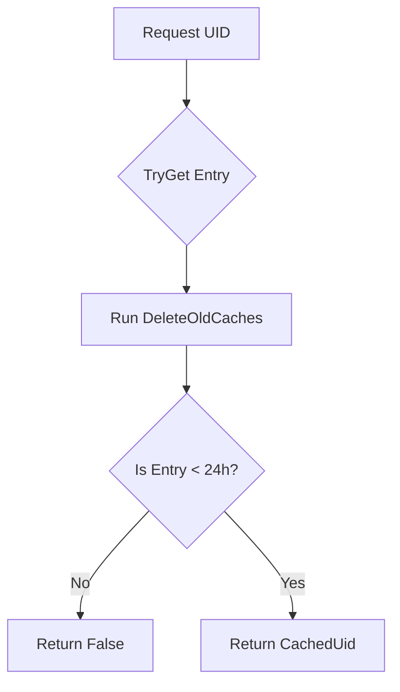
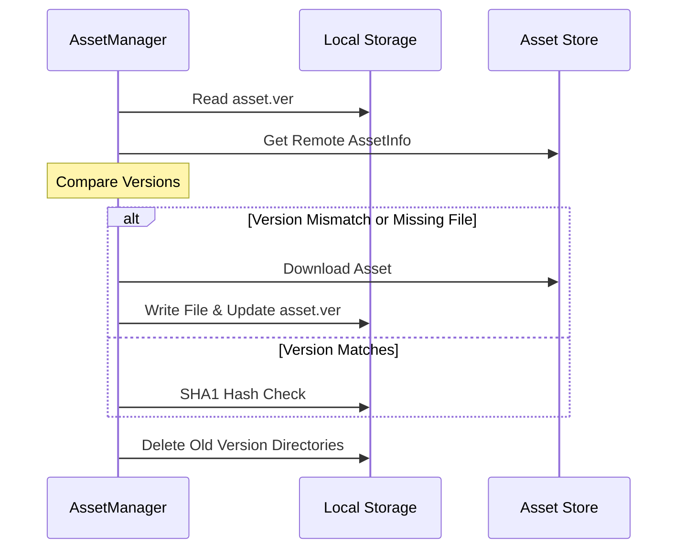

Relevant source files

The following files were used as context for generating this wiki page:

- [CoreLibLaunchSupport/cache.cs](CoreLibLaunchSupport/cache.cs)
- [LibDalamud/Dalamud/AssetManager.cs](LibDalamud/Dalamud/AssetManager.cs)
- [LibDalamud/Dalamud/DalamudUpdater.cs](LibDalamud/Dalamud/DalamudUpdater.cs)
- [LibDalamud/Patching/IndexedZiPatch/IndexedZiPatchIndex.cs](LibDalamud/Patching/IndexedZiPatch/IndexedZiPatchIndex.cs)
- [LaunchApp/wwwroot/service-worker.published.js](LaunchApp/wwwroot/service-worker.published.js)

# Data Caching Engine

The Data Caching Engine manages the persistence, retrieval, and validation of local data within the WebLaunch ecosystem. It handles multiple layers of storage including user session identifiers, game assets, patch indexes, and web application resources to ensure efficient operation and offline availability.

Sources: [CoreLibLaunchSupport/cache.cs](CoreLibLaunchSupport/cache.cs), [LibDalamud/Dalamud/AssetManager.cs](LibDalamud/Dalamud/AssetManager.cs), [LaunchApp/wwwroot/service-worker.published.js](LaunchApp/wwwroot/service-worker.published.js)

## Architecture Overview

The caching engine operates across three distinct domains:

1.  **Unique Identifier Cache**: Manages short-term storage of user session data to facilitate auto-login and session persistence.
2.  **Asset and Patch Caching**: Handles large-scale binary data, versioning, and integrity verification for game-related files.
3.  **Service Worker Cache**: Provides offline support for the web-based launcher interface by intercepting network requests.

Sources: [CoreLibLaunchSupport/cache.cs:81-83](CoreLibLaunchSupport/cache.cs#L81-L83), [LibDalamud/Dalamud/AssetManager.cs:17-21](LibDalamud/Dalamud/AssetManager.cs#L17-L21), [LaunchApp/wwwroot/service-worker.published.js:10-12](LaunchApp/wwwroot/service-worker.published.js#L10-L12)

## Unique ID Caching

The `CommonUniqueIdCache` class implements the `IUniqueIdCache` interface to store `UniqueIdCacheEntry` objects. This system utilizes JSON serialization for disk persistence and enforces a strictly timed expiration policy.

### Data Model and Persistence
The cache stores user-specific launch context including region and expansion levels.

| Field | Type | Description |
| :--- | :--- | :--- |
| `UserName` | string | The account name associated with the entry. |
| `UniqueId` | string | The unique session identifier. |
| `Region` | int | The game region code. |
| `ExpansionLevel` | int | The maximum entitlement level for the account. |
| `CreationDate` | DateTime | Timestamp used for expiration logic. |

Sources: [CoreLibLaunchSupport/cache.cs:157-165](CoreLibLaunchSupport/cache.cs#L157-L165)

### Expiration Logic
The engine invalidates entries older than 24 hours. The `DeleteOldCaches` method removes expired entries during retrieval attempts.

The diagram shows the validation sequence performed during a cache retrieval request.
Sources: [CoreLibLaunchSupport/cache.cs:83-145](CoreLibLaunchSupport/cache.cs#L83-L145)

## Asset Caching and Versioning

The `AssetManager` provides a structured approach to downloading and validating game assets. It compares local versions against a remote manifest and uses SHA1 hashing to verify data integrity.

### Asset Refresh Workflow
1.  **Version Check**: Reads `asset.ver` to determine the local version.
2.  **Manifest Retrieval**: Fetches current asset metadata from the remote store.
3.  **Hash Verification**: Validates existing files using SHA1.
4.  **Delta Download**: Downloads missing or mismatched assets.
5.  **Cleanup**: Removes assets from the previous version.

This diagram illustrates the synchronization process between the local asset cache and the remote repository.
Sources: [LibDalamud/Dalamud/AssetManager.cs:40-108](LibDalamud/Dalamud/AssetManager.cs#L40-L108), [LibDalamud/Dalamud/AssetManager.cs:146-163](LibDalamud/Dalamud/AssetManager.cs#L146-L163)

## Patch Index Caching

The `IndexedZiPatchIndex` manages a specialized cache for patching operations. It stores mapping between source patch files and target game files, allowing the engine to locate data offsets without re-parsing entire patch archives.

### Index Components
-  **Source Files**: A list of patch file names used as data sources.
-  **Source File Last Pointer**: Tracking for data boundaries within sources.
-  **Target Files**: Definitions of game files and their constituent parts.
-  **Source Parts Cache**: An optimized lookup table for finding which target files depend on specific source indexes.

Sources: [LibDalamud/Patching/IndexedZiPatch/IndexedZiPatchIndex.cs:20-27](LibDalamud/Patching/IndexedZiPatch/IndexedZiPatchIndex.cs#L20-L27), [LibDalamud/Patching/IndexedZiPatch/IndexedZiPatchIndex.cs:55-71](LibDalamud/Patching/IndexedZiPatch/IndexedZiPatchIndex.cs#L55-L71)

## Web Resource Caching

The Service Worker implementation manages a browser-level cache named `offline-cache-[version]`. It specifically targets static assets required to run the launcher application in a disconnected state.

### Inclusion Criteria
The cache engine includes files matching these extensions:
-  Binaries: `.dll`, `.pdb`, `.wasm`, `.blat`, `.dat`
-  Web Assets: `.html`, `.js`, `.json`, `.css`
-  Media: `.png`, `.jpg`, `.gif`, `.ico`, `.woff`

Sources: [LaunchApp/wwwroot/service-worker.published.js:12](LaunchApp/wwwroot/service-worker.published.js#L12)

### Fetch Strategy
The engine employs a "Cache First" strategy for navigation requests, attempting to serve `index.html` from the cache before falling back to the network.

Sources: [LaunchApp/wwwroot/service-worker.published.js:37-48](LaunchApp/wwwroot/service-worker.published.js#L37-L48)

## Storage Management

The `Storage` class abstracts the physical file system paths based on the operating system.

-  **Windows**: Uses `%AppData%/[AppName]`.
-  **Non-Windows**: Uses `~/. [AppName]`.

It provides utility methods `GetFile` and `GetFolder` to ensure directory structures exist before the caching engine attempts I/O operations.

Sources: [CoreLibLaunchSupport/cache.cs:41-76](CoreLibLaunchSupport/cache.cs#L41-L76)

## Summary
The Data Caching Engine provides a multi-tier storage solution. It ensures high performance by caching session tokens in the `CommonUniqueIdCache`, maintains game stability through versioned assets in the `AssetManager`, and facilitates reliable web access via the Service Worker. Integrity is maintained throughout via MD5/SHA1 hashing and strict versioning protocols.
