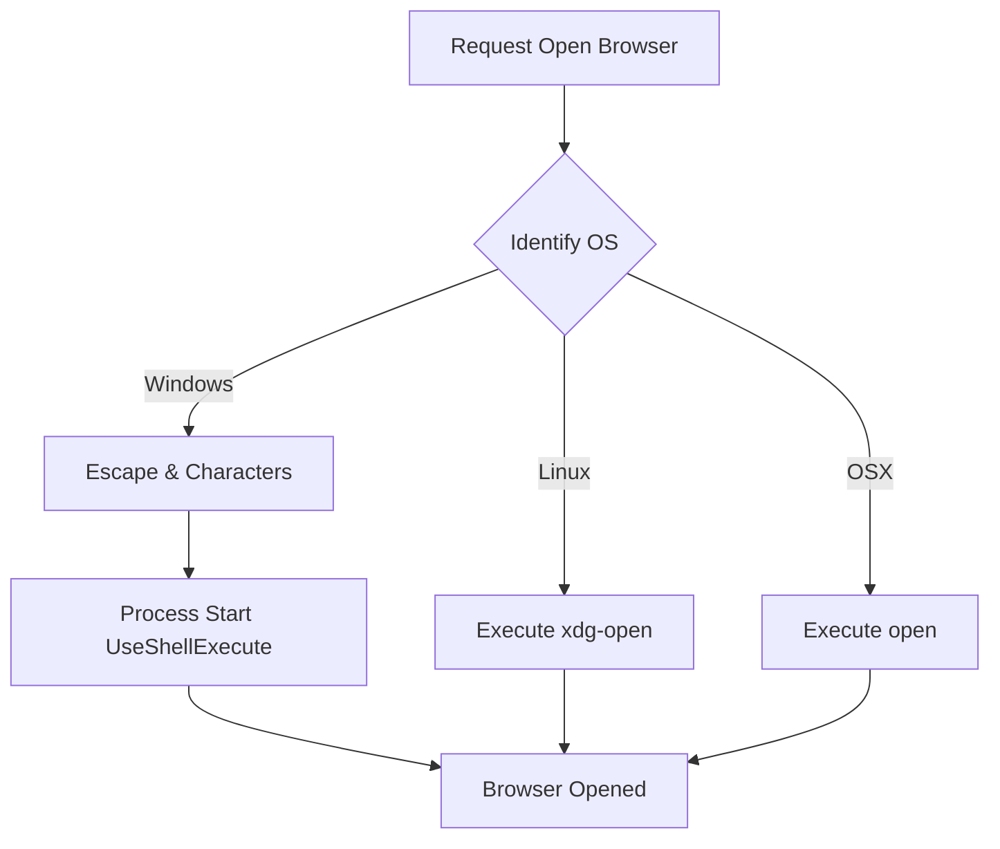
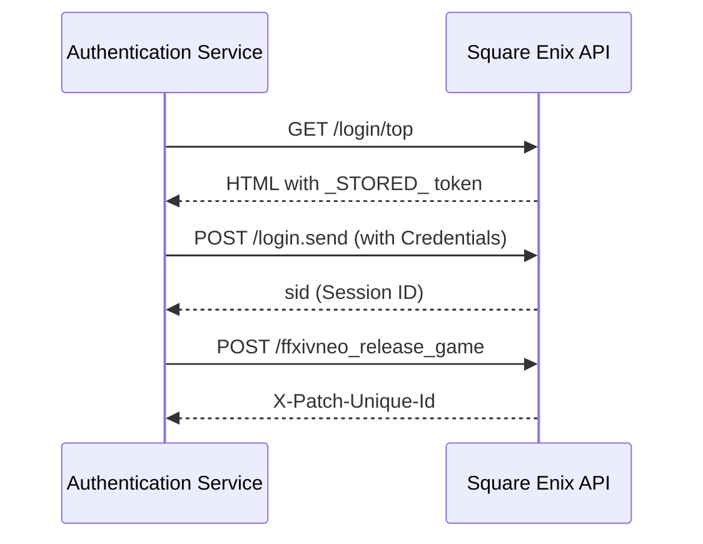

Relevant source files

The following files were used as context for generating this wiki page:

- [LibDalamud/Util/ApiHelpers.cs](LibDalamud/Util/ApiHelpers.cs)
- [LibDalamud/Util/PlatformHelpers.cs](LibDalamud/Util/PlatformHelpers.cs)
- [LibDalamud/Dalamud/DalamudUpdater.cs](LibDalamud/Dalamud/DalamudUpdater.cs)
- [LibDalamud/Dalamud/AssetManager.cs](LibDalamud/Dalamud/AssetManager.cs)
- [CoreLibLaunchSupport/Class1.cs](CoreLibLaunchSupport/Class1.cs)

# Utility and Network Helpers

Utility and Network Helpers provide fundamental support functions for cross-platform operations, web communication, and data formatting. These components abstract operating system differences and standardize how the application interacts with remote APIs and local hardware resources.

The system facilitates secure game authentication, automated asset downloads, and platform-specific tasks like process elevation and disk space monitoring. Centralized helpers ensure consistent behavior across Windows, Linux, and macOS environments while managing shared network resources.

## Network and API Helpers

The project uses specialized classes to manage web requests and format API-related data. These helpers standardize HTTP headers, manage client lifecycles, and provide time-based calculations.

### Shared HTTP Client Management
The `SharedHttpClientProvider` manages a single `HttpClient` instance to prevent socket exhaustion. It configures automatic decompression for GZip and Deflate streams. If required, it disables server certificate validation for specific environments.

Sources: [CoreLibLaunchSupport/Class1.cs:644-688](CoreLibLaunchSupport/Class1.cs#L644-L688)

### API Data Formatting
The `ApiHelpers` class provides static methods for common data operations. It converts byte counts into human-readable strings like "KB" or "MB" and generates Unix timestamps in milliseconds. It also assists in generating randomized `Accept-Language` headers to mimic standard browser behavior.

Sources: [LibDalamud/Util/ApiHelpers.cs:7-58](LibDalamud/Util/ApiHelpers.cs#L7-L58)

### World Status and Authentication
The `WorldStatusService` and `FfxivAuthenticationService` utilize shared network logic to verify game server availability and user credentials. The authentication service manages the multi-step login flow, including fetching stored tokens and requesting session identifiers.

Sources: [CoreLibLaunchSupport/Class1.cs:749-866](CoreLibLaunchSupport/Class1.cs#L749-L866)

## Platform and System Helpers

The `PlatformHelpers` class handles tasks that depend on the host operating system. This ensures the application functions correctly regardless of the underlying platform.

### OS Detection and Execution
The utility identifies if the application runs on Win32, Mac, or Win32-on-Linux. It provides a standardized method to open the default system browser and execute shell commands like `tar` for file extraction.

Sources: [LibDalamud/Util/PlatformHelpers.cs:11-73](LibDalamud/Util/PlatformHelpers.cs#L11-L73)

### Resource Monitoring
The system monitors local environment state through several checks:
*  **Elevation**: Detects if the current process has Administrator or Root privileges.
*  **Port Discovery**: Locates an available TCP port by binding a temporary socket to port 0.
*  **Disk Space**: Calculates available free space using `DriveInfo` or direct kernel calls on Wine environments.

Sources: [LibDalamud/Util/PlatformHelpers.cs:75-126](LibDalamud/Util/PlatformHelpers.cs#L75-L126)

## Update and Asset Utilities

The application utilizes network helpers to perform background maintenance and integrity verification.

### Progress-Aware Downloads
The `DalamudUpdater` executes file downloads through an `HttpClientDownloadWithProgress` implementation. This allows the UI to report real-time data regarding download size and percentage to the user.

Sources: [LibDalamud/Dalamud/DalamudUpdater.cs:407-418](LibDalamud/Dalamud/DalamudUpdater.cs#L407-L418)

### Asset Integrity and Synchronization
The `AssetManager` compares local asset versions against a remote metadata store. If a refresh is needed, it downloads missing or corrupted files. It verifies file integrity using SHA1 hashes before finalizing the update.

Sources: [LibDalamud/Dalamud/AssetManager.cs:47-105](LibDalamud/Dalamud/AssetManager.cs#L47-L105)

## Technical Summaries

### Data Conversion Reference
| Method | Input | Output | Purpose |
| :--- | :--- | :--- | :--- |
| `GetUnixMillis` | N/A | `long` | Retrieves current UTC Unix time. |
| `BytesToString` | `long` byteCount | `string` | Formats size (e.g., "1.5GB"). |
| `GetAvailablePort` | N/A | `int` | Finds a free TCP port. |
| `GetTempFileName` | N/A | `string` | Generates a unique path. |

Sources: [LibDalamud/Util/ApiHelpers.cs:9-25](LibDalamud/Util/ApiHelpers.cs#L9-L25), [LibDalamud/Util/PlatformHelpers.cs:28-87](LibDalamud/Util/PlatformHelpers.cs#L28-L87)

### Platform Operation Flow
The following diagram illustrates how the system handles cross-platform browser requests.

The diagram shows the logic used to abstract browser execution across different operating systems.
Sources: [LibDalamud/Util/PlatformHelpers.cs:34-54](LibDalamud/Util/PlatformHelpers.cs#L34-L54)

### Network Communication Sequence
The sequence below details how the `FfxivAuthenticationService` interacts with remote endpoints.

This sequence represents the multi-stage network handshake required to acquire a unique session identifier.
Sources: [CoreLibLaunchSupport/Class1.cs:758-825](CoreLibLaunchSupport/Class1.cs#L758-L825)

### Conclusion
Utility and Network Helpers serve as the backbone for environment abstraction and remote communication. By centralizing operations like OS detection, hash calculation, and HTTP client management, the project maintains high reliability and cross-platform compatibility. These helpers allow higher-level modules to focus on game management without concern for low-level system differences.
