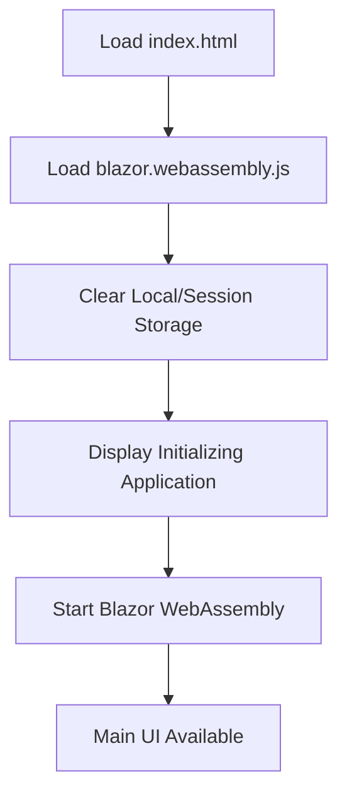
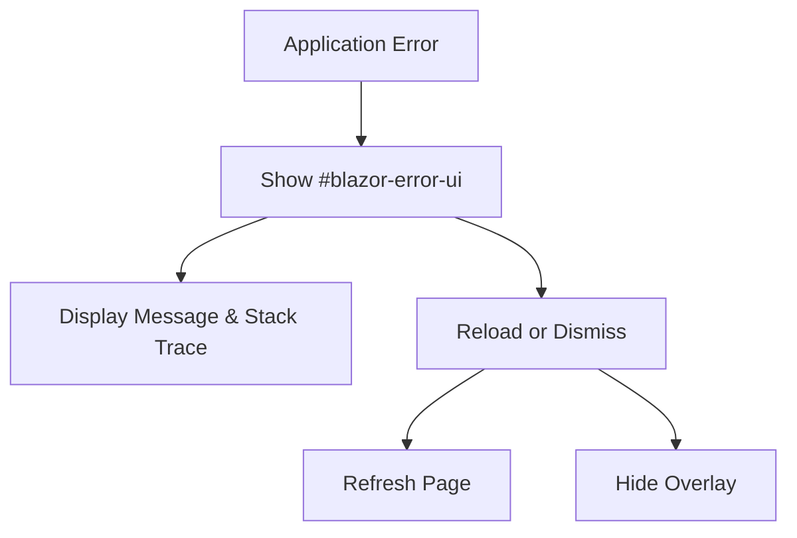
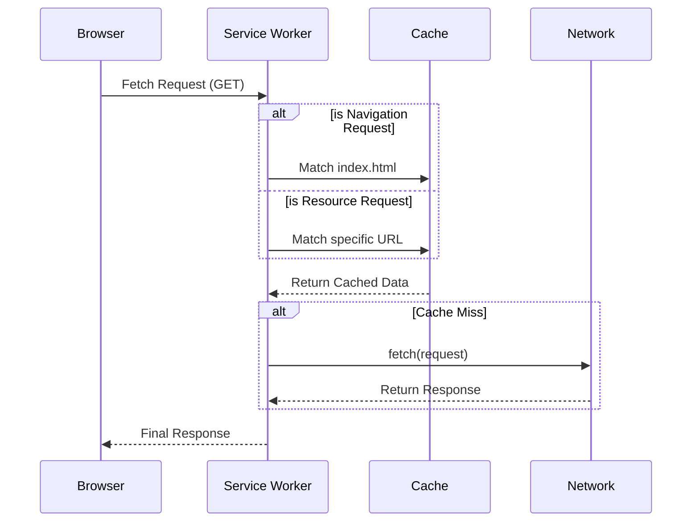

Relevant source files

The following files were used as context for generating this wiki page:

- [LaunchApp/wwwroot/index.html](LaunchApp/wwwroot/index.html)
- [LaunchApp/wwwroot/css/site.css](LaunchApp/wwwroot/css/site.css)
- [LaunchApp/wwwroot/css/app.css](LaunchApp/wwwroot/css/app.css)
- [LaunchApp/wwwroot/css/theme.css](LaunchApp/wwwroot/css/theme.css)
- [LaunchApp/wwwroot/service-worker.published.js](LaunchApp/wwwroot/service-worker.published.js)
- [LaunchApp/tailwind.config.js](LaunchApp/tailwind.config.js)

# Blazor Web Interface

The Blazor Web Interface provides a web-based portal for the Game Launcher application. It manages the user experience for launching games, monitoring progress, and configuring application themes. The interface operates as a Blazor WebAssembly application, utilizing modern web technologies and frameworks to provide a responsive environment.

Sources: [LaunchApp/wwwroot/index.html:10](LaunchApp/wwwroot/index.html#L10), [LaunchApp/wwwroot/service-worker.published.js:14](LaunchApp/wwwroot/service-worker.published.js#L14)

## Frontend Architecture

The frontend uses Blazor WebAssembly to execute C# code in the browser. It integrates multiple CSS frameworks and JavaScript libraries to handle UI components and interactions.

### UI Frameworks and Libraries
The interface includes several external and internal styling resources:
*  **Masa Blazor**: Provides Material Design components.
*  **LumexUI**: Used for theme-specific UI elements and layout.
*  **Bootstrap**: Provides a base for responsive grid layouts.
*  **Tailwind CSS**: Manages utility-first styling and theme extensions.

Sources: [LaunchApp/wwwroot/index.html:14-22](LaunchApp/wwwroot/index.html#L14-L22), [LaunchApp/tailwind.config.js:1-15](LaunchApp/tailwind.config.js#L1-L15)

### Application Bootstrapping
The application starts by initializing the Blazor runtime. While the application loads, it displays an initialization screen with a circular progress indicator.

The bootstrapping process also includes cache management, where existing local storage, session storage, and caches are cleared on load to ensure a fresh state.
Sources: [LaunchApp/wwwroot/index.html:27-32](LaunchApp/wwwroot/index.html#L27-L32), [LaunchApp/wwwroot/index.html:61-75](LaunchApp/wwwroot/index.html#L61-L75)

## Theme and Visual Style

The interface supports dynamic switching between light and dark modes. It uses CSS variables and data attributes on the HTML body to apply theme-specific colors and styles.

### Theme Management Logic
The application detects the user's system color scheme preference using `matchMedia`. It provides a `switchTheme` function to toggle attributes and classes.

| Feature | Implementation Detail |
| :--- | :--- |
| **Dark Theme Class** | `m-application--dark` |
| **Light Theme Class** | `m-application--light` |
| **Attribute** | `data-theme` (set to "dark" or "light") |
| **Detection** | `window.matchMedia('(prefers-color-scheme: dark)')` |

Sources: [LaunchApp/wwwroot/index.html:84-98](LaunchApp/wwwroot/index.html#L84-L98), [LaunchApp/wwwroot/css/site.css:16-21](LaunchApp/wwwroot/css/site.css#L16-L21)

### Layout Components
The layout is structured with a sticky navigation bar and a centered content container.

*  **App Bar**: A sticky header with a height of 64px. It contains branding, navigation items, and theme controls.
*  **Content Container**: A responsive container with a maximum width defined by `--content-max-width`.
*  **Navigation Items**: Interactive elements that change color and background on hover.

Sources: [LaunchApp/wwwroot/css/theme.css:26-40](LaunchApp/wwwroot/css/theme.css#L26-L40), [LaunchApp/wwwroot/css/site.css:76-81](LaunchApp/wwwroot/css/site.css#L76-L81)

## Error Handling and Feedback

The interface includes specialized UI components for error reporting and background task feedback.

### Error UI
A fixed overlay (`#blazor-error-ui`) appears at the bottom of the screen when a runtime error occurs. It displays the error title, message, stack trace, and relevant components.

Sources: [LaunchApp/wwwroot/index.html:35-45](LaunchApp/wwwroot/index.html#L35-L45), [LaunchApp/wwwroot/css/site.css:84-102](LaunchApp/wwwroot/css/site.css#L84-L102)

### Loading Indicators
Progress bars and circular indicators provide feedback during long-running operations. The styling uses CSS variables such as `--blazor-load-percentage` to update the visual fill of the progress circles dynamically.
Sources: [LaunchApp/wwwroot/css/site.css:110-128](LaunchApp/wwwroot/css/site.css#L110-L128)

## Service Worker and Offline Support

The interface utilizes a service worker to cache assets and enable offline capabilities.

### Asset Caching
The service worker identifies and caches specific file types including `.dll`, `.wasm`, `.html`, `.js`, `.json`, and `.css`. It excludes the service worker itself and route configurations to prevent update loops.

### Fetch Strategy
The service worker intercepts network requests to serve cached assets when available. For navigation requests, it defaults to serving `index.html` to support Single Page Application (SPA) routing.

Sources: [LaunchApp/wwwroot/service-worker.published.js:14-27](LaunchApp/wwwroot/service-worker.published.js#L14-L27), [LaunchApp/wwwroot/service-worker.published.js:38-54](LaunchApp/wwwroot/service-worker.published.js#L38-L54)

## Summary

The Blazor Web Interface serves as the primary user interaction layer for the Game Launcher. It integrates multiple UI frameworks, manages visual themes through JavaScript and CSS variables, and ensures reliability through a service worker-based caching strategy. The architecture supports modern web standards and provides detailed error reporting and progress feedback to the user.
