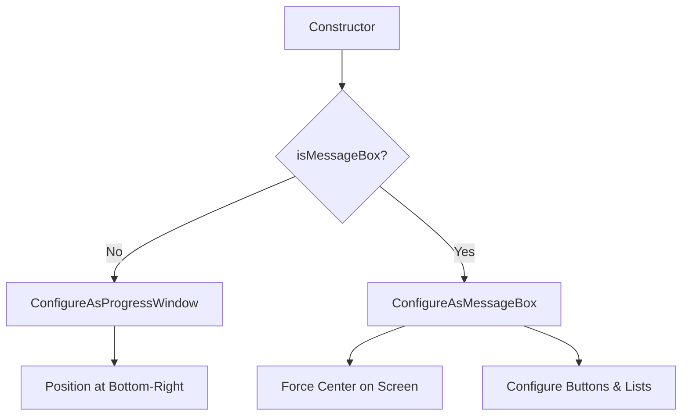
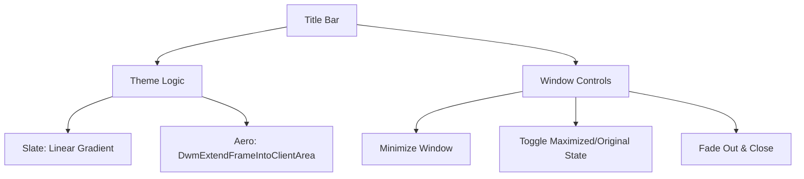

Relevant source files

The following files were used as context for generating this wiki page:

- [SpinningWheelLib/CircularProgressBar.xaml.cs](SpinningWheelLib/CircularProgressBar.xaml.cs)
- [SpinningWheelLib/RibbonControl.xaml.cs](SpinningWheelLib/RibbonControl.xaml.cs)
- [SpinningWheelLib/CustomLonghornTitleBar.xaml.cs](SpinningWheelLib/CustomLonghornTitleBar.xaml.cs)
- [SpinningWheelLib/Window1.xaml.cs](SpinningWheelLib/Window1.xaml.cs)
- [SpinningWheelLib/SettingsWindow.xaml.cs](SpinningWheelLib/SettingsWindow.xaml.cs)

# WPF Controls Library

The WPF Controls Library provides a set of custom user interface components used to build the launcher's desktop experience. It includes specialized windows for progress tracking and messaging, as well as stylized controls that emulate legacy and modern Windows aesthetics.

This library handles the visual representation of game updates, application settings, and system notifications. It manages window positioning, custom title bar logic, and specialized progress animations to provide feedback during long-running operations.

Sources: [SpinningWheelLib/Window1.xaml.cs](SpinningWheelLib/Window1.xaml.cs), [SpinningWheelLib/SettingsWindow.xaml.cs](SpinningWheelLib/SettingsWindow.xaml.cs)

## Specialized Windows

### Window1 (Progress and Message Window)
The `Window1` class is a versatile component that functions as either a background progress tracker or a standard modal message box. It supports console output redirection, allowing real-time logs to be displayed within the UI.

The window adjusts its layout based on the `_isMessageBox` flag. When configured as a progress window, it docks to the bottom-right of the work area. When configured as a message box, it centers on the screen and displays standard buttons, icons, and list items.

The following table describes the configuration options for `Window1`:

| Parameter | Type | Description |
| :--- | :--- | :--- |
| estimatedDurationInSeconds | double | The time used to calculate progress percentage. |
| isMessageBox | bool | Determines if the window acts as a message box or progress tracker. |
| customLabel | string | The primary text displayed in the window. |
| listItems | List&lt;string&gt; | Optional collection of items to display in a list view. |
| autoCloseSeconds | int? | Optional delay before the window automatically closes. |

Sources: [SpinningWheelLib/Window1.xaml.cs:115-155](SpinningWheelLib/Window1.xaml.cs#L115-L155), [SpinningWheelLib/Window1.xaml.cs:202-235](SpinningWheelLib/Window1.xaml.cs#L202-L235)

### SettingsWindow
The `SettingsWindow` provides the user interface for application configuration. It detects the operating system version to apply theme-specific resources, such as Fluent design dictionaries for Windows 11.

Sources: [SpinningWheelLib/SettingsWindow.xaml.cs:21-39](SpinningWheelLib/SettingsWindow.xaml.cs#L21-L39)

## Custom UI Components

### CustomLonghornTitleBar
The `CustomLonghornTitleBar` is a `UserControl` that replaces standard window chrome. It implements logic for Aero glass effects and Slate themes using Desktop Window Manager (DWM) interop.

Key capabilities include:
*  **Theme Support**: Toggles between Slate gradients and Aero blur-behind effects.
*  **Window Controls**: Custom implementations for Minimize, Maximize, and Close with opacity animations.
*  **Interaction**: Handles window dragging via `DragMove()` on left button down.

Sources: [SpinningWheelLib/CustomLonghornTitleBar.xaml.cs:14-60](SpinningWheelLib/CustomLonghornTitleBar.xaml.cs#L14-L60), [SpinningWheelLib/CustomLonghornTitleBar.xaml.cs:285-350](SpinningWheelLib/CustomLonghornTitleBar.xaml.cs#L285-L350)

### CircularProgressBar
The `CircularProgressBar` visualizes task completion using a ring of markers. It supports a "Marquee" mode for indeterminate progress, which animates blocks across the control width.

The control uses `TotalMarks` (120) to draw individual lines in a circle. It updates line opacity using a `DoubleAnimation` to fill the ring based on the `Progress` property.

Sources: [SpinningWheelLib/CircularProgressBar.xaml.cs:13-30](SpinningWheelLib/CircularProgressBar.xaml.cs#L13-L30), [SpinningWheelLib/CircularProgressBar.xaml.cs:140-195](SpinningWheelLib/CircularProgressBar.xaml.cs#L140-L195)

### RibbonControl
The `RibbonControl` provides a tabbed interface often placed within the `CustomLonghornTitleBar`. It features a folding mechanism that animates the control height between collapsed (74px) and expanded (180px) states.

The control utilizes a `RibbonStateStorage` class to persist the folded state and height across sessions.

Sources: [SpinningWheelLib/RibbonControl.xaml.cs:147-190](SpinningWheelLib/RibbonControl.xaml.cs#L147-L190), [SpinningWheelLib/RibbonControl.xaml.cs:238-265](SpinningWheelLib/RibbonControl.xaml.cs#L238-L265)

## Layout and Redirection Utilities

### Value Converters
The library includes `HeightConverter` and `WidthConverter` to dynamically position windows relative to the system work area. These are primarily used to ensure progress windows do not overlap taskbars or system elements.

Sources: [SpinningWheelLib/Window1.xaml.cs:25-50](SpinningWheelLib/Window1.xaml.cs#L25-L50)

### Console Redirection
The `ConsoleOutputRedirector` (derived from `TextWriter`) captures standard console output and writes it to a `FlowDocument` within the UI. This allows developers to see internal engine logs directly in the launcher window. The `MultiWriter` class allows output to be mirrored to multiple destinations simultaneously, such as the original console and a log file.

Sources: [SpinningWheelLib/Window1.xaml.cs:52-95](SpinningWheelLib/Window1.xaml.cs#L52-L95)

## Conclusion
The WPF Controls Library provides the architectural foundation for the WebLaunch user interface. By combining custom DWM-based themes with specialized windows and redirected logging, it ensures a consistent and informative user experience during the game launching process.
