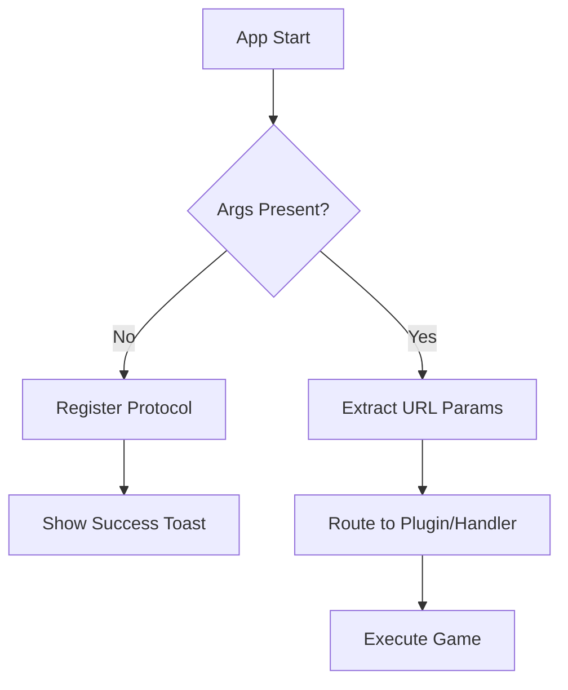
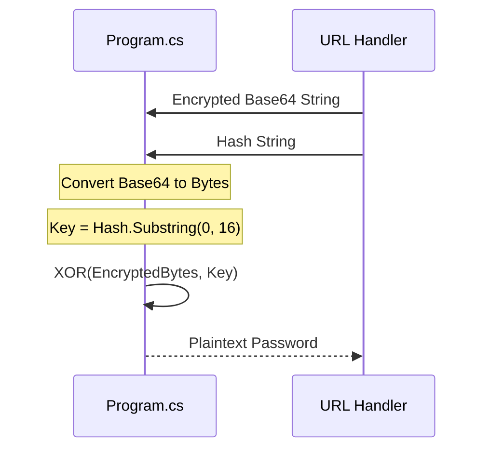

Relevant source files

The following files were used as context for generating this wiki page:

- [handlerlaunch/Program.cs](handlerlaunch/Program.cs)
- [handlerlaunch/SupportObjects.cs](handlerlaunch/SupportObjects.cs)
- [CoreLibLaunchSupport/Class1.cs](CoreLibLaunchSupport/Class1.cs)
- [SpinningWheelLib/Window1.xaml.cs](SpinningWheelLib/Window1.xaml.cs)
- [LibDalamud/Game/Launcher.cs](LibDalamud/Game/Launcher.cs)

# URL Protocol Handler System

The URL Protocol Handler System enables the WebLaunch application to bridge web-based requests with local game execution. It registers a custom URI scheme in the Windows Registry, allowing a browser to trigger the local `WMConsole.exe` launcher with specific parameters for game authentication and startup.

This system handles the extraction of credentials from URL arguments, performs password decryption, and initiates the game process for supported titles such as Final Fantasy XIV and The Chronicles of Spellborn. Sources: [handlerlaunch/Program.cs:175-189](handlerlaunch/Program.cs#L175-L189), [handlerlaunch/SupportObjects.cs:407-425](handlerlaunch/SupportObjects.cs#L407-L425)

## Protocol Registration and Initialization

The system registers the `HandleWebRequest` protocol in the Windows Current User registry hive. When a user clicks a link using the `HandleReqLaunch` scheme, the operating system executes the local launcher with the URL as a command-line argument.

The registration process creates a key under `Software\Classes\HandleWebRequest` and sets the shell open command to point to the `WMConsole.exe` executable path. Sources: [handlerlaunch/Program.cs:175-189](handlerlaunch/Program.cs#L175-L189), [handlerlaunch/Program.cs:337-340](handlerlaunch/Program.cs#L337-L340)

## Argument Parsing and Security

The system parses complex URL strings to extract sensitive information including session IDs (SIDs), usernames, and encrypted passwords. 

### Credential Extraction
The `ExtractCredentials` function identifies specific keys within the URL fragment. It handles the following parameters:

| Parameter | Key in URL | Description |
| :--- | :--- | :--- |
| Username | `login=` | The game account username. |
| Password | `pass=` | Base64 encoded encrypted password. |
| Hash | `hash=` | Salt/Key used for XOR decryption. |
| OTP | `otp=` | One-Time Password for 2FA. |
| Game Path | `gamepath=` | Local installation directory. |

Sources: [handlerlaunch/Program.cs:489-530](handlerlaunch/Program.cs#L489-L530), [handlerlaunch/SupportObjects.cs:427-465](handlerlaunch/SupportObjects.cs#L427-L465)

### Password Decryption
The system implements a custom XOR-based decryption for passwords passed through the URL. It uses the first 16 characters of the provided hash as the decryption key.

Sources: [handlerlaunch/Program.cs:542-570](handlerlaunch/Program.cs#L542-L570), [handlerlaunch/SupportObjects.cs:390-405](handlerlaunch/SupportObjects.cs#L390-L405)

## Game Execution Flow

Once arguments are validated, the system routes the request to specific handlers based on the game type identified in the URL.

### Final Fantasy XIV Launch
The FFXIV handler utilizes `networklogic` and `AuthService` to validate the session before launching the binary. It performs a "Gate Status" check and a "Login Status" check against Frontier servers before proceeding. Sources: [handlerlaunch/SupportObjects.cs:410-425](handlerlaunch/SupportObjects.cs#L410-L425), [CoreLibLaunchSupport/Class1.cs:815-840](CoreLibLaunchSupport/Class1.cs#L815-L840)

### The Chronicles of Spellborn Launch
The Spellborn handler uses a `StartupRoutine` that ensures the install directory exists, checks for registry keys, and verifies the local version against `latest.json` on the server before launching `Sb_client.exe`. Sources: [handlerlaunch/SupportObjects.cs:161-210](handlerlaunch/SupportObjects.cs#L161-L210)

## User Interface and Notifications

The system provides visual feedback during the protocol handling process through Windows Toast notifications and a specialized progress window.

*  **Toasts:** Used for initial registration success and alerting the user when a launch begins. Sources: [handlerlaunch/Program.cs:321-329](handlerlaunch/Program.cs#L321-L329)
*  **Progress Window:** A WPF-based `Window1` displays a "Loading..." label and a progress bar while the game environment is prepared. It includes a console output redirector to show technical logs to the user. Sources: [handlerlaunch/Program.cs:213-250](handlerlaunch/Program.cs#L213-L250), [SpinningWheelLib/Window1.xaml.cs:98-115](SpinningWheelLib/Window1.xaml.cs#L98-L115)

## Technical Specifications

| Feature | Implementation |
| :--- | :--- |
| Registry Path | `HKEY_CURRENT_USER\Software\Classes\HandleWebRequest` |
| Protocol Scheme | `HandleReqLaunch` |
| Primary Executable | `WMConsole.exe` |
| Decryption Algorithm | XOR (with 16-byte key from hash) |
| Requirements | Administrator privileges for registry write and game launch. |

Sources: [handlerlaunch/Program.cs:175-189](handlerlaunch/Program.cs#L175-L189), [handlerlaunch/Program.cs:558-565](handlerlaunch/Program.cs#L558-L565), [handlerlaunch/SupportObjects.cs:370-385](handlerlaunch/SupportObjects.cs#L370-L385)

The URL Protocol Handler System provides a seamless transition from a web-based dashboard to local gameplay by centralizing URI registration, argument sanitation, and secure credential handling. This architecture ensures that sensitive data like passwords are never stored in plaintext within the URL and that the local environment is verified before the game client initiates.
