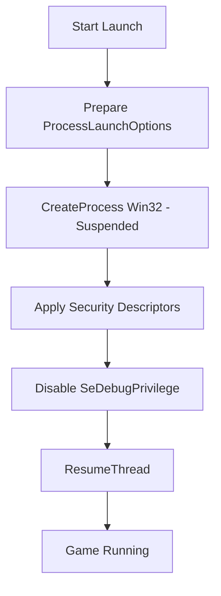
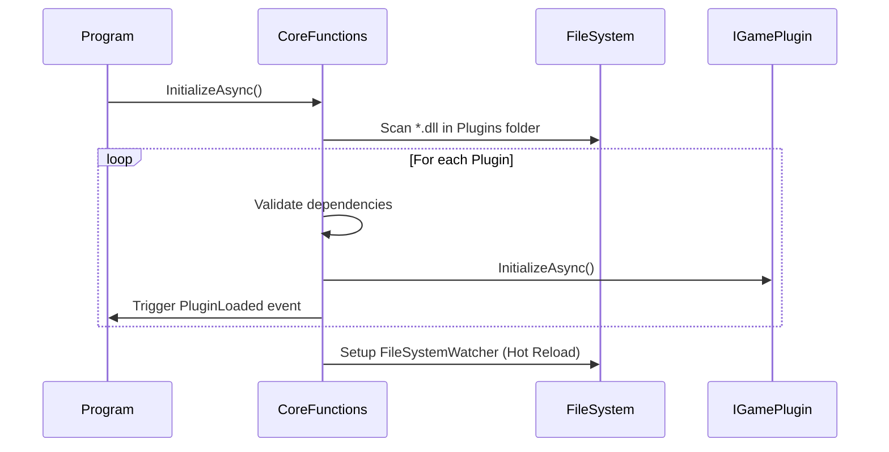

Relevant source files

The following files were used as context for generating this wiki page:

- [handlerlaunch/SupportObjects.cs](handlerlaunch/SupportObjects.cs)
- [handlerlaunch/Program.cs](handlerlaunch/Program.cs)
- [CoreLibLaunchSupport/Class1.cs](CoreLibLaunchSupport/Class1.cs)
- [CoreLibLaunchSupport/Troubleshootthing.cs](CoreLibLaunchSupport/Troubleshootthing.cs)
- [LibDalamud/Dalamud/DalamudLauncher.cs](LibDalamud/Dalamud/DalamudLauncher.cs)

# Launch Support Libraries

The Launch Support Libraries provide the core infrastructure for executing, updating, and authenticating game clients within the WebLaunch ecosystem. These libraries manage the low-level interactions with the Windows operating system, handle secure authentication flows for game services, and maintain game file integrity.

The system supports multiple game titles, specifically providing specialized handlers for *The Chronicles of Spellborn* and *Final Fantasy XIV* (FFXIV). It integrates with external tools like Dalamud to enhance game functionality while ensuring security through native process isolation and registry management.

## Core Process Management

The library executes game binaries using a specialized native launcher that manages security descriptors and process privileges. This ensures the game runs with the correct permissions while preventing unauthorized debugging or process interference.

### Native Process Launcher
The `NativeProcessLauncher` class uses Win32 API calls via P/Invoke to create game processes. It starts the executable in a suspended state to apply configuration before execution begins.

- **Security Descriptors:** The launcher applies custom Discretionary Access Control Lists (DACL) to the process handle.
- **Privilege Management:** It explicitly disables `SeDebugPrivilege` to enhance security.
- **DPI Awareness:** It sets the `__COMPAT_LAYER` environment variable to handle high DPI scaling based on user settings.

Sources: [CoreLibLaunchSupport/Class1.cs:72-101](CoreLibLaunchSupport/Class1.cs#L72-L101), [CoreLibLaunchSupport/Class1.cs:238-316](CoreLibLaunchSupport/Class1.cs#L238-L316)

The diagram shows the sequence of Win32 operations required to securely start a game process.
Sources: [CoreLibLaunchSupport/Class1.cs:268-300](CoreLibLaunchSupport/Class1.cs#L268-L300)

## Final Fantasy XIV Launch Flow

The FFXIV handler manages a complex multi-step authentication and initialization sequence. This involves checking world status, retrieving session identifiers (SID), and optionally injecting the Dalamud plugin framework.

### Authentication Service
The `FfxivAuthenticationService` interacts with Square Enix OAuth endpoints. It performs the following actions:
1.  Fetches a stored token from the login gateway.
2.  Requests a Session ID using user credentials (including OTP if enabled).
3.  Requests a unique patch identifier using the local game version and hash payload.

Sources: [CoreLibLaunchSupport/Class1.cs:703-780](CoreLibLaunchSupport/Class1.cs#L703-L780)

### Launch Logic Orchestration
The `networklogic` class coordinates the authentication service with the game runner. It validates the game version against remote metadata before initiating the launch.

| Component | Function |
| :--- | :--- |
| `StatusService` | Checks if game gates and login servers are online. |
| `HashBuilder` | Generates SHA1 hashes of boot, launcher, and updater files for verification. |
| `DalamudUpdater` | Ensures the plugin framework and .NET runtime are up to date. |
| `launchers` | Constructs the command line arguments including expansion levels and SIDs. |

Sources: [CoreLibLaunchSupport/Class1.cs:811-920](CoreLibLaunchSupport/Class1.cs#L811-L920), [CoreLibLaunchSupport/Class1.cs:978-1002](CoreLibLaunchSupport/Class1.cs#L978-L1002)

## Spellborn Lifecycle Support

Launch support for *The Chronicles of Spellborn* focuses on automated updates and registry-based installation tracking.

### Update Mechanism
The `SpellbornSupporter` class manages a recursive update check. It compares the `installedVersion` stored in the Windows Registry against a `latest.json` file hosted on a remote server. If a mismatch exists, it downloads ZIP patches, verifies them via MD5 checksums, and extracts them to the installation directory.

Sources: [handlerlaunch/SupportObjects.cs:175-230](handlerlaunch/SupportObjects.cs#L175-L230), [handlerlaunch/SupportObjects.cs:337-370](handlerlaunch/SupportObjects.cs#L337-L370)

### Registry Manipulation
The `registryManipulation` class handles persistent configuration. It stores the `installPath` and `installedVersion` under `HKEY_CURRENT_USER\Software\The Chronicles of Spellborn`.

Sources: [handlerlaunch/SupportObjects.cs:64-125](handlerlaunch/SupportObjects.cs#L64-L125)

## Plugin and Extension System

The project uses the El'Garnan plugin system to load modular game launchers and enhancement tools.

### Core functions
The `CoreFunctions` class manages the lifecycle of these plugins. It scans the `Plugins` directory for DLL files, validates their dependencies, and initializes them asynchronously. It supports "Hot Reload," allowing plugins to be updated while the launcher is running by monitoring file system changes.

Sources: [handlerlaunch/Program.cs:186-198](handlerlaunch/Program.cs#L186-L198), [El'GarnanPluginSystem/CoreFunctions.cs:55-110](El'GarnanPluginSystem/CoreFunctions.cs#L55-L110)

The sequence diagram illustrates the plugin discovery and initialization process.
Sources: [El'GarnanPluginSystem/CoreFunctions.cs:72-130](El'GarnanPluginSystem/CoreFunctions.cs#L72-L130)

## Troubleshooting and Diagnostics

The libraries include extensive logging and diagnostic tools to identify launch failures.

- **Troubleshooting Payload:** The system generates a JSON object containing the OS platform, game versions, DirectX settings, and launcher hashes.
- **Exception Logging:** When a failure occurs, the `Troubleshooting` class captures the stack trace and context, encoding it as a Base64 string for log analysis.
- **Version Tracking:** The `RepoExtensions` provides methods to read and write `.ver` and `.bck` files for the base game and all expansion packs (Ex1 through Ex4).

Sources: [CoreLibLaunchSupport/Troubleshootthing.cs:140-200](CoreLibLaunchSupport/Troubleshootthing.cs#L140-L200), [CoreLibLaunchSupport/Troubleshootthing.cs:23-60](CoreLibLaunchSupport/Troubleshootthing.cs#L23-L60)

## Summary

The Launch Support Libraries serve as the bridge between the web interface and the local operating system. By centralizing Win32 process management, complex OAuth authentication, and modular plugin loading, the project provides a consistent and secure method for launching legacy and modern MMO clients. The inclusion of robust troubleshooting and automated update logic ensures high reliability for end-users.
