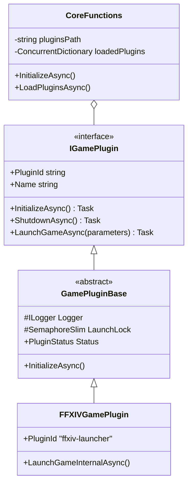
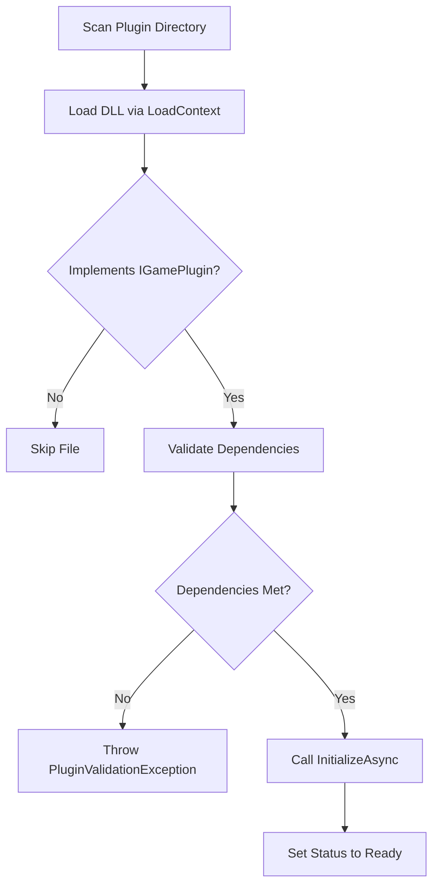

Relevant source files

The following files were used as context for generating this wiki page:

- [El'GarnanPluginSystem/CoreFunctions.cs](El%27GarnanPluginSystem/CoreFunctions.cs)
- [El'GarnanPluginSystem/Interfaces/pluginbase.cs](El%27GarnanPluginSystem/Interfaces/pluginbase.cs)
- [El'GarnanPluginSystem/Interfaces/renderbase.cs](El%27GarnanPluginSystem/Interfaces/renderbase.cs)
- [El'GarnanPluginSystem/Models/plugindependency.cs](El%27GarnanPluginSystem/Models/plugindependency.cs)
- [Gameplugins.Plugin.FFXIV/FFXIVGamePlugin.cs](Gameplugins.Plugin.FFXIV/FFXIVGamePlugin.cs)
- [Plugins/FFXIV/Elgarnan.xml](Plugins/FFXIV/Elgarnan.xml)

# El'Garnan Plugin Architecture

The El'Garnan Plugin Architecture provides a modular framework for extending game launcher functionality. It enables the project to load, validate, and manage external assemblies (DLLs) that implement specific game-launching logic and user interfaces. The system handles the entire lifecycle of a plugin, including dependency resolution, asynchronous initialization, and graphical rendering.

Sources: [El'GarnanPluginSystem/CoreFunctions.cs](El'GarnanPluginSystem/CoreFunctions.cs), [El'GarnanPluginSystem/Interfaces/pluginbase.cs](El'GarnanPluginSystem/Interfaces/pluginbase.cs)

## Core Components

The architecture relies on three primary components to manage extensibility: the Plugin Manager, the Plugin Interface, and the Base Implementation.

### CoreFunctions (The Plugin Manager)
`CoreFunctions` acts as the central orchestrator for the system. It monitors a specified directory for plugin assemblies and manages a `ConcurrentDictionary` of loaded plugins. It handles asynchronous initialization and provides events for loading, unloading, and errors.
Sources: [El'GarnanPluginSystem/CoreFunctions.cs:11-30](El'GarnanPluginSystem/CoreFunctions.cs#L11-L30)

### IGamePlugin Interface
The `IGamePlugin` interface defines the contract that all modules must follow. It requires metadata such as `PluginId`, `Name`, and `Version`, and specifies methods for lifecycle management like `InitializeAsync()` and `ShutdownAsync()`.
Sources: [Plugins/FFXIV/Elgarnan.xml:225-250](Plugins/FFXIV/Elgarnan.xml#L225-L250)

### GamePluginBase
This abstract class provides a default implementation of the `IGamePlugin` and `INotificationService` interfaces. It manages the internal state transition of a plugin and includes a `SemaphoreSlim` named `LaunchLock` to ensure only one launch operation occurs at a time.
Sources: [El'GarnanPluginSystem/Interfaces/pluginbase.cs:13-30](El'GarnanPluginSystem/Interfaces/pluginbase.cs#L13-L30)

The diagram above shows the relationship between the management core and the plugin implementations.
Sources: [El'GarnanPluginSystem/CoreFunctions.cs](El'GarnanPluginSystem/CoreFunctions.cs), [El'GarnanPluginSystem/Interfaces/pluginbase.cs](El'GarnanPluginSystem/Interfaces/pluginbase.cs), [Gameplugins.Plugin.FFXIV/FFXIVGamePlugin.cs](Gameplugins.Plugin.FFXIV/FFXIVGamePlugin.cs)

## Plugin Lifecycle and Status

Each plugin maintains a state tracked by the `PluginStatus` enumeration. `GamePluginBase` handles these transitions during initialization and shutdown sequences.

| Status | Description |
| :--- | :--- |
| `Uninitialized` | The default state before `InitializeAsync` is called. |
| `Initializing` | The plugin is currently running its setup logic. |
| `Ready` | The plugin is successfully validated and available for use. |
| `Failed` | An error occurred during initialization or validation. |
| `Reloading` | The plugin is being reset, typically during a hot reload. |
| `Disabled` | The plugin is manually or automatically turned off. |

Sources: [El'GarnanPluginSystem/Interfaces/pluginbase.cs:20-25](El'GarnanPluginSystem/Interfaces/pluginbase.cs#L20-L25), [Plugins/FFXIV/Elgarnan.xml:253-285](Plugins/FFXIV/Elgarnan.xml#L253-L285)

## Loading and Validation Logic

The system uses a custom `PluginLoadContext` to isolate assembly loading. Validation occurs in two stages: dependency checking and configuration validation.

1.  **Assembly Discovery**: `CoreFunctions` scans the plugins directory for `*.dll` files.
2.  **Context Creation**: A new `PluginLoadContext` is instantiated for the file path to prevent dependency conflicts.
3.  **Dependency Validation**: The system checks if required libraries (like `ImGui.NET` or `Veldrid`) are present in the base directory or plugin folder.
4.  **Version Check**: It compares the assembly version against the `MinVersion` required by the plugin.
5.  **Initialization**: If validation passes, `InitializeAsync` is executed.

Sources: [El'GarnanPluginSystem/CoreFunctions.cs:81-125](El'GarnanPluginSystem/CoreFunctions.cs#L81-L125), [El'GarnanPluginSystem/Models/plugindependency.cs:5-23](El'GarnanPluginSystem/Models/plugindependency.cs#L5-L23)

This flowchart illustrates the verification steps performed before a plugin is activated.
Sources: [El'GarnanPluginSystem/CoreFunctions.cs:85-115](El'GarnanPluginSystem/CoreFunctions.cs#L85-L115)

## UI Rendering Architecture

The system supports ImGui-based rendering for plugin interfaces. It utilizes a standalone window managed by `ImGuiPluginRenderer` which uses Veldrid and SDL2.

*  **Plugin UI Support**: Plugins indicate support by setting `SupportsImGui` to true.
*  **Rendering Loop**: The renderer pumps SDL2 events and updates the ImGui context at approximately 60 FPS.
*  **Integration**: `CoreFunctions.RenderPluginInterfaces()` iterates through all loaded plugins and calls their specific `RenderImGui()` methods within the frame.

Sources: [El'GarnanPluginSystem/Interfaces/renderbase.cs:33-70](El'GarnanPluginSystem/Interfaces/renderbase.cs#L33-L70), [El'GarnanPluginSystem/CoreFunctions.cs:255-265](El'GarnanPluginSystem/CoreFunctions.cs#L255-L265)

### Notification System
The architecture includes a built-in notification queue. Plugins can call `ShowNotification()`, which enqueues a `PluginNotification` object. If ImGui is supported, the base class automatically renders these as popups or lists in the UI.
Sources: [El'GarnanPluginSystem/Interfaces/pluginbase.cs:188-215](El'GarnanPluginSystem/Interfaces/pluginbase.cs#L188-L215)

## Hot Reload

If enabled, the `CoreFunctions` class uses `FileSystemWatcher` to monitor changes to plugin DLLs. When a file is modified, the system:
1.  Acquires a reload lock.
2.  Unloads the existing plugin instance.
3.  Re-scans and loads the new assembly.
4.  Triggers the `PluginReloaded` event.

Sources: [El'GarnanPluginSystem/CoreFunctions.cs:135-165](El'GarnanPluginSystem/CoreFunctions.cs#L135-L165)

## Summary

The El'Garnan Plugin Architecture isolates game-specific logic from the core launcher through a robust assembly loading and interface system. By combining `GamePluginBase` for state management and `CoreFunctions` for lifecycle orchestration, it provides a stable environment for dynamic extensions. The integration of Veldrid and ImGui allows these plugins to provide complex user interfaces while maintaining high performance.

Sources: [El'GarnanPluginSystem/CoreFunctions.cs](El'GarnanPluginSystem/CoreFunctions.cs), [El'GarnanPluginSystem/Interfaces/pluginbase.cs](El'GarnanPluginSystem/Interfaces/pluginbase.cs)
