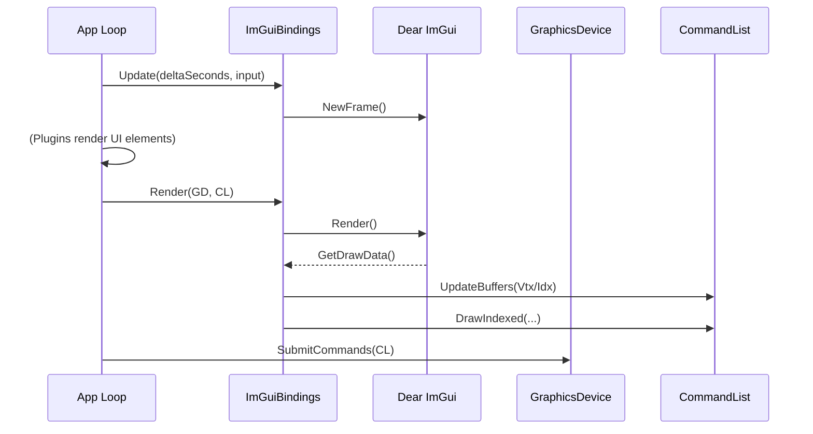
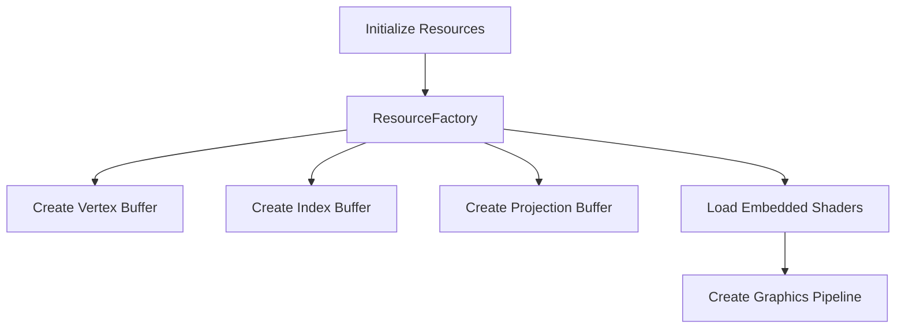
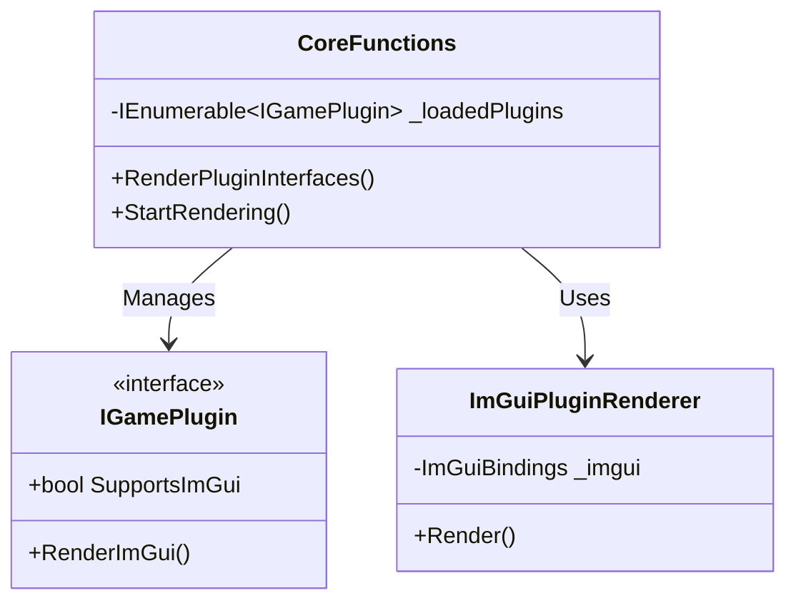

Relevant source files

The following files were used as context for generating this wiki page:

- [El'GarnanPluginSystem/Rendering/ImGuiController.cs](El%27GarnanPluginSystem/Rendering/ImGuiController.cs)
- [El'GarnanPluginSystem/Rendering/ImGuiBindings.cs](El%27GarnanPluginSystem/Rendering/ImGuiBindings.cs)
- [El'GarnanPluginSystem/Rendering/ImGuiHelpers.cs](El%27GarnanPluginSystem/Rendering/ImGuiHelpers.cs)
- [El'GarnanPluginSystem/Interfaces/renderbase.cs](El%27GarnanPluginSystem/Interfaces/renderbase.cs)
- [El'GarnanPluginSystem/Rendering/ImGuiColors.cs](El%27GarnanPluginSystem/Rendering/ImGuiColors.cs)
- [El'GarnanPluginSystem/CoreFunctions.cs](El%27GarnanPluginSystem/CoreFunctions.cs)

# ImGui Rendering Controller

The ImGui Rendering Controller manages the integration between the Dear ImGui user interface library and the Veldrid graphics API. It provides the necessary infrastructure to render immediate-mode graphical interfaces for plugins within the application. The system handles input processing, resource allocation, and draw call translation to bridge the gap between ImGui's draw lists and Veldrid's command lists.

Sources: [El'GarnanPluginSystem/Rendering/ImGuiController.cs](El'GarnanPluginSystem/Rendering/ImGuiController.cs), [El'GarnanPluginSystem/Rendering/ImGuiBindings.cs](El'GarnanPluginSystem/Rendering/ImGuiBindings.cs)

## Architecture and Core Components

The rendering system consists of a controller that initializes ImGui contexts and manages GPU resources such as buffers, shaders, and textures. It utilizes a dedicated renderer class to translate ImGui draw data into Veldrid commands.

### Component Overview

| Component | Class | Responsibility |
| :--- | :--- | :--- |
| **Main Controller** | `ImGuiController` | Manages the ImGui lifecycle, including initialization, resizing, and per-frame updates. |
| **Graphics Bindings** | `ImGuiBindings` | Handles Veldrid-specific resource management, including vertex/index buffers and pipeline creation. |
| **Plugin Renderer** | `ImGuiPluginRenderer` | Implements the `IPluginRenderer` interface to provide a standalone window loop for plugin UIs. |
| **Helpers** | `ImGuiHelpers` | Provides utility functions for UI layout, such as text wrapping and cursor centering. |

Sources: [El'GarnanPluginSystem/Rendering/ImGuiController.cs:17-30](El'GarnanPluginSystem/Rendering/ImGuiController.cs#L17-L30), [El'GarnanPluginSystem/Rendering/ImGuiBindings.cs:20-40](El'GarnanPluginSystem/Rendering/ImGuiBindings.cs#L20-L40), [El'GarnanPluginSystem/Interfaces/renderbase.cs:25-35](El'GarnanPluginSystem/Interfaces/renderbase.cs#L25-L35), [El'GarnanPluginSystem/Rendering/ImGuiHelpers.cs:13-25](El'GarnanPluginSystem/Rendering/ImGuiHelpers.cs#L13-L25)

### Data Flow for Frame Rendering

The following diagram illustrates the sequence of events during a single rendering frame:

The system captures input snapshots from the window, updates the ImGui state, triggers plugin render calls, and finally converts the resulting draw data into GPU commands.

Sources: [El'GarnanPluginSystem/Rendering/ImGuiController.cs:157-164](El'GarnanPluginSystem/Rendering/ImGuiController.cs#L157-L164), [El'GarnanPluginSystem/Rendering/ImGuiBindings.cs:245-253](El'GarnanPluginSystem/Rendering/ImGuiBindings.cs#L245-L253), [El'GarnanPluginSystem/Interfaces/renderbase.cs:100-120](El'GarnanPluginSystem/Interfaces/renderbase.cs#L100-L120)

## Graphics Resource Management

The controller allocates dynamic buffers to store geometry data generated by ImGui. If the required buffer size exceeds the current allocation, the system disposes of the old buffers and creates larger ones with a 1.5x overhead to minimize frequent reallocations.

### Buffers and Shaders

The system uses three primary Veldrid buffers:
1.  **Vertex Buffer**: Stores `ImDrawVert` structures (Position, UV, Color).
2.  **Index Buffer**: Stores 16-bit unsigned integers for triangle indices.
3.  **Projection Matrix Buffer**: A uniform buffer containing an orthographic projection matrix.

Shaders are loaded as embedded resources specific to the active graphics backend (Direct3D11, OpenGL, Vulkan, or Metal).

Sources: [El'GarnanPluginSystem/Rendering/ImGuiController.cs:78-100](El'GarnanPluginSystem/Rendering/ImGuiController.cs#L78-L100), [El'GarnanPluginSystem/Rendering/ImGuiBindings.cs:108-140](El'GarnanPluginSystem/Rendering/ImGuiBindings.cs#L108-L140)

## Input Handling

Input processing translates Veldrid `InputSnapshot` data into ImGui events. This includes mouse positions, button states, scroll wheel deltas, and keyboard events.

*  **Keyboard Mappings**: Standard keys like Tab, Arrows, Enter, and Escape are explicitly mapped to `ImGuiKey` values.
*  **Modifiers**: The system tracks the state of Control, Shift, Alt, and Super (Windows) keys.
*  **Character Input**: Text input is handled by iterating through `KeyCharPresses` and adding them to the ImGui IO structure.

Sources: [El'GarnanPluginSystem/Rendering/ImGuiController.cs:49-71](El'GarnanPluginSystem/Rendering/ImGuiController.cs#L49-L71), [El'GarnanPluginSystem/Rendering/ImGuiBindings.cs:275-320](El'GarnanPluginSystem/Rendering/ImGuiBindings.cs#L275-L320)

## Plugin UI Integration

The `CoreFunctions` class orchestrates the rendering for all loaded plugins. If a plugin indicates it `SupportsImGui`, its `RenderImGui()` method is called within the rendering loop.

The system can run in a standalone mode, where `ImGuiPluginRenderer` creates its own SDL2 window and graphics device to host the plugin interfaces.

Sources: [El'GarnanPluginSystem/CoreFunctions.cs:245-275](El'GarnanPluginSystem/CoreFunctions.cs#L245-L275), [El'GarnanPluginSystem/Interfaces/renderbase.cs:40-60](El'GarnanPluginSystem/Interfaces/renderbase.cs#L40-L60)

## Styling and Appearance

The project includes a standard color palette defined in `ImGuiColors.cs`. These colors provide a consistent look across the launcher and plugins.

| Color Name | Hex-like Vector4 (RGBA) |
| :--- | :--- |
| `DalamudRed` | (1.0, 0.0, 0.0, 1.0) |
| `TankBlue` | (0.0, 0.6, 1.0, 1.0) |
| `HealerGreen` | (0.0, 0.8, 0.13, 1.0) |
| `DpsRed` | (0.7, 0.0, 0.0, 1.0) |

Sources: [El'GarnanPluginSystem/Rendering/ImGuiColors.cs:10-50](El'GarnanPluginSystem/Rendering/ImGuiColors.cs#L10-L50)

## Summary

The ImGui Rendering Controller provides a robust bridge between the Dear ImGui library and the Veldrid backend. It ensures that plugins can render high-performance, interactive user interfaces by managing graphics resources, processing user input, and maintaining a dedicated rendering pipeline. The architecture supports multiple graphics backends and provides helper utilities to streamline UI development.

Sources: [El'GarnanPluginSystem/Rendering/ImGuiController.cs](El'GarnanPluginSystem/Rendering/ImGuiController.cs), [El'GarnanPluginSystem/CoreFunctions.cs](El'GarnanPluginSystem/CoreFunctions.cs)
