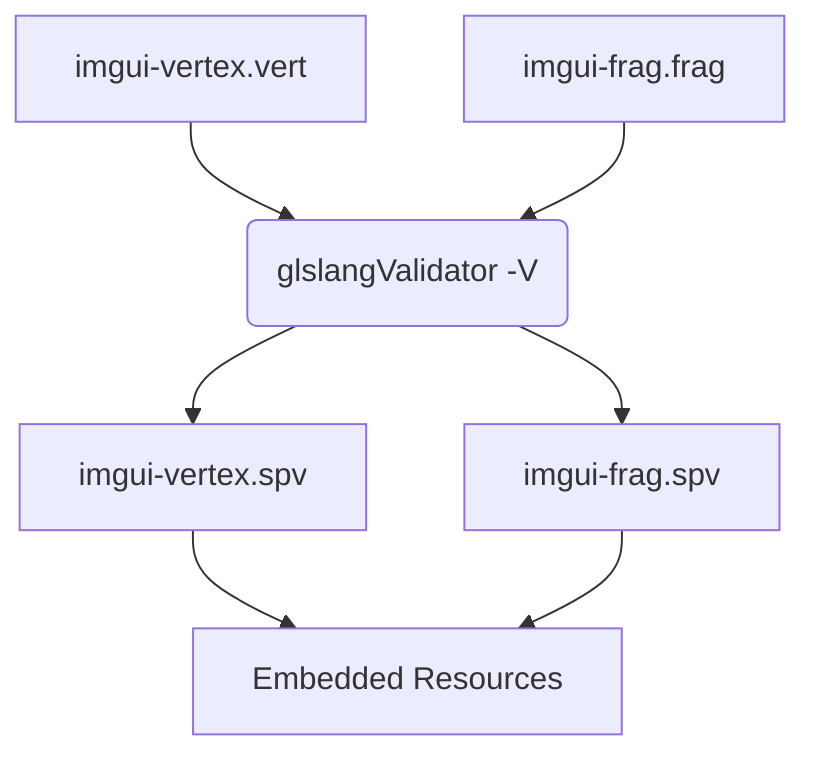
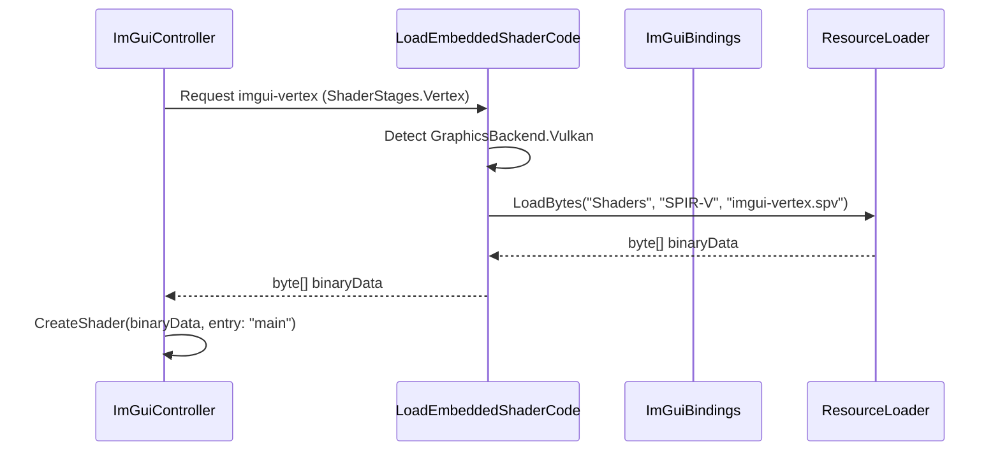

Relevant source files

The following files were used as context for generating this wiki page:

- [El'GarnanPluginSystem/Shaders/SPIR-V/generate-spirv.bat](El%27GarnanPluginSystem/Shaders/SPIR-V/generate-spirv.bat)
- [El'GarnanPluginSystem/Rendering/ImGuiController.cs](El%27GarnanPluginSystem/Rendering/ImGuiController.cs)
- [El'GarnanPluginSystem/Rendering/ImGuiBindings.cs](El%27GarnanPluginSystem/Rendering/ImGuiBindings.cs)
- [El'GarnanPluginSystem/Rendering/ImGuiHelpers.cs](El%27GarnanPluginSystem/Rendering/ImGuiHelpers.cs)
- [El'GarnanPluginSystem/CoreFunctions.cs](El%27GarnanPluginSystem/CoreFunctions.cs)

# SPIR-V Shader Generation

SPIR-V shader generation provides a cross-platform intermediate representation for graphics shaders used in the El'Garnan Plugin System. The system compiles high-level GLSL source code into binary SPIR-V modules. These modules facilitate hardware-accelerated rendering via the Vulkan graphics backend, primarily supporting ImGui user interfaces.
Sources: [El'GarnanPluginSystem/Shaders/SPIR-V/generate-spirv.bat](El'GarnanPluginSystem/Shaders/SPIR-V/generate-spirv.bat), [El'GarnanPluginSystem/Rendering/ImGuiController.cs:122-127](El'GarnanPluginSystem/Rendering/ImGuiController.cs#L122-L127)

## Compilation Pipeline

The build process converts GLSL shader source files into SPIR-V binary files using a command-line utility. You use the `glslangValidator` tool to perform this conversion.

### Build Tooling
The system employs `glslangValidator.exe` to process vertex and fragment shader stages. The `-V` flag specifies that the output must conform to the SPIR-V standard. The `-o` flag defines the destination path for the resulting binary.
Sources: [El'GarnanPluginSystem/Shaders/SPIR-V/generate-spirv.bat:1-2](El'GarnanPluginSystem/Shaders/SPIR-V/generate-spirv.bat#L1-L2)

### Shader Source Mappings
The project maintains specific source-to-binary relationships for the ImGui rendering system:

| Shader Stage | Source File | Compiled Output |
| :--- | :--- | :--- |
| Vertex | `imgui-vertex.vert` | `imgui-vertex.spv` |
| Fragment | `imgui-frag.frag` | `imgui-frag.spv` |

Sources: [El'GarnanPluginSystem/Shaders/SPIR-V/generate-spirv.bat:1-2](El'GarnanPluginSystem/Shaders/SPIR-V/generate-spirv.bat#L1-L2)

The diagram shows the compilation flow from GLSL source code to SPIR-V binary modules.
Sources: [El'GarnanPluginSystem/Shaders/SPIR-V/generate-spirv.bat](El'GarnanPluginSystem/Shaders/SPIR-V/generate-spirv.bat)

## Runtime Loading Logic

The `ImGuiController` and `ImGuiBindings` classes manage the retrieval and initialization of SPIR-V shaders during application execution.

### Backend Selection
The software selects the `.spv` file extension when the `GraphicsBackend` is set to `Vulkan`. If you use other backends like `Direct3D11` or `OpenGL`, the system selects different extensions such as `.hlsl.bytes` or `.glsl`.
Sources: [El'GarnanPluginSystem/Rendering/ImGuiController.cs:141-150](El'GarnanPluginSystem/Rendering/ImGuiController.cs#L141-L150), [El'GarnanPluginSystem/Rendering/ImGuiBindings.cs:228-232](El'GarnanPluginSystem/Rendering/ImGuiBindings.cs#L228-L232)

### Resource Retrieval
The `ImGuiResourceLoader` searches for compiled shaders within the assembly manifest or the local file system. It attempts multiple naming patterns, including paths like `Shaders/SPIR-V/imgui-vertex.spv`.
Sources: [El'GarnanPluginSystem/Rendering/ImGuiHelpers.cs:64-75](El'GarnanPluginSystem/Rendering/ImGuiHelpers.cs#L64-L75), [El'GarnanPluginSystem/Rendering/ImGuiBindings.cs:228-232](El'GarnanPluginSystem/Rendering/ImGuiBindings.cs#L228-L232)

### Shader Initialization
When initializing a shader for the Vulkan backend, the `ImGuiController` sets the entry point to `"main"`. This differs from non-Vulkan backends which may use `"VS"` or `"FS"`.
Sources: [El'GarnanPluginSystem/Rendering/ImGuiController.cs:100-103](El'GarnanPluginSystem/Rendering/ImGuiController.cs#L100-L103)

The sequence diagram illustrates how the system detects the Vulkan backend and pulls the correct SPIR-V binary from resources.
Sources: [El'GarnanPluginSystem/Rendering/ImGuiController.cs:134-150](El'GarnanPluginSystem/Rendering/ImGuiController.cs#L134-L150), [El'GarnanPluginSystem/Rendering/ImGuiBindings.cs:214-232](El'GarnanPluginSystem/Rendering/ImGuiBindings.cs#L214-L232)

## Integration with Rendering Pipeline

SPIR-V shaders define the programmable stages of the graphics pipeline for plugin rendering.

### Vertex Layout
The SPIR-V shaders expect a specific vertex input structure defined in `ImGuiController`. This includes two-dimensional positions, texture coordinates, and four-byte normalized colors.
Sources: [El'GarnanPluginSystem/Rendering/ImGuiController.cs:105-111](El'GarnanPluginSystem/Rendering/ImGuiController.cs#L105-L111)

### Resource Layouts
Shaders interact with memory through defined resource layouts. The vertex shader utilizes a `ProjectionMatrixBuffer` uniform. The fragment shader utilizes a `MainSampler` and a `MainTexture` sampled resource.
Sources: [El'GarnanPluginSystem/Rendering/ImGuiController.cs:113-117](El'GarnanPluginSystem/Rendering/ImGuiController.cs#L113-L117)

## Conclusion

SPIR-V shader generation is a critical build-time step that enables high-performance rendering for the plugin system's Vulkan backend. By standardizing on SPIR-V binaries, the project ensures consistent behavior across different hardware architectures while maintaining a unified shader source base in GLSL.
Sources: [El'GarnanPluginSystem/Rendering/ImGuiController.cs:122-127](El'GarnanPluginSystem/Rendering/ImGuiController.cs#L122-L127), [El'GarnanPluginSystem/Shaders/SPIR-V/generate-spirv.bat](El'GarnanPluginSystem/Shaders/SPIR-V/generate-spirv.bat)
