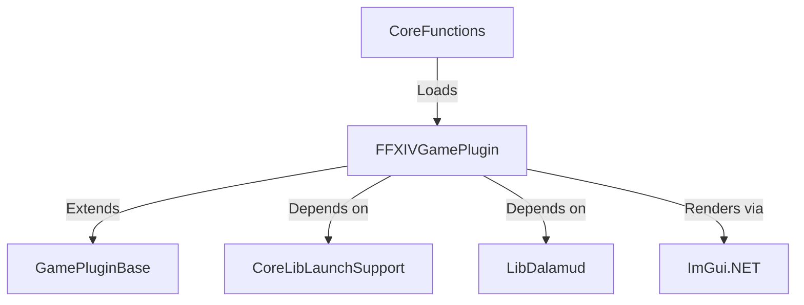
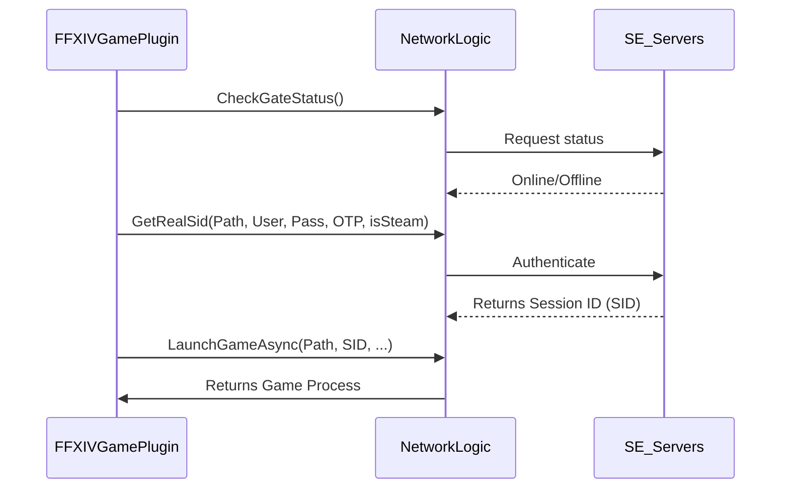

Relevant source files

The following files were used as context for generating this wiki page:

- [Gameplugins.Plugin.FFXIV/FFXIVGamePlugin.cs](Gameplugins.Plugin.FFXIV/FFXIVGamePlugin.cs)
- [Plugins/FFXIV/Elgarnan.xml](Plugins/FFXIV/Elgarnan.xml)
- [El'GarnanPluginSystem/CoreFunctions.cs](El%27GarnanPluginSystem/CoreFunctions.cs)
- [El'GarnanPluginSystem/Interfaces/pluginbase.cs](El%27GarnanPluginSystem/Interfaces/pluginbase.cs)
- [CoreLibLaunchSupport/Class1.cs](CoreLibLaunchSupport/Class1.cs)

# FFXIV Game Plugin

The **FFXIV Game Plugin** provides specialized logic to authenticate and launch Final Fantasy XIV within the El'Garnan plugin architecture. It manages secure session acquisition, server status verification, and provides a custom graphical interface for the launcher.

Sources: [Gameplugins.Plugin.FFXIV/FFXIVGamePlugin.cs:41-45](Gameplugins.Plugin.FFXIV/FFXIVGamePlugin.cs#L41-L45), [Plugins/FFXIV/Elgarnan.xml:184-188](Plugins/FFXIV/Elgarnan.xml#L184-L188)

## Architecture and Components

The plugin inherits from `GamePluginBase` and implements the `IGamePlugin` interface. It operates as a modular component loaded dynamically by the `CoreFunctions` system. The plugin relies on reflection to interact with underlying libraries like `ImGui.NET` and `CoreLibLaunchSupport`.

Sources: [Gameplugins.Plugin.FFXIV/FFXIVGamePlugin.cs:17](Gameplugins.Plugin.FFXIV/FFXIVGamePlugin.cs#L17), [El'GarnanPluginSystem/CoreFunctions.cs:100-110](El'GarnanPluginSystem/CoreFunctions.cs#L100-L110), [El'GarnanPluginSystem/Interfaces/pluginbase.cs:15](El'GarnanPluginSystem/Interfaces/pluginbase.cs#L15)

### Component Relationship

The following diagram illustrates the relationship between the FFXIV Plugin and the core system:

The plugin defines specific metadata used by the loader for identification and dependency management.

| Property | Value |
| :--- | :--- |
| **PluginId** | ffxiv-launcher |
| **Name** | FFXIV Game Launcher |
| **TargetApplication** | ffxiv_dx11.exe |
| **SupportsImGui** | true |

Sources: [Gameplugins.Plugin.FFXIV/FFXIVGamePlugin.cs:51-57](Gameplugins.Plugin.FFXIV/FFXIVGamePlugin.cs#L51-L57)

## Authentication and Launch Logic

The plugin executes a multi-step sequence to launch the game. You must provide valid environment variables for the process to succeed. It verifies server availability before attempting to acquire a session.

Sources: [Gameplugins.Plugin.FFXIV/FFXIVGamePlugin.cs:646-655](Gameplugins.Plugin.FFXIV/FFXIVGamePlugin.cs#L646-L655)

### Launch Sequence Flow

The following sequence diagram describes the interaction between the plugin and the network logic:

Sources: [Gameplugins.Plugin.FFXIV/FFXIVGamePlugin.cs:258-278](Gameplugins.Plugin.FFXIV/FFXIVGamePlugin.cs#L258-L278), [CoreLibLaunchSupport/Class1.cs:1078-1090](CoreLibLaunchSupport/Class1.cs#L1078-L1090)

### Security and Credentials
The plugin retrieves credentials from `GameLaunchParameters.EnvironmentVariables`. It expects the following keys:
- `FFXIV_USERNAME`
- `FFXIV_PASSWORD`
- `FFXIV_OTP`

If any credential is missing, the plugin throws an `ArgumentException`.

Sources: [Gameplugins.Plugin.FFXIV/FFXIVGamePlugin.cs:657-670](Gameplugins.Plugin.FFXIV/FFXIVGamePlugin.cs#L657-L670), [Gameplugins.Plugin.FFXIV/FFXIVGamePlugin.cs:696-702](Gameplugins.Plugin.FFXIV/FFXIVGamePlugin.cs#L696-L702)

## Graphical User Interface (ImGui)

The plugin uses `ImGui.NET` to render a custom launcher window. Because it is a dynamically loaded plugin, it initializes ImGui bindings through reflection to ensure compatibility with the host application's memory space.

Sources: [Gameplugins.Plugin.FFXIV/FFXIVGamePlugin.cs:72-132](Gameplugins.Plugin.FFXIV/FFXIVGamePlugin.cs#L72-L132)

### Initialization Process
1. **Load Assemblies**: The plugin loads `ImGui.NET` and `System.Numerics` into the `PluginLoadContext`.
2. **Find Methods**: It locates static methods such as `Begin`, `End`, `Text`, and `SetNextWindowPos`.
3. **Initialize Flags**: It converts integer bitmasks to `ImGuiWindowFlags` enums.

Sources: [Gameplugins.Plugin.FFXIV/FFXIVGamePlugin.cs:208-250](Gameplugins.Plugin.FFXIV/FFXIVGamePlugin.cs#L208-L250)

### Window Rendering Logic
The `RenderImGui` method defines the visual layout. It performs the following actions:
- Calculates the window center based on the `DisplaySize` retrieved from `ImGui.IO`.
- Sets window flags to disable the title bar, resizing, and collapsing.
- Checks the gate and login server status via `networklogic`.
- Renders a custom background using `AddRectFilled` on the `WindowDrawList`.
- Renders an animated loading spinner using `AddArc` with time-based angles.

Sources: [Gameplugins.Plugin.FFXIV/FFXIVGamePlugin.cs:282-310](Gameplugins.Plugin.FFXIV/FFXIVGamePlugin.cs#L282-L310), [Gameplugins.Plugin.FFXIV/FFXIVGamePlugin.cs:575-635](Gameplugins.Plugin.FFXIV/FFXIVGamePlugin.cs#L575-L635)

## Dependencies

The plugin specifies strict version requirements for its operation. The `CoreFunctions` loader validates these dependencies before initialization.

| Dependency | Minimum Version |
| :--- | :--- |
| CoreLibLaunchSupport | 1.0.0 |
| LibDalamud | 1.0.0 |
| ImGui.NET | 1.89.4 |
| Veldrid | 4.9.0 |

Sources: [Gameplugins.Plugin.FFXIV/FFXIVGamePlugin.cs:60-65](Gameplugins.Plugin.FFXIV/FFXIVGamePlugin.cs#L60-L65), [El'GarnanPluginSystem/CoreFunctions.cs:133-145](El'GarnanPluginSystem/CoreFunctions.cs#L133-L145)

## Summary

The **FFXIV Game Plugin** serves as the specialized interface between the El'Garnan launcher and the Final Fantasy XIV service. It abstracts complex authentication flows—including SID acquisition and hash-checking—into a standard plugin interface. By utilizing reflection-based ImGui rendering, it provides a consistent user experience while maintaining strict isolation from the host application.
