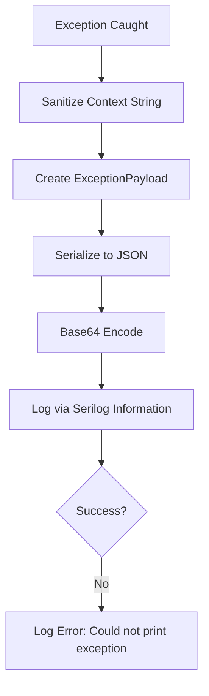
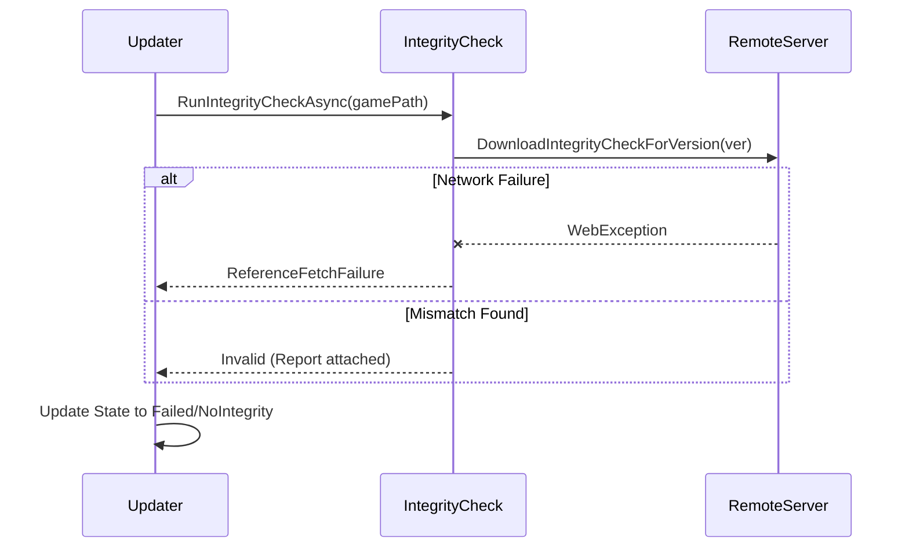

Relevant source files

The following files were used as context for generating this wiki page:

- [CoreLibLaunchSupport/Troubleshootthing.cs](CoreLibLaunchSupport/Troubleshootthing.cs)
- [LibDalamud/Dalamud/DalamudUpdater.cs](LibDalamud/Dalamud/DalamudUpdater.cs)
- [CoreLibLaunchSupport/Class1.cs](CoreLibLaunchSupport/Class1.cs)
- [handlerlaunch/SupportObjects.cs](handlerlaunch/SupportObjects.cs)
- [LibDalamud/Game/IntegrityCheck.cs](LibDalamud/Game/IntegrityCheck.cs)

# Error Handling and Exceptions

The WebLaunch project implements a structured error handling and exception management system to ensure stability during the game launching and updating process. This system captures runtime failures, validates environment integrity, and provides diagnostic data for troubleshooting.

The architecture relies on custom exception classes, centralized logging via Serilog, and integrity verification mechanisms. These components work together to intercept failures in network authentication, file system operations, and process management.

## Exception Hierarchy and Types

The project defines specific exception classes to categorize failures during different stages of the application lifecycle.

### Core Exceptions
The following table describes the primary custom exceptions used in the system:

| Exception Class | Description | Trigger Condition |
| :--- | :--- | :--- |
| `GameExitedException` | Signals a premature exit. | Thrown when the game process terminates before initialization completes. |
| `NoValidSubscriptionException` | Indicates auth failure. | Thrown when a Square Enix account lacks an active subscription. |
| `BinaryNotPresentException` | Missing executable. | Thrown when the game executable (`ffxiv_dx11.exe`) is not found. |
| `DalamudRunnerException` | Component failure. | Thrown when the Dalamud runner or injector fails to initialize. |

Sources: [CoreLibLaunchSupport/Class1.cs:17-23](CoreLibLaunchSupport/Class1.cs#L17-L23), [CoreLibLaunchSupport/Class1.cs:493-500](CoreLibLaunchSupport/Class1.cs#L493-L500), [LibDalamud/Dalamud/DalamudLauncher.cs:59-63](LibDalamud/Dalamud/DalamudLauncher.cs#L59-L63)

## Troubleshooting and Diagnostic Logging

The `Troubleshooting` class provides a centralized mechanism for capturing and encoding application state when an error occurs.

### Exception Payload Capture
When an exception is caught, the system generates an `ExceptionPayload`. This object contains the timestamp, the full exception string, and a sanitized context message. The system serializes this payload to JSON, encodes it in Base64, and logs it with the prefix `LASTEXCEPTION:`.

Sources: [CoreLibLaunchSupport/Troubleshootthing.cs:156-180](CoreLibLaunchSupport/Troubleshootthing.cs#L156-L180)

### Diagnostic Flow
The following diagram illustrates how the system logs troubleshooting data during a failure:

The system captures the state of the game version, platform, and integrity results during these logs. Sources: [CoreLibLaunchSupport/Troubleshootthing.cs:156-180](CoreLibLaunchSupport/Troubleshootthing.cs#L156-L180), [CoreLibLaunchSupport/Troubleshootthing.cs:181-190](CoreLibLaunchSupport/Troubleshootthing.cs#L181-L190)

## Integrity and Verification Errors

Integrity checks prevent the application from running with corrupted or outdated files. The `IntegrityCheck` and `DalamudUpdater` modules handle these validations.

### Integrity Validation States
The system uses the `CompareResult` and `DownloadState` enums to track verification status:

*  **Valid/Done**: Integrity matches local or remote references.
*  **Invalid/Failed**: Hashes do not match.
*  **ReferenceNotFound**: Remote integrity data is missing (HTTP 404).
*  **NoIntegrity**: Local files exist but cannot be read or verified.

Sources: [LibDalamud/Game/IntegrityCheck.cs:30-36](LibDalamud/Game/IntegrityCheck.cs#L30-L36), [LibDalamud/Dalamud/DalamudUpdater.cs:64-70](LibDalamud/Dalamud/DalamudUpdater.cs#L64-L70)

### Verification Sequence

Sources: [LibDalamud/Game/IntegrityCheck.cs:38-75](LibDalamud/Game/IntegrityCheck.cs#L38-L75), [LibDalamud/Dalamud/DalamudUpdater.cs:181-190](LibDalamud/Dalamud/DalamudUpdater.cs#L181-L190)

## Network and Authentication Failures

The `networklogic` and `FfxivAuthenticationService` components manage errors related to external web services.

1.  **Session Failures**: If the session ID request returns "BAD", the authentication service stops the launch process. Sources: [CoreLibLaunchSupport/Class1.cs:513-524](CoreLibLaunchSupport/Class1.cs#L513-L524)
2.  **HTTP Retries**: The `DalamudUpdater` implements a retry loop. If an update fails, it attempts the operation up to 10 times before setting the state to `Failed`. Sources: [LibDalamud/Dalamud/DalamudUpdater.cs:100-118](LibDalamud/Dalamud/DalamudUpdater.cs#L100-L118)
3.  **Subscription Errors**: Specific logic checks for `HttpStatusCode.Unauthorized` during unique ID requests to identify expired subscriptions. Sources: [CoreLibLaunchSupport/Class1.cs:493-500](CoreLibLaunchSupport/Class1.cs#L493-L500)

## Conclusion

WebLaunch utilizes a robust exception system that prioritizes diagnostic visibility. By combining custom exceptions with Base64-encoded JSON payloads in logs, the project enables precise debugging of game launch and update failures while maintaining a clear state machine for integrity and authentication. 

Sources: [CoreLibLaunchSupport/Troubleshootthing.cs](CoreLibLaunchSupport/Troubleshootthing.cs), [LibDalamud/Dalamud/DalamudUpdater.cs](LibDalamud/Dalamud/DalamudUpdater.cs), [CoreLibLaunchSupport/Class1.cs](CoreLibLaunchSupport/Class1.cs)
