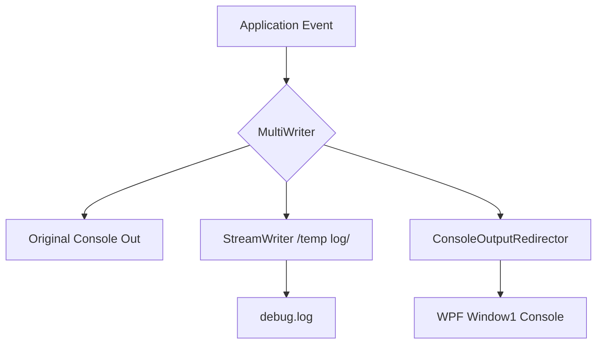
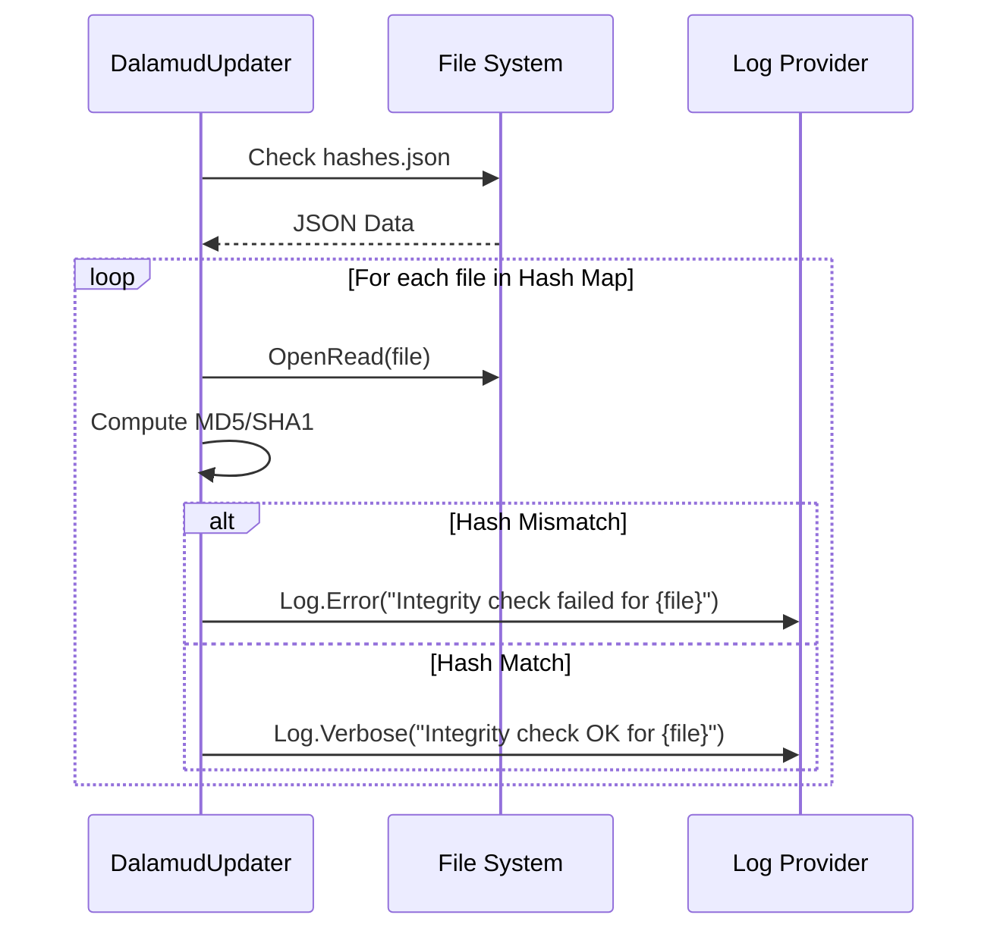

Relevant source files

The following files were used as context for generating this wiki page:

- [CoreLibLaunchSupport/Troubleshootthing.cs](CoreLibLaunchSupport/Troubleshootthing.cs)
- [handlerlaunch/SupportObjects.cs](handlerlaunch/SupportObjects.cs)
- [handlerlaunch/Program.cs](handlerlaunch/Program.cs)
- [LibDalamud/Dalamud/DalamudUpdater.cs](LibDalamud/Dalamud/DalamudUpdater.cs)
- [SpinningWheelLib/Window1.xaml.cs](SpinningWheelLib/Window1.xaml.cs)

# Logging and Diagnostics

Logging and Diagnostics in WebLaunch provides a system for capturing application events, handling exceptions, and generating detailed troubleshooting reports. The system records runtime information to local log files and console windows to assist developers and users in identifying issues during game updates and launches.

The diagnostics framework includes specialized troubleshooting payloads that capture system state, version information, and configuration settings. These payloads are often encoded for parseable logging, allowing support teams to reconstruct the exact environment of a failure.

## Logging Architecture

The project uses multiple logging providers, including Serilog, log4net, and custom console redirectors. This multi-layered approach ensures that information is captured regardless of whether the application is running in a headless state or with a visible user interface.

### Logging Components
- **Serilog**: Captures high-level application flow and structured troubleshooting data.
- **log4net**: Used within game-specific handlers like `SpellbornSupporter` for internal logic tracing.
- **Console Redirection**: The `ConsoleOutputRedirector` class intercepts standard console output and writes it to a graphical UI component (`Window1`).
- **File Logging**: Application events are persisted to a `debug.log` file in the application's base directory.

Sources: [handlerlaunch/Program.cs:466-473](handlerlaunch/Program.cs#L466-L473), [handlerlaunch/SupportObjects.cs:150-155](handlerlaunch/SupportObjects.cs#L150-L155), [SpinningWheelLib/Window1.xaml.cs:51-68](SpinningWheelLib/Window1.xaml.cs#L51-L68)

### Console Output Flow
This diagram illustrates how console output is simultaneously handled by the application for display and persistence.

Sources: [handlerlaunch/Program.cs:55-75](handlerlaunch/Program.cs#L55-L75), [SpinningWheelLib/Window1.xaml.cs:51-87](SpinningWheelLib/Window1.xaml.cs#L51-L87)

## Exception Handling and Troubleshooting

The `Troubleshooting` class serves as the central hub for error reporting. It captures the last occurring exception and generates a Base64 encoded JSON payload containing comprehensive system metadata.

### Troubleshooting Payloads
The diagnostic system generates a `TroubleshootingPayload` containing the following environment data:
- **System Info**: Platform type (Win32, Mac, Linux), DPI awareness, and timestamps.
- **Launcher State**: Version, hash, and whether it is an official build.
- **Game Integrity**: Version strings for various game repositories (Boot, Ffxiv, Ex1-Ex4) and backup match status.
- **Dalamud Configuration**: Injection delay, load method, and enabled features.

Sources: [CoreLibLaunchSupport/Troubleshootthing.cs:134-177](CoreLibLaunchSupport/Troubleshootthing.cs#L134-L177)

### Diagnostic Logic Table
| Component | Description | Data Captured |
| :--- | :--- | :--- |
| `LogException` | Serializes exceptions with context. | Timestamp, Stack Trace, Context string. |
| `LogTroubleshooting` | Logs the full state of the game and launcher. | Versions, Platform, Integrity results. |
| `RepoExtensions` | Analyzes game file structures. | `.ver` and `.bck` version strings. |

Sources: [CoreLibLaunchSupport/Troubleshootthing.cs:178-212](CoreLibLaunchSupport/Troubleshootthing.cs#L178-L212), [CoreLibLaunchSupport/Troubleshootthing.cs:13-74](CoreLibLaunchSupport/Troubleshootthing.cs#L13-L74)

## Integrity and Update Monitoring

The `DalamudUpdater` and `IntegrityCheck` modules provide diagnostic verification for game assets and injection hooks. These components log specific prefixes like `[DUPDATE]` and `[DASSET]` to categorize log entries.

### Update Diagnostic Process
1. **Version Fetching**: The updater logs the bucket (Canary/Control) and track (Staging/Release) being used.
2. **Integrity Validation**: The system calculates MD5 or SHA1 hashes of local files and compares them against a remote `hashes.json`.
3. **Failure Reporting**: Any mismatch in hashes or failure to download assets is logged as an `Error` level event with the specific file path involved.

Sources: [LibDalamud/Dalamud/DalamudUpdater.cs:228-261](LibDalamud/Dalamud/DalamudUpdater.cs#L228-L261), [LibDalamud/Dalamud/DalamudUpdater.cs:263-294](LibDalamud/Dalamud/DalamudUpdater.cs#L263-L294)

## Diagnostic UI Features

The `Window1` component in `SpinningWheelLib` provides a real-time console view for users. It supports expanding/collapsing a console log area and allows the application to write color-coded messages directly to the UI.

- **Console Redirection**: Methods like `WriteToConsole` use the WPF Dispatcher to ensure thread-safe updates to the logging UI.
- **Progress Tracking**: The UI diagnostics include progress percentages and step descriptions (e.g., "Checking game files...", "Verifying credentials...") derived from background tasks.

Sources: [SpinningWheelLib/Window1.xaml.cs:176-193](SpinningWheelLib/Window1.xaml.cs#L176-L193), [handlerlaunch/Program.cs:266-281](handlerlaunch/Program.cs#L266-L281)

## Conclusion

Logging and Diagnostics in WebLaunch ensure that every stage of the game launch—from registry manipulation and version checking to DLL injection—is transparent. By combining structured JSON troubleshooting payloads with real-time console redirection, the system provides both human-readable logs for users and machine-parseable data for automated support analysis.

Sources: [CoreLibLaunchSupport/Troubleshootthing.cs:181-197](CoreLibLaunchSupport/Troubleshootthing.cs#L181-L197), [handlerlaunch/Program.cs:411-420](handlerlaunch/Program.cs#L411-L420)
