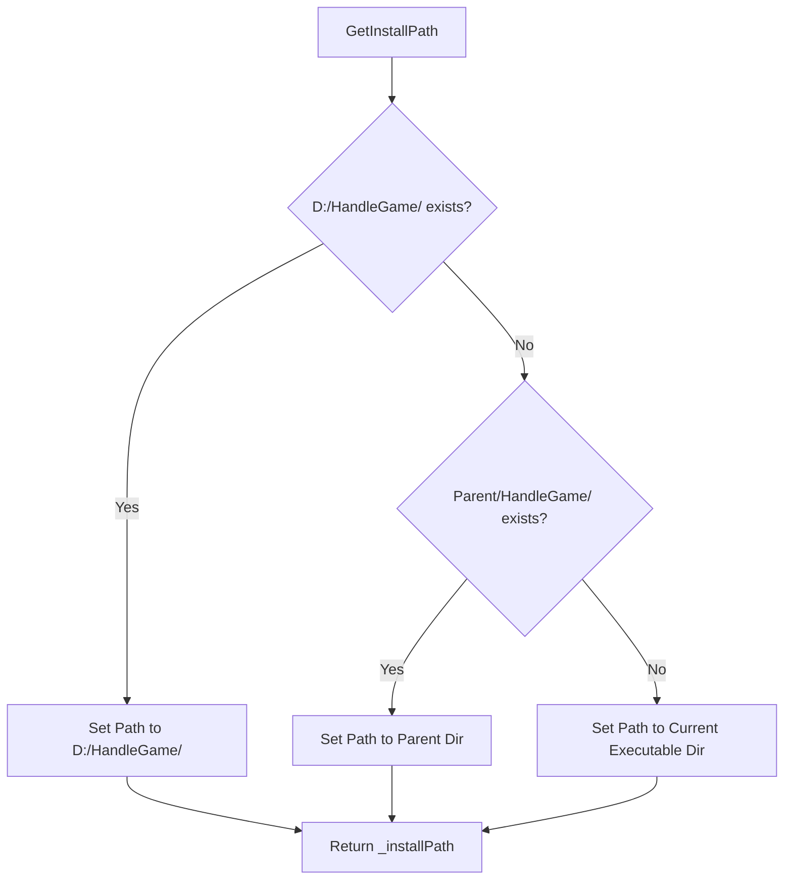
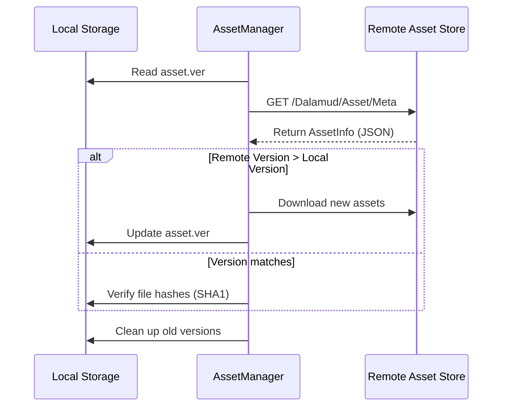

<details>
<summary>Relevant source files</summary>

The following files were used as context for generating this wiki page:

- [handlerlaunch/Program.cs](handlerlaunch/Program.cs)
- [handlerlaunch/SupportObjects.cs](handlerlaunch/SupportObjects.cs)
- [LaunchApp/tailwind.config.js](LaunchApp/tailwind.config.js)
- [LaunchApp/wwwroot/index.html](LaunchApp/wwwroot/index.html)
- [LibDalamud/Dalamud/AssetManager.cs](LibDalamud/Dalamud/AssetManager.cs)
- [LibDalamud/Dalamud/DalamudUpdater.cs](LibDalamud/Dalamud/DalamudUpdater.cs)
- [LibDalamud/Patching/IndexedZiPatch/IndexedZiPatchIndex.cs](LibDalamud/Patching/IndexedZiPatch/IndexedZiPatchIndex.cs)

</details>

# Build and Packaging Configurations

Build and Packaging Configurations define how the WebLaunch project assembles its components, manages dependencies, and prepares files for distribution. The system manages a hybrid environment comprising a Blazor-based web application and a native Windows launcher that interacts with local game files and registry settings.

This system handles the deployment of executable binaries, the configuration of front-end styling frameworks, and the automated retrieval of runtime assets. It ensures that the local environment matches the requirements for launching games like *The Chronicles of Spellborn* and *Final Fantasy XIV*.

## Native Application Packaging

The native launcher components use a file-copy mechanism to prepare a local installation directory, typically defaulting to `D:\HandleGame\`. The `Program` class defines a set of required assemblies and configuration files that must be present in the distribution package.

### Distribution File List
The following files represent the core components of the packaged launcher:

| File Category | Key Files |
| :--- | :--- |
| **Executables** | `WMConsole.exe`, `Sb_client.exe` |
| **Core Libraries** | `CoreLibLaunchSupport.dll`, `LibDalamud.dll`, `SpinningWheelLib.dll` |
| **External Dependencies** | `Newtonsoft.Json.dll`, `DotNetZip.dll`, `Serilog.dll`, `SDL2.dll` |
| **Configuration** | `WMConsole.runtimeconfig.json`, `Elgar'nan.xml` |

Sources: [handlerlaunch/Program.cs:119-174](handlerlaunch/Program.cs#L119-L174), [handlerlaunch/SupportObjects.cs:411-415](handlerlaunch/SupportObjects.cs#L411-L415)

### Installation and Path Resolution
The packaging logic resolves the installation path dynamically. It checks for a default path at `D:\HandleGame\` before falling back to paths relative to the current assembly location.



Sources: [handlerlaunch/Program.cs:88-116](handlerlaunch/Program.cs#L88-L116)

## UI and Asset Configuration

The web-based portion of the launcher utilizes Tailwind CSS for styling and Blazor WebAssembly for the application logic. The build process involves compiling CSS utilities and managing static assets required for the loading interface.

### Tailwind CSS Build Setup
The `tailwind.config.js` file specifies the content paths for the CSS compiler to scan, including Razor components, HTML files, and C# source files from the LumexUI component library.

```javascript
module.exports = {
    content: [
        "./**/*.{razor,html,cshtml}",
        "C:/Users/Andrey/.nuget/packages/lumexui/1.0.0-preview.3/theme/components/*.cs"
    ],
    plugins: [lumexui],
};
```

Sources: [LaunchApp/tailwind.config.js:4-13](LaunchApp/tailwind.config.js#L4-L13)

### Static Resource Loading
The `index.html` file serves as the entry point for the packaged web application. It configures the loading of external CSS frameworks (Masa Blazor, Bootstrap) and initializes the Blazor WebAssembly runtime.

- **Theming**: Supports dynamic switching between dark and light themes via JavaScript interop.
- **Cache Management**: Clears `localStorage` and `sessionStorage` on load to ensure fresh configuration state.
- **Service Workers**: Unregisters existing service workers to prevent stale application state during updates.

Sources: [LaunchApp/wwwroot/index.html:13-25](LaunchApp/wwwroot/index.html#L13-L25), [LaunchApp/wwwroot/index.html:56-74](LaunchApp/wwwroot/index.html#L56-L74)

## Runtime Asset Management

The packaging system includes a dedicated `AssetManager` and `DalamudUpdater` to handle post-installation dependency resolution. This ensures the environment has the correct .NET runtimes and game-specific hooks.

### Asset Verification Flow
The `AssetManager` performs a version check against a remote metadata store to determine if local assets are outdated.



Sources: [LibDalamud/Dalamud/AssetManager.cs:40-112](LibDalamud/Dalamud/AssetManager.cs#L40-L112), [LibDalamud/Dalamud/AssetManager.cs:141-155](LibDalamud/Dalamud/AssetManager.cs#L141-L155)

### Patching and Versioning
For game updates, the project uses an indexed patching system (`IndexedZiPatchIndex`). This system tracks file offsets and decompressed sizes to apply incremental updates to game binaries without redistributing the entire game client.

- **Expansion Versioning**: Tracks versions for different expansions (e.g., `ex1`, `ex2`, `ex3`, `ex4`).
- **Integrity Checks**: Uses MD5 hashes stored in a `hashes.json` file to verify that the packaged files have not been corrupted during the update process.

Sources: [LibDalamud/Patching/IndexedZiPatch/IndexedZiPatchIndex.cs:22-44](LibDalamud/Patching/IndexedZiPatch/IndexedZiPatchIndex.cs#L22-L44), [LibDalamud/Dalamud/DalamudUpdater.cs:266-293](LibDalamud/Dalamud/DalamudUpdater.cs#L266-L293)

## Deployment Summary

The WebLaunch deployment combines static web deployment for the interface and a structured file distribution for the native launcher. The system relies on:
1.  **Registry Keys**: Storing the `installPath` and `installedVersion` under `Software\The Chronicles of Spellborn`.
2.  **Protocol Handlers**: Registering `HandleReqLaunch` in the Windows registry to bridge the web interface and the native executable.
3.  **Local Buffers**: Utilizing a temporary directory for console output logs and downloaded update archives.

Sources: [handlerlaunch/SupportObjects.cs:78-100](handlerlaunch/SupportObjects.cs#L78-L100), [handlerlaunch/Program.cs:175-192](handlerlaunch/Program.cs#L175-L192), [handlerlaunch/Program.cs:445-455](handlerlaunch/Program.cs#L445-L455)
